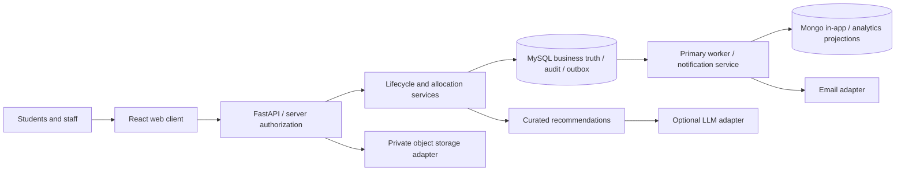

# LabTrack — Software Design Document (SDD)
## Deterministic Execution Template

Expanded project SDD — review draft v0.1; supplied structure retained as minimum baseline.

> **Document purpose:** This document is the implementation contract for LabTrack.
>
> The SDD defines normal business behavior before coding. Implementation agents are responsible for execution, validation, defensive error handling and recovery—not for inventing missing business policy.

---

# 0. DOCUMENT CONTROL

**Version 0.1 | 2026-10-16 | SDD_READY_FOR_VALIDATION | Unapproved review draft.**

The latest user direction, “BRUH WORK ON THE PPTS LATER, FIRST DO SDD”, authorizes authoring now and supersedes the earlier instruction to postpone the SDD. It does not approve all requirements or resolve open policy. Gate 1 remains unapproved; this draft makes the design reviewable without manufacturing approval. Implementation and presentation work are paused.

Source basis: SRC-01 ASTRA protocol; SRC-02 current Master Context; SRC-03 supplied deterministic SDD template; SRC-04 faculty notes; SRC-05/06 official rubrics. The six ASTRA artifacts preserve source locations, authority classes and stable requirement IDs. Current implementation/contracts/tests are comparison evidence, never independent product-policy authority. Historical pitch decks have ZERO product or architecture authority, as explicitly instructed.

The supplied 43-section/101-heading structure is the MINIMUM baseline. All headings remain identifiable and in order; this document adds detailed contracts and two final review sections. Retained template statements describe the recorded design under review, not institutional approval. Section-specific qualifications override inherited template wording. OPEN OD-xx means affected behavior cannot be guessed. ENGINEERING SELECTION identifies technical choices under the earlier execution authorization; AS-BUILT reports existing behavior without narrowing requirements.

Related evidence: ASTRA/00_SOURCE_MANIFEST.md, 01_REFERENCE_GRAPH.md, 02_REQUIREMENT_LEDGER.md, 03_RECONCILIATION_REPORT.md, 04_CONTEXT_REVIEW.md, 05_OPEN_DECISIONS.md, EXECUTION_AUTHORIZATION.md; ../EXECUTION_DECISIONS.md. Final validation owner is the user/project lead, with faculty/IT for institutional policy. No measured impact, official adoption, cloud budget or production approval is inferred.


| Field | Value |
|---|---|
| Project | LabTrack |
| Description | Hardware Component Availability, Issuance & Tracking System |
| Department Scope | Robotics & Automation (R&A) |
| SDD Status | Review draft — SDD_READY_FOR_VALIDATION; unapproved |
| Source of Truth | Current evidence and explicit user decisions; this SDD pending validation |
| Product Lead | Ishaan |
| Frontend Lead | Raghu |
| Primary Backend | Ishaan |
| Primary Frontend | Raghu |
| Academic Context | DCDS + CCE |

## 0.1 Source-of-Truth Hierarchy

1. Explicit faculty/college-confirmed policy.
2. Explicit current project decision confirmed by the user.
3. Current V1 configuration/assumption.
4. Future-scope design.
5. Agent inference.

Agent inference must never silently become a requirement.

---

# 1. IMPLEMENTATION MATURITY TAGS

Maturity and validation status are separate. A CORE requirement may still contain OPEN policy. Status labels are RECORDED_CURRENT, USER_CONFIRMED, ENGINEERING_SELECTION, CONFLICTED, OPEN and DEFERRED. Whole-request no-partial issue is USER_CONFIRMED. Synthetic identity and local adapters are PROTOTYPE. Values 24h/48h/two extensions/seven overdue days are CONFIGURABLE project values, not college law. Numeric REPO/NLP is CONFLICTED; formula detail is not approval.


Every requirement/component must carry one or more of:

- `CORE` — permanent domain behavior.
- `CONFIGURABLE` — V1 value may change without code redesign.
- `ADAPTER` — replaceable integration boundary.
- `PROTOTYPE` — current demonstration implementation.
- `PRODUCTION` — intended institutional implementation.
- `FUTURE` — not implemented in V1.
- `DEPRECATED` — historical rule; must not be reused.

---

# 2. SYSTEM IDENTITY

LabTrack replaces fragmented email/notebook/Excel handling with project-linked availability, approval, custody and reconciliation history. Scope is R&A; cross-department transfers, procurement/payment automation, mobile release and institutional rollout remain excluded/deferred. Consumables are returnable, not disposed on issue.



Style: modular monolith with independent worker. Browser input is untrusted. API authorizes every resource. SQL owns business truth. Delivery/storage/AI are fallible adapters. The notification worker cannot approve or issue; Mongo cannot override SQL. External effects follow durable intent or explicit compensation. Avoid distributed inventory transactions across clouds at this scale.


LabTrack is a centralized laboratory hardware lifecycle system for R&A.

Core lifecycle:

**Project → Requirement → Availability → Request → Faculty Review → Class-Specific Routing → HoD Final Approval → Physical Issue/Use → Tracking → Reminder/Extension/Reservation → Return/Reconciliation → Inventory Update → History**

The product is not merely inventory CRUD.

---

# 3. PROJECT MODEL

REQ-LT-0002–0004. Database identity renders as PROJ- plus at least six decimal digits; gaps after rollback are allowed, reuse is not. Required human name may duplicate another project's name. Lead/mentor reference active users; membership is a distinct relation. Project ID remains stable across requests, custody, audit and notifications. Archival cannot cascade-delete history.

Initial Lead creation/submission is specified. OPEN OD-05 covers submitted amendments, membership removal during custody, lead transfer, mentor multiplicity and delegated submission. Editing metadata cannot silently rewrite approved contents or preserve approval of changed quantities. Members contribute without authoritative submission; current initial-membership-only implementation is not permanent product policy.


Each project is a first-class entity.

## 3.1 Project Identity

### Project ID

- Format: `PROJ-000001`, `PROJ-000002`, …
- Sequential.
- Generated by the system/database.
- Immutable.
- Never reused.
- Globally unique within the LabTrack deployment.
- Used as the stable project reference in requests, issues, approvals, notifications and audit records.

### Project Name

- Required human-readable name.
- Editable only by authorized project-level actors.
- Not the authoritative identifier.

## 3.2 Project Fields

- Project ID
- Project Name
- Description
- Project Lead
- Members
- Faculty Mentor
- Requirements
- Requests
- Issues
- Reservations
- Return/reconciliation history
- Accountability history

## 3.3 Project Permissions

- Project Lead manages project metadata, membership and requirements according to project rules.
- Members may view and contribute but cannot silently mutate authoritative request state.
- Submission, cancellation and material changes are auditable.

---

# 4. USERS AND ROLES

REQ-LT-0005–0010,0023,0061–0064. Role membership is necessary but insufficient: checks include project relation, assigned Mentor, lab mapping, claim and current workflow stage. Inactive/revoked users lose access on the next server request. Hidden buttons are not authorization. Student PRN is the intended institutional identifier, but its encoding is unverified; synthetic IDs must not imply a real PRN format. Required profile model includes name, batch, branch, email, section and phone, with production source/validation deferred. Faculty IDs are T plus five digits, staff IDs N plus five; these formats do not grant roles by themselves.

| Action | Required actor/scope | Forbidden substitute |
|---|---|---|
| Create/submit/cancel/extend | Student Lead of project; legal state | Member/outsider submitting as Lead |
| Project read | Lead/member, assigned reviewer, scoped operational actor; HoD R&A-wide | Unrelated student |
| Mentor review | Assigned Mentor at Mentor stage | Arbitrary faculty/self-approval |
| Asset In-Charge review | Responsible lab faculty at In-Charge stage | Assistant acting as faculty |
| Final approval | HoD at HoD stage | Technical Admin replacing HoD |
| Claim/issue/return | Assigned Assistant, selected labs, current claim/state | Assistant from unrelated lab |
| Evidence | Authorized request participant/reviewer/operator | Public object URL/guessed ID |
| Accountability view | Authorized faculty/In-Charge/HoD | Public student history |
| Configuration/deployment | Technical Admin/developer | Administrative bypass of normal approval |

Central Store is a system stage, not a login role. In-Charge is faculty responsible for one/max two labs; Assistant mappings are many-to-many. OPEN OD-06 covers role overlap/multi-review; no automatic stage bypass. OD-08 preserves scoped Assistant FIFO exception versus general HoD overwrite. OD-15 governs live catalogue/stock administration; fixture CLI is offline development only.


## 4.1 Student

Can:

- access own authorized projects;
- create/manage project information where authorized;
- enter component requirements;
- view live availability;
- submit/withdraw allowed requests;
- reserve unavailable inventory where permitted;
- request extensions;
- view active issues and notifications;
- acknowledge returns/statuses.

Cannot:

- approve own request;
- alter inventory;
- alter approval state;
- change FIFO priority;
- perform operational issue actions.

## 4.2 Faculty Mentor

- First faculty review stage.
- Can approve/reject.
- Does not silently modify the student's requested quantity/duration.
- Receives relevant notifications.

## 4.3 Lab In-Charge

- Faculty role.
- Maximum one or two labs.
- Asset-side faculty review/decision point.
- Receives relevant escalations.

## 4.4 Lab Assistant

- Operational physical-inventory role.
- May manage multiple labs.
- Performs physical issue/return/reconciliation.
- Confirms physical asset assignment.
- May claim operational orders when multiple assistants are assigned.
- FIFO override permitted only with reason + audit.

## 4.5 HoD

- First-class system role.
- Super Access within R&A.
- Sees all R&A projects.
- Final approval for normal requests.
- Only role with overwrite authority.
- Overwrite actions are fully audited.

## 4.6 Technical/System Admin

- Development/configuration/deployment authority.
- Not a substitute for institutional HoD approval.

---

# 5. INVENTORY MODEL

REQ-LT-0011–0015. Catalogue identity is a type/model; Asset identity is one physical unit. Asset references type and lab, with unique SIT Barcode and required Default ID/Bill Number; Bill Number intentionally may repeat. Optional purchase/CPR references do not replace barcode identity. Only AVAILABLE units count toward issue availability.

Stock is unique by (lab,item), with nonnegative integral good/bad and total derived as good+bad. Issued quantity belongs to custody outside current lab stock. Conservation includes returned, missing and retained quantities. No second decrement on closure. Repair moves bad→good at constant total; authorization/verification remains OD-16. Asset string states need API/domain validation and database constraint review before production; defective/retained units never count as available.


Two primary classes only:

## 5.1 Assets

Individually identifiable physical units.

Required identifiers:

- SIT Barcode — primary lookup/identity.
- Default ID.
- Bill Number — procurement metadata, may be shared.

Examples: Turtle Bot, Robotic Arm, Intel Depth Camera, Jetson Nano, PLC.

## 5.2 Consumables

Quantity-tracked, returnable items.

Classes:

- Sensor
- MC
- Microprocessor
- Motors
- Misc
- Communication Module
- Battery

Sensors and actuators are consumables.

Per-lab quantity state:

`good_quantity + bad_quantity = total_physical_quantity`

---

# 6. PROJECT/COMPONENT REQUIREMENT ENTRY

REQ-LT-0016,0057–0060. Inputs are known catalogue ID and positive integral quantity. Reject ambiguous duplicate lines; do not double-count. Availability is a timestamped SQL read, not a promise. Existing unavailable types may enter FIFO; absent catalogue items create named unmet demand, never stock.

Alternative selection requires curated mapping and function/interface/specification compatibility, optional advisory explanation, then live SQL availability validation. Student explicitly accepts any replacement; approved contents are never silently substituted. Unknown compatibility is not guaranteed. Demand aggregates quantities/repeated needs without automatic procurement. Exact demand readership/mapping maintenance authority is OD-15.


When a student enters a requirement:

1. Identify catalogue item.
2. Determine Asset vs Consumable.
3. Query authoritative MySQL inventory.
4. Show current availability.
5. If unavailable, inform student immediately.
6. Offer reservation if existing but currently unavailable.
7. Offer approved alternatives if available.
8. Record unmet demand if no stocked compatible alternative exists.
9. For fulfilable requests, calculate minimum-lab plan.
10. Persist requirement/request only after validation.

---

# 7. MINIMUM-LAB FULFILMENT

REQ-LT-0017–0019. For demand r[c]>0 and current usable q[l,c]>=0, a subset S is feasible if every component has sum(q[l,c],l in S)>=r[c]. Optimize lexicographically (number of labs, negative score, sorted stable lab IDs), with score=sum_c sum_l_in_S min(q[l,c],r[c]). The score selects labs; final allocated totals still equal demand.

Evaluate ALL feasible subsets at the first feasible cardinality, then score/tie-break. Complexity O(2^L*L*C) is acceptable for recorded 8–10 labs, not a claim of polynomial optimization. ENGINEERING SELECTION: distribute each component over chosen labs by ascending stable ID until its quantity is met. Asset planning counts available units; barcode assignment occurs at issue. OPEN OD-09 covers holds and reapproval after replanning. Plans create no stock reservation.

Acceptance: demand(A=4,B=3), labs1=(4,0),2=(0,3),3=(4,3) selects lab3 alone. Test equal-size score differences, exact ID tie, input permutations, impossible demand and multi-component feasibility. Enumeration must not stop at the first feasible subset before comparing peers.


## 7.1 Objective

Minimize number of issuing labs.

## 7.2 Secondary objective

Maximize concentration/quantity fulfilled from selected labs.

## 7.3 Tertiary deterministic tie-breaker

Use stable lab identifier ordering.

## 7.4 Exact V1 algorithm

For current 8–10 lab scale:

1. Verify total departmental good stock for each required component.
2. Reject/notify immediately if any requested quantity is impossible.
3. Enumerate lab subsets in increasing cardinality.
4. Select the first feasible cardinality.
5. Among equal-size feasible subsets, maximize total covered quantity/concentration.
6. Break remaining ties deterministically by lab ID.
7. Group operational orders by issuing lab.

## 7.5 Feasibility

For every required component `c`:

`Σ min(q[l,c], r[c]) for l in S >= r[c]`

No implementation may silently use a non-feasible subset.

---

# 8. APPROVAL WORKFLOW

REQ-LT-0020–0025,0055. Central Store processing is system validation/planning, not a human approver. Consumable Mentor approval advances through that recorded stage to HoD; asset Mentor approval advances to relevant In-Charge then HoD. Reviews preserve quantities/duration/purpose. Rejection is terminal for the submitted request, without stock movement.

Mixed classes, multiple In-Charges, parent/child rejection and combined-role approvals are OPEN OD-06. Do not silently split a request in a way that defeats whole-request issue. AS-BUILT independent path accepts one class and one asset In-Charge; unsupported broader paths return policy-required. API TAKE_OUTSIDE denotes TAKE_HOME/OUTSIDE_COLLEGE; BORROW denotes consumable borrowing. Both asset purposes require actual checkout/use, duration and reconciliation.


## 8.1 Consumable

**Student → Faculty Mentor → Central Store system stage → HoD → Lab Assistant → Physical Issue**

Faculty Mentor = approve/reject.

Central Store = inventory-management stage; not a user role.

HoD = final approval.

## 8.2 Asset

**Student → Faculty Mentor → Lab In-Charge → HoD → Lab Assistant → Physical Asset Handling**

## 8.3 Asset purpose

Two distinct purposes:

- `USE_IN_COLLEGE`
- `TAKE_HOME / OUTSIDE_COLLEGE`

Both are physical transactions and require reconciliation.

---

# 9. CANONICAL STATE MODEL

REQ-LT-0025,0031,0036,0039. REVIEW is conceptual; MENTOR_REVIEW/INCHARGE_REVIEW are executable substates. SUBMITTED/Store may be transient audit transitions. Claim represents fulfilment-pending metadata; current implementation leaves request APPROVED while claimed. This compression must not erase guards or transition history.

| From | Authorized trigger/guard | To | Stock effect |
|---|---|---|---|
| DRAFT | Lead validates/submits | SUBMITTED→MENTOR_REVIEW | None |
| MENTOR_REVIEW | Assigned Mentor approves consumable | Store system step→HOD_REVIEW | None |
| MENTOR_REVIEW | Assigned Mentor approves asset | INCHARGE_REVIEW | None |
| INCHARGE_REVIEW | Relevant In-Charge approves | HOD_REVIEW | None |
| Any review | Assigned current reviewer rejects | REJECTED | None |
| HOD_REVIEW | HoD approves | APPROVED | No implicit hold |
| APPROVED | Authorized first claim | Fulfilment-pending concept | None |
| Approved/claimed | Full locked validation + complete handover | ISSUED/IN_USE | Every line together |
| Approved/claimed | Genuine stock change | FULFILMENT_FAILED_STOCK | Zero inventory mutation |
| Nonterminal pre-issue | Lead cancels | CANCELLED | Release only actual holds |
| Approved/claimed | Collection deadline before issue | APPROVED_EXPIRED_BEFORE_ISSUE | No issue |
| ISSUED/IN_USE | Complete inspection/reconciliation | CLOSED | Restore returned good/bad only |
| ISSUED/IN_USE | Authorized retention; authority OPEN | CLOSED / asset RETAINED_IN_PROJECT | No second decrement |

Terminal requests cannot be revived by ordinary commands. Correction adds compensating history rather than raw edits. Extensions have their own review substates and never reopen parent approvals. Reservation WAITING_FIFO→FULFILABLE→FULFILLED, EXPIRED/CANCELLED remains conceptual until OD-04 defines holds/bridge/expiry. Asset RESERVED cannot be entered by an invented hold policy.


## 9.1 Request states

`DRAFT → SUBMITTED → REVIEW → HOD_REVIEW → APPROVED → FULFILMENT_PENDING → ISSUED/IN_USE → CLOSED`

Exception/terminal states:

- `REJECTED`
- `CANCELLED`
- `APPROVED_EXPIRED_BEFORE_ISSUE`
- `FULFILMENT_FAILED_STOCK`

## 9.2 Reservation states

`WAITING_FIFO → FULFILABLE → FULFILLED`

Exception:

- `EXPIRED`
- `CANCELLED`

## 9.3 Asset states

`AVAILABLE`

`RESERVED`

`IN_USE`

`ISSUED_OUT`

`DEFECTIVE`

`UNDER_REPAIR`

`LOST`

`RETAINED_IN_PROJECT`

## 9.4 Extension states

`REQUESTED → APPROVED | REJECTED`

Approved extension creates a new due-date version; historical due dates remain preserved.

---

# 10. REQUEST / APPROVAL EXECUTION CONTRACT

Each mutable command reloads/locks the aggregate, verifies current actor/stage/content, and commits domain mutation+SQL audit+SQL outbox+idempotency result together. Email/network calls are outside that transaction. SQL infrastructure rollback leaves no partial business records; an explicit business failure may instead commit a failure-state audit/event with zero inventory change.

Command key namespace is actor+operation+client key; fingerprint includes target and normalized body. Same key/content returns original result; different body conflicts. Retention duration is OPEN production policy. Concurrent approvals serialize on parent row; second actor sees current stage. Deadlock recovery uses bounded same-key retries, never a new approval. §34 supplies operation records with explicit shared-contract inheritance.


Every request transition must define:

- actor;
- preconditions;
- authorized transition;
- input;
- validation;
- state mutation;
- audit event;
- outbox event;
- notification recipients;
- failure path;
- retry/idempotency;
- tests.

## 10.1 Example: Faculty Approval

**Actor:** Faculty Mentor

**Preconditions:** request is in Faculty review; actor is the assigned Faculty Mentor.

**Validation:** request is still current; request not cancelled/expired; project ownership valid.

**Decision:** approve or reject.

**Mutation:** transition request to next state / rejected terminal state.

**Audit:** actor, role, timestamp, action, remarks, previous state, new state.

**Event:** `REQUEST_FACULTY_DECISION`.

**Notification:** Student + next workflow actor(s), or Student only on rejection.

**Failure:** transaction rollback; no state change.

**Idempotency:** repeated submission of the same decision must not duplicate state transitions.

---

# 11. PHYSICAL ISSUE CONTRACT

**USER_CONFIRMED: no partial issue applies to the ENTIRE REQUEST ACROSS ALL LABS.** REQ-LT-0026–0029. A shortage on any line prevents every line's issue. SQL rollback cannot undo hardware handed over earlier: the ordinary path needs one accountable operator coordinating and confirming complete handover. OPEN OD-10 covers different operators/labs handing over at different times, readiness confirmation/interruption and physical recovery; that wider flow is blocked.

ENGINEERING SELECTION: lock request, then all relevant stock/asset rows in stable key order. Validate every line before mutating any. Claim owner still needs all selected lab scopes. Barcodes must be unique, match approved item/lab and be AVAILABLE. Set issued_at once; due_at=issued_at+approved duration; due_version=1. Mutate all stock/units, issue data, audit/outbox/idempotency atomically. True shortage persists FULFILMENT_FAILED_STOCK through a clean business-failure path with no decrements; SQL outage rolls back rather than pretending shortage.

AS-BUILT uses request/lines as the single issue record rather than separate issue table. Future schema changes cannot weaken aggregate atomicity. Tests: last-unit concurrent issue, competing claims, one of several labs short, wrong barcode, replay, cancellation race and injected failure after first attempted mutation. Physical transfer/commit interruption needs an operator recovery procedure; it is not magically rolled back.


## 11.1 Consumable issue

1. Lab Assistant claims/receives operational order.
2. Revalidate good stock.
3. Begin MySQL transaction.
4. Lock relevant stock rows.
5. Re-read quantity.
6. Verify full approved quantity is available.
7. Update stock.
8. Create issue transaction.
9. Create audit record.
10. Create notification outbox event.
11. Commit.

## 11.2 Asset issue/use

1. Lab Assistant identifies/assigns physical asset.
2. Verify SIT Barcode.
3. Revalidate asset state and issuing lab.
4. Begin transaction.
5. Update asset state.
6. Create use/issue transaction.
7. Audit.
8. Outbox event.
9. Commit.

## 11.3 Failure

If physical stock/state changed between approval and issue:

`FULFILMENT_FAILED_STOCK`

No automatic partial fulfilment.

---

# 12. PROJECT/REQUEST CANCELLATION

REQ-LT-0039. Lock before checking pre-issue state; first legal committed action wins issue/cancel race. After issue, direct cancellation fails and guides return/reconciliation. Project cancellation cannot implicitly close custody or delete history; its aggregate semantics remain OD-05. Reservation cancellation checks queue state separately. Release only holds that actually exist under an approved contract; cancellation never invents a stock increment.


Student cancellation allowed while not physically issued:

- DRAFT
- SUBMITTED
- pending approval
- APPROVED but not issued
- WAITING_FIFO reservation

Cancellation:

- state → `CANCELLED`
- audit
- release temporary hold
- advance FIFO where applicable
- notification

Once physically issued, the transaction closes through return/reconciliation instead.

---

# 13. RESERVATION

REQ-LT-0035–0038. FIFO order is (created_at,id) within type queue with durable history. Asset unit assignment is later. A queue place is not a physical hold. Retain recorded configurable 24h, but anchor, hold ownership, scarcity/head-of-line handling, multi-component scope and approval bridge remain OPEN OD-04. Automatic ready/fulfil/expiry is DESIGN-INCOMPLETE. An unanswered question has no default approval.

Override retains reason, actor/role/time, old/new positions and affected IDs. Assistant scope cannot silently expand across unrelated labs; exact queue authority is OD-08. HoD cannot erase history. Independent enrollment/cancel paths do not claim full reservation automation.


- Applies to Assets and Consumables.
- FIFO.
- Asset reservations are asset-type level first.
- Specific asset assigned later.
- V1 expiry = 24 hours.
- Lab Assistant can override FIFO with mandatory reason/audit.
- HoD can override FIFO with audit.

Override record must preserve previous position and new position.

---

# 14. APPROVED-BUT-NOT-COLLECTED EXPIRY

REQ-LT-0035. Recorded approval collection window is approved_at+configured48 elapsed hours (UTC technical storage). Recheck under request lock; issued requests cannot expire as uncollected. Claim alone is not collection. At exact deadline the issue command must enforce eligibility using the same clock, not trust the last scheduler scan; implementation verification remains required. Reservation24h clock is separate and cannot be inferred from this approval rule.


V1 demo:

`APPROVED → 48h collection window → APPROVED_EXPIRED_BEFORE_ISSUE`

On expiry:

- release temporary hold;
- audit;
- notify student;
- allow new request/reservation.

---

# 15. BORROWING / USAGE DURATION

REQ-LT-0030. API instants include timezone and serialize UTC Z; requested duration is positive finite hours within datetime representability, with no invented universal borrowing cap. Due starts at actual issue/use, not submission/approval. UTC is engineering serialization, not department calendar policy. OPEN OD-11 covers calendar-day reminders, cutoffs and timezone semantics. UI displays timezone and cannot silently rewrite due dates.


- Student chooses requested duration.
- Faculty approves/rejects; does not silently change it.
- Due date is computed from approved issue/use start.
- HoD overwrite remains permitted and audited.

---

# 16. EXTENSIONS

REQ-LT-0031–0032. Extension references parent/current due version, old/new due, reason and original approval route. Pending/rejected extension leaves parent due unchanged. Final approval creates next due version and retains old history. Lock parent/extension to serialize return, maximum count and competing approval. Closed requests cannot extend. Configurable demo maximum2 counts approved extensions, not rejected submissions.

OPEN OD-11: late submissions/approvals, simultaneous pending extensions and stale-version resolution. Current future-due-only path is an implementation boundary, not permanent policy. Reminder identities carry due_version so obsolete obligations are suppressed before sending.


- Same authority path as original request.
- Maximum V1 demo = 2.
- Existing due date remains authoritative until extension approval.
- Each approved extension creates a new due-date version.
- Old due-date records remain in history.

---

# 17. RETURN / INSPECTION

REQ-LT-0040–0043,0065. Full ordinary reconciliation requires each original line exactly once. Lock parent, stock and original units; ensure outstanding custody. Consumables: good+bad+missing=expected; physically returned=good+bad; all integral/nonnegative. Functional FAIL cannot be good. Restore returned good/bad to original lab quantities; missing stays outside stock and creates incident evidence without automatic blame.

Each issued asset barcode has one inspection/disposition: acceptable→AVAILABLE, damaged/defective→DEFECTIVE pending repair, missing→LOST. Record functional test, condition/accessories/damage/remarks/operator/time. Damaged/defective photo references must be private authorized evidence belonging to the issue. No exception bypass until OD-17 resolves it. Inventory, inspection, incident, closure, audit/outbox commit together. Student acknowledgement is separate, not retroactive inventory authorization. OPEN OD-16 covers partial/cross-lab returns, disputes, repair verifier and retention acceptor. Current full-return-only implementation is not an institutional prohibition on other returns.


Return/reconciliation applies to both inventory classes.

## 17.1 Asset inspection

Record:

- SIT Barcode
- functional test: PASS / FAIL / NOT_TESTED
- physical condition
- missing parts/accessories
- visible damage
- photo evidence
- remarks
- actor
- timestamp

Photo evidence is required for damage/defect cases in V1 unless a configured exception applies.

## 17.2 Consumable inspection

Record:

- expected quantity
- physically returned quantity
- good quantity
- bad quantity
- missing/lost quantity
- functional status where testable
- remarks
- actor
- timestamp

No standard photo requirement for consumables in V1.

## 17.3 Reconciliation

Consumable issue:

`good -= issued_qty; total -= issued_qty`

Consumable good return:

`good += returned_good; total += returned_good`

Consumable bad return:

`bad += returned_bad; total += returned_bad`

Missing/lost quantity is not restored.

Asset return:

- acceptable → AVAILABLE
- damaged/defective → DEFECTIVE / UNDER_REPAIR
- lost → LOST

---

# 18. RETAINED IN PROJECT

REQ-LT-0045. Retention closes original issue with project/quantity/barcode/reason/actor/acceptance links. Consumables already excluded from lab stock remain excluded; asset stays in register as RETAINED_IN_PROJECT, unavailable. No restore and no second decrement. Retention authority, mixed return/retain, later recovery and acceptance are OPEN OD-16. Current endpoint returns policy-required with no mutation, not successful retention.


Explicit action/state:

`RETAINED_IN_PROJECT`

The issue is closed, but the physical item remains associated with the project.

**No second stock decrement occurs.**

Consumable quantity remains excluded from active stock.

Asset remains in asset register but is unavailable for normal issue.

---

# 19. DEFECT / DAMAGE / LOSS

REQ-LT-0046–0048. Occurrence, condition and culpability are different. Inspection may record NOT_DETERMINED attribution; defect is not automatic misconduct. Incident links project, original custody, unit/quantity, reporting actor, involved student facts, evidence/time/condition/repair and human attribution history. Team membership is not liability. HoD correction references original incident with reason/actor/time; no raw history overwrite. Monetary penalty automation is excluded. Individual/team liability and review policy remain OD-13.


Incidents must record:

- item/asset
- student
- project
- original issue
- timestamp
- incident type
- description
- condition
- evidence
- remarks
- repair status
- attribution status

Normal equipment failure must not automatically count as student misconduct.

---

# 20. EXPLAINABLE REPO INDEX

**CONFLICTED CANDIDATE, NOT AN APPROVED V1 OBLIGATION.** REQ-LT-0049–0051 / F-13 / OD-13. Current context A3/UAQ15/AK/AW19 says score unnecessary/future, while Z/UAQ29/AW48–50/BE and the template specify it. Formula/subsections below preserve candidate detail without silently resolving precedence.

If adopted, inputs include incident identity, severity/version, human attribution, calculation time/age, prior-confirmed window, optional p_fault/model version. Full contribution output must reproduce from a fixed snapshot. OPEN: uncertain0.5 versus confirmed-only wording; severity for attributable defect; student/team liability; recurrence after void/correction; rounding/window boundaries; V1 NLP scope. Until resolved, incident history is independent. Candidate tests: no contributions→zero; bounded monotonic score; decay; correction replay; no automatic access restriction/penalty. These are design targets, not executed evidence.


## 20.1 Purpose

Informational accountability summary. Not a monetary penalty.

## 20.2 NLP layer

Candidate if OD-13 scope approved:

**Remarks → TF-IDF → Logistic Regression → `p_fault`**

The NLP model is advisory and cannot create an incident or override human attribution.

## 20.3 Incident contribution

`C_i = S_i × A_i × N_i × D_i × R_i`

Where:

- `S_i` = severity.
- `A_i` = human attribution: 0 / 0.5 / 1.
- `N_i` = `0.75 + 0.25*p_fault` when remarks exist, otherwise 1.
- `D_i` = `0.5^(age_days / 90)`.
- `R_i` = `1 + 0.10*min(previous_confirmed_incidents_in_180_days,5)`.

Recommended severity defaults:

| Incident | Severity |
|---|---:|
| Late return | 10 |
| Missing part | 20 |
| Minor damage | 20 |
| Major damage | 35 |
| Unauthorized use | 40 |
| Loss | 50 |

Overall:

`E = Σ C_i`

`REPO = 100 × (1 - e^(-E/100))`

## 20.4 Repeated-offender flag

`2+ confirmed attributable incidents in previous 180 days OR REPO >= 35`

## 20.5 Correction

HoD may void/correct incident with reason + audit.

Score is recomputed deterministically.

## 20.6 Explainability output

System exposes:

- score;
- contributing incidents;
- severity;
- human attribution;
- NLP probability;
- decay;
- recurrence multiplier;
- contribution;
- calculation timestamp.

No automatic access restriction.

---

# 21. NOTIFICATION ARCHITECTURE

REQ-LT-0052–0056. AA6/UAQ32 is the recorded normative matrix; F-03/OD-03 retains stale/conflicting wording. HoD record/audit is not automatically an extra email. Resolve recipients server-side from project/lab assignments. Email contains minimal summary and live authorized link, never approval authority or unnecessary incident/photo data.

ENGINEERING SELECTION: SQL audit/outbox are canonical; Mongo notification/delivery documents are projections. Event envelope: unique event_id/key, type, UTC occurred_at, aggregate_type/id, project_id, actor_id, prior/new state when applicable, payload_schema_version, due_version when relevant, intended recipient IDs. Current compact payload needs explicit version/envelope reconciliation before production.

Unique delivery identity is (event_id,user_id,channel). In-app upsert and email are independent. PENDING→SENDING→SENT; known retryable failure returns PENDING with attempts/error/next_attempt; ambiguous provider acceptance becomes UNKNOWN for reconciliation, never blind resend. Durable SQL send intent survives Mongo/process failure. Exactly-once external email is not claimed. Inbox reads cannot mutate requests. Observe outbox oldest age, retries, projection lag and UNKNOWN count with sanitized correlation/event logs.


## 21.1 Event flow

`Authoritative domain transaction → SQL outbox → Notification Service → In-app + Email`

Email is not notification truth.

## 21.2 Recipient matrix

| Event | Recipients |
|---|---|
| Submission | Student + Faculty Mentor |
| Faculty approve/forward | Student + next workflow actor(s) |
| Faculty reject | Student |
| Asset Lab In-Charge decision | Student + Faculty Mentor + next actor(s) |
| HoD decision | Student + relevant Faculty + Lab Assistant + HoD record/audit |
| Issue/use completed | Student + Faculty + Lab In-Charge where relevant + Lab Assistant + HoD |
| Return completed | Student + Faculty + Lab In-Charge where relevant + Lab Assistant |
| Extension | Student + relevant approval actors |
| Reservation lifecycle | Student + relevant Faculty + Lab Assistant; HoD for override |
| Overdue days 0–4 | Student + Lab Assistant |
| Overdue day 5 onward | Student + Lab Assistant + Faculty Mentor |
| Overdue day 7 | Student + Faculty + Lab In-Charge + Lab Assistant + HoD |
| Damage/defect/loss | Student + Faculty + Lab In-Charge + Lab Assistant; HoD when escalated |
| Issue-time fulfilment failure | Student + relevant Faculty + Lab Assistant + HoD |

## 21.3 Email approval

Email contains:

- request ID;
- current status;
- summary;
- live LabTrack link.

Approve/reject occurs on website.

After the website action, a new event produces a follow-up notification/email reflecting the new state and next workflow actor(s).

---

# 22. AI RECOMMENDATION ARCHITECTURE

REQ-LT-0057–0059. RecommendationService owns curated mappings/metadata checks. LLMAdapter receives allow-listed catalogue IDs/specifications/context version and supplies advisory explanation/ranking; no student identity, credentials or DB write handle. Validate bounded structured output, compatibility and current SQL availability; reject unknown IDs and malformed output. Refresh stale context; curated deterministic fallback remains available.

BrowserAPIFree→ChatGPT is the recorded initial boundary. OPEN OD-18: callable transport/auth/schema, snapshot/delta protocol and timeout/error contract are absent. Boundary code does not prove live LLM integration. No invented external API or purchased platform is selected. Student acceptance enters ordinary requirement/approval workflow; AI cannot mutate stock/FIFO/institutional state.


`LabTrack Recommendation Service → LLM Adapter → BrowserAPIFree → ChatGPT`

Inventory context:

- initial snapshot;
- later delta updates;
- live MySQL revalidation before display.

AI cannot:

- decide inventory;
- approve;
- issue;
- alter FIFO;
- set institutional status;
- create unsupported alternatives.

Alternative pipeline:

`Curated mapping → metadata filter → AI explanation/ranking → live DB validation → UI`

---

# 23. DATA ARCHITECTURE

REQ-LT-0066–0067. Required logical contract below distinguishes desired data from compact AS-BUILT models. IDs are positive deployment-local integers unless opaque/hash; required fields are non-null unless optional. Enum checks belong at API/domain and database boundaries.

| Entity/key | Required fields/constraints | Ownership/lifecycle |
|---|---|---|
| User/id | unique identifier/email, name,batch,branch,section,phone logically; active, role set, prototype password hash | Deactivate, preserve historical actor links; PRN encoding unverified |
| AuthSession/token_hash | SHA-256 opaque token hash, user FK, UTC expiry | Revocable, no raw token logging |
| Lab/id | name, faculty In-Charge FK | Max two labs/In-Charge; Assistant many-to-many logically |
| Catalogue/id | name, class enum, category, specifications, curated mappings | Demand cannot auto-create stock |
| Asset/id | unique barcode, default ID/bill, item/lab FK, allowed state | One physical unit; bill nonunique |
| Stock/(lab,item) | good/bad nonnegative integer, total derived | Locked physical lab truth |
| Project/id | immutable generated code, required name, lead/mentor FK, description | History retained; no cascade deletion |
| Member/(project,user) | unique relation | Revision/custody policy OD-05 |
| Request/id | project, class,purpose,duration,state; optional approved/issued/due instants, due_version | Immutable submitted contents |
| Allocation/(request,item,lab) | positive quantity, unique triple, unit assignments optional until issue | Sum by item equals requested quantity |
| Approval/id (logical) | parent, stage, actor, decision, remarks,time | Append-only; currently audit events |
| Issue/id (logical) | parent unique for whole issue, operator/start/due, confirmed handover | Currently Request/lines carry single issue |
| Extension/id | parent, old/new due, reason,state | Preserved due/approval history |
| Reservation/id | project,item,positive quantity,state,created_at, optional ready_at | FIFO; hold/timer OPEN |
| Inspection/id | parent unique for current full return, actor,time, per-line findings/remarks | Prevent repeated reconciliation |
| Incident/id | custody/project, actor, condition, attribution, details,time | Human corrections; no automatic liability |
| Evidence/opaque ID | parent/actor FK, private object key,MIME,SHA-256,size/time logically | Binary external; retention OPEN |
| Audit/id | aggregate/project/actor/action/time, before/after, details/reason | Append-only compensating correction |
| Outbox/id | unique event_key, payload, creation, attempts/dispatch/error | Atomic domain transaction |
| Idempotency/namespaced key | fingerprint/result; creation/retention logically | Same-content replay; mismatch conflict |
| Delivery/event-user-channel | durable state, attempts/errors/provider receipt where known | External ambiguity visible |
| Policy/versioned key (logical) | typed value, effective version, authority/maturity | Current env config; no hard-coded college policy |

AS-BUILT JSON roles/scopes replace normalized mappings; some profile/evidence/policy fields and enum/secondary-index constraints remain incomplete. Audit carries approval/due-history. ORM listeners do not establish DBA-proof immutability. Production review needs DB grants/constraints, backup retention and migration coverage.

Design indexes: request(project,state), request(state,approved_at), due obligations(state,due_at,version), asset(item,lab,state), reservation(item,state,created_at,id), outbox(dispatched,created_at), audit(aggregate,time), notification(user,time). These are targets, not claims that all are installed. Analytics avoids long issue locks.

Mongo: notification {event_id,user_id,type,summary,link,created_at,schema_version}, unique event-user; demand {source_event_id,item_id optional,name,quantity,actor/project scope,time}; delivery mirror; optional AI record with catalogue/context version. Aggregations summarize demand/usage without SQL mutation. Rebuild depends on approved durable-event retention; unlimited replay is not claimed. SQLite/local SQL document adapters are OFFLINE PROTOTYPE, never silent production failover and never evidence of deployed MySQL/Mongo.


## 23.1 MySQL — authoritative state

- users
- roles
- projects
- project members
- components
- labs
- assets
- per-lab consumable stock
- requests
- approvals
- issues/use
- reservations
- returns
- extensions
- accountability incidents
- configuration/policy values
- outbox events

## 23.2 MongoDB — document/event/analytics state

- in-app notification documents
- delivery state
- AI recommendation records
- unmet-demand analytics
- operational telemetry/events

MongoDB cannot override MySQL state.

---

# 24. API CONTRACT

REQ-LT-0066,0029,0079. Current FastAPI-generated OpenAPI snapshot is contracts/openapi.yaml; generated TS types are src/frontend/src/generated/api.d.ts. These are AS-BUILT contracts. Required policy-blocked operations are not executable promises; reconcile state/schema gaps after approval, without editing code/contracts during this task.

JSON UTF-8 inputs reject unknown fields; quantities are positive integers; IDs verified; finite positive duration; timezone-aware timestamps; exact enum strings. Current technical limits: project name1..160, remarks<=4000, request lines1..100, evidence IDs<=30 per return line. They are validation defaults, not institutional entitlements. Error envelope: {"error":{"code":"STATE_CONFLICT","message":"...","decision":null}}; policy-required supplies OD ID. No stack trace, SQL, secrets or cross-project data leaks.

| Boundary | Current route family | Guard/side effects |
|---|---|---|
| Auth | POST /api/auth/login,/logout; GET /api/me | Synthetic session issue/revoke |
| Discovery | GET /api/directory,/catalogue,/capabilities; POST /api/plans | Active/scoped; plan read-only |
| Projects | GET/POST /api/projects | Scoped read; Student create |
| Requests | GET/POST /api/requests; GET /api/requests/{id} | Lead submission; relation-scoped read |
| Decisions | POST /api/requests/{id}/decision | Current assigned reviewer |
| Operations | POST /api/requests/{id}/claim,/issue,/cancel,/return,/acknowledge | Legal stage/project/lab/claim |
| Extensions | POST /api/requests/{id}/extensions; /api/extensions/{id}/decision | Original route/current due version |
| Queue | GET/POST /api/reservations; POST /api/reservations/{id}/cancel | Enroll/cancel only independent path |
| Retention | POST /api/requests/{id}/retained | Policy-required until OD-16 |
| Evidence | POST /api/requests/{id}/evidence; GET /api/evidence/{id} | Private authorized storage/fetch |
| Notifications | GET /api/notifications | Own recipient documents only |
| Alternatives/demand | GET /api/alternatives/{item_id}; POST /api/demand,/api/demand/unstocked | Curated live validation; no stock creation |
| Reporting | GET /api/incidents,/api/reports/usage,/api/reports/demand | Authorized faculty/HoD |
| Health | GET /api/health | No secrets; liveness distinct from dependency readiness |

401 invalid/expired login;403 scope/actor;404 unknown authorized resource;409 state/idempotency/stock/policy conflict;422 malformed input;503 infrastructure unavailable where sync completion cannot occur. Async email failure leaves domain success intact. Mutation keys are required wherever replay could duplicate action. Read-only planning has no mutation key; upload uses hash dedup/compensation; sessions have separate semantics. Future API versioning strategy is technical evolution, not an invented route set.


Canonical source:

`contracts/openapi.yaml`

Rules:

- FastAPI/OpenAPI schema is authoritative.
- TypeScript frontend types/client are generated.
- Frontend must not duplicate backend domain rules.
- HTTP errors use a stable error envelope.
- Idempotency is required for state-changing operations where duplicate submission is possible.

---

# 25. TECHNOLOGY SELECTION & RATIONALE

Selections derive from SRC-02 BL1, never pitch. Versions in lockfiles are implementation snapshots, not immutable design requirements.

| Requirement→selection | Alternatives not selected | Trade-off / replaceability / academic value |
|---|---|---|
| Typed web client→React/Vite/TS REST | Server-render-only/mobile-first | Separate contract/deployment coordination; replace client; web-first |
| Python validation→FastAPI/Pydantic | Django/Flask | Explicit workflow/auth design; service boundary; Python/exception evidence |
| Atomic relational stock→MySQL/InnoDB, SQLAlchemy/Alembic | Mongo-only; SQLite cloud authority | Migration/locking operations; repository boundary; SQL joins/routines |
| Flexible projections→MongoDB | SQL-only notification/analytics | Eventual consistency/two services; document adapter; meaningful NoSQL |
| Small scheduled workload→APScheduler/simple worker | Redis/Celery platform | Fencing/restart still needed; scheduler replaceable; Redis excluded V1 |
| Replace integrations→AuthProvider/Gmail/S3 adapters | Vendor calls in domain | Integration lifecycle overhead; preserve business rules across providers |
| Portability→Docker/GitHub Actions, Terraform preferred | Manual/provider-coupled deployment | Infrastructure/credentials still needed; same images; CCE running example |
| Advisory explanation→BrowserAPIFree/ChatGPT boundary | Autonomous AI approvals/stock | External contract absent; deterministic fallback; no business authority |

Upgrades need compatibility/security validation without silently changing policy. No additional platform is selected to make the project appear advanced.


Every technology decision must be documented with:

**Requirement → Candidates → Selected → Why → Rejected alternatives → Trade-offs → Replaceability → Academic relevance**

## 25.1 Stack

| Layer | Selection | Rationale |
|---|---|---|
| Frontend | React + Vite + TypeScript | Separate API-first client, strong typing, fast development, future Capacitor path |
| Backend | Python + FastAPI + Pydantic | Python aligns with project/DCDS; validation/OpenAPI; clean service boundary |
| API | REST + OpenAPI | Stable contract, documentation, client generation |
| SQL | MySQL 8.4/InnoDB | Transactions, locking, foreign keys, DCDS SQL fit, already-aligned project direction |
| ORM | SQLAlchemy 2.x | Mature relational abstraction and explicit transaction control |
| Migrations | Alembic | Versioned schema evolution |
| NoSQL | MongoDB | Appropriate for notifications/events/analytics and satisfies DCDS NoSQL integration |
| Scheduler | APScheduler/simple scheduler | Sufficient for V1 without adding a queue platform |
| Auth | Replaceable AuthProvider | Avoid institutional/vendor coupling; later SSO adapter |
| Email | Gmail API adapter | Dedicated sender account with provider boundary |
| AI | BrowserAPIFree → ChatGPT adapter | Reuses established BrowserAPIFree architecture while keeping AI replaceable |
| Containers | Docker | Reproducible runtime and cross-cloud portability |
| CI/CD | GitHub Actions | Native to GitHub repository and parallel team workflow |
| IaC | Terraform | Provider-neutral infrastructure definition |
| Mobile | Capacitor future path | Reuses web application and API |
| Redis | Excluded V1 | Avoid unnecessary operational complexity |

---

# 26. CLOUD / DEPLOYMENT

REQ-LT-0069–0070,0078. HTTPS browser→web/API; private SQL/Mongo; private object storage through authorized API. Secrets enter deployment, not images. Environment identifiers separate synthetic staging/domain/delivery keys.

AWS primary is the only authoritative write environment; Azure staging is isolated/DR-ready target only after restore/promotion evidence; GCP receives read-only analytics. One writer does not mean one DB connection. Secondary scheduler disabled. Promotion requires old-primary fencing, verified restore/schema compatibility and explicit confirmation of one active writer/scheduler. Env PRIMARY flag alone is not distributed fencing. Exact services/sizes/budget/DNS/TLS/RPO/RTO/backups remain OD-21.

Docker/Compose/CI are prepared; recorded local Docker engine unavailable. No cloud, real Gmail/S3/LLM or failover is claimed. Migrations run explicitly before compatible rollout; failed migration retains prior compatible app. Destructive rollback/restore requires validated procedure, not automatic data loss. Worker restart replays durable outbox and current legal obligations; business SQL persists independently.


## Primary V1 roles

- AWS = primary authoritative live demo.
- Azure = staging / DR-ready.
- GCP = analytics/read-only demonstration.

Rules:

- One authoritative writer.
- Only primary runs scheduler.
- Same Docker images.
- Terraform provider modules where practical.
- No active-active inventory writes in V1.

---

# 27. OBJECT STORAGE

REQ-LT-0065. Adapter put/get/delete operates on opaque private keys with hash/MIME metadata. ENGINEERING limits: decoded PNG/JPEG<=5MiB and20Mp; reject spoofed MIME/extension, invalid image and oversized decompression. Never user-supplied filesystem paths/public ACLs. Authorize request/evidence relation on upload and fetch.

Validate/write blob, then commit metadata. SQL failure deletes NEW orphan object; cleanup failure records durable cleanup evidence. Do not delete pre-existing deduplicated blobs. Missing object prevents valid damage evidence rather than claiming successful upload. Production scanning, exception authority, retention/deletion remain OD-17. Local storage is prototype; S3 source code is not live deployment proof.


Inspection photos use:

`ObjectStorageAdapter`

V1 implementation:

**AWS S3**

Future adapters:

- Azure Blob Storage
- Google Cloud Storage

Database stores metadata/reference only.

Retention duration is configuration/deferred production policy.

---

# 28. SECURITY

REQ-LT-0061–0065. ENGINEERING synthetic auth: random opaque bearer; SHA-256 token hash; salted PBKDF2 password hash (current310k iterations); configurable8h session; logout revocation. Institutional SSO is deferred adapter, not simulated official login. HTTPS outside loopback, no raw token/password logging. Production review still needs login throttling, browser token/XSS strategy, CSP/origin limits, secret rotation and privacy controls.

Every operation rechecks current SQL actor/roles/scopes; identity is not a caller impersonation field. ORM parameter binding, bounded inputs, private evidence and separate app/migration DB principals are required. Raw audit overwrite must be restricted at DB boundary; ORM guards alone are insufficient. Only synthetic data on external demo cloud; real institutional rollout/privacy remains unapproved. AI prompts exclude real student history.

Known AS-BUILT UI defect: delayed logout refresh can clear a newly created session during rapid role switching. Required response handling is session-generation-aware; stale prior-session refreshes must not mutate the new login. This defect is recorded for later work, not fixed during SDD authoring.


Mandatory:

- Server-side RBAC.
- Ownership checks.
- Lab-scope checks.
- HoD overwrite authorization server-side.
- Input validation.
- Parameterized SQL/ORM queries.
- Secrets outside repository.
- Synthetic data in cloud prototype.
- Audit trail.
- No silent historical overwrites.

---

# 29. ERROR / RECOVERY CATALOG

The matrix below supplies detection, safe state, recovery and required test for every minimum error. T-ERR-n is a specification, not an executed test claim. Log sanitized correlation/event ID. Business transitions append SQL audit; infrastructure rollback must not fabricate successful audit.

| ID/detection | Safe state/compensation | Retry/idempotency; visible result; test |
|---|---|---|
|1 Plan shortage|No request/stock mutation|Fresh replan; unavailable message; T-ERR-1 impossible demand|
|2 Issue stock changed|Failed-stock event, zero line decrement|Fresh reviewed request; no subset success; T-ERR-2 cross-lab race|
|3 Asset unavailable|No unit mutated|Legal scope reassignment only; rescan; T-ERR-3 wrong state|
|4 Duplicate submit|Original result|Same fingerprint replay/different conflict; T-ERR-4|
|5 Duplicate issue|Custody once|Same key replay/new key state conflict; T-ERR-5|
|6 Approval expired|No issue, expiry audit once|Dedup scan; new request guidance; T-ERR-6 deadline race|
|7 Reservation expiry|No invented hold/stock movement|Blocked OD-04; anchor test pending T-ERR-7|
|8 Invalid extension|Current due unchanged|Correct input/new key; T-ERR-8 max/closed/stale|
|9 Unauthorized|No state/data disclosure|Authenticate/correct actor; T-ERR-9 role negatives|
|10 Lab mismatch|No claim/issue/return|Assigned operator; T-ERR-10 revoked lab scope|
|11 Invalid barcode|No inventory writes|Rescan; T-ERR-11 duplicate/type/lab|
|12 Invalid quantity|No command persisted|Correct integral bounds; T-ERR-12 negative/fraction/overflow|
|13 SQL fail/deadlock|Full transaction rollback|Bounded same-key retry; not completed message; T-ERR-13 injected mid-write|
|14 Mongo outage|SQL commit survives; projection pending|Backoff/event-user upsert; delivery delayed; T-ERR-14 replay|
|15 Email outage/ambiguous send|Domain success; pending/UNKNOWN channel|Known failure retry, UNKNOWN reconciliation; T-ERR-15 crash around acceptance|
|16 Scheduler restart|Durable obligations retained|Current-version scan/dedup; calendar catch-up OPEN; T-ERR-16|
|17 AI malformed/timeout|No domain mutation|Curated fallback/bounded retry; T-ERR-17 invalid IDs|
|18 Stale AI context|Live SQL rejects suggestion|Refresh availability; T-ERR-18 stock changed|
|19 Invalid import|Import rollback with row errors|Correct keyed file; T-ERR-19 FK/duplicates/counts|
|20 Photo/storage/SQL failure|No fake evidence; new orphan deleted or cleanup journal|Hash dedup; T-ERR-20 storage/DB/cleanup failures|
|21 Duplicate notification|Single event-user-channel|Unique upsert; T-ERR-21 replay|
|22 Cloud restart|Persistent SQL truth, no secondary writer|Migration/health/fencing/replay; T-ERR-22 restore pending|
|23 Unknown policy|No mutation, POLICY_REQUIRED+OD|Human decision, no timed retry; T-ERR-23 blocked branches|
|24 Stale client response|Current login preserved|Ignore old session-generation response; T-ERR-24 rapid relogin|

Infrastructure retries use bounded exponential backoff/jitter; intervals/attempt counts are technical configuration, not a production SLA. UNKNOWN/dead-letter handling needs operator visibility/runbook. No rollback claim can erase actual physical handover; OD-10 remains explicit.


The SDD must predefine at minimum:

1. insufficient stock;
2. stock changed after approval;
3. asset unavailable after approval;
4. duplicate submission;
5. duplicate issue;
6. approved request expiry;
7. reservation expiry;
8. invalid extension;
9. unauthorized action;
10. role/lab mismatch;
11. invalid SIT Barcode;
12. invalid quantity;
13. SQL transaction failure/deadlock;
14. MongoDB outage;
15. email provider outage;
16. scheduler restart/missed job;
17. AI timeout/malformed output;
18. stale AI context;
19. import validation failure;
20. inspection photo upload failure;
21. duplicate notifications;
22. cloud restart.

For every error define:

- detection;
- safe state;
- rollback/compensation;
- retry;
- idempotency;
- user-facing message;
- audit;
- test.

---

# 30. SCHEDULER

REQ-LT-0033–0037,0068. Primary worker reads SQL obligations and uses the same guards/locks as API. Obligation identity=(request,due_version,kind,scheduled_slot,recipient,channel); approval expiry identity includes approved_at. Store durable intent/completion, never worker-memory truth.

Recorded reminders: T−5days, daily overdue; days0–4 Student+Assistant; day5 adds Mentor; day7 relevant In-Charge+HoD. OPEN OD-11 covers elapsed/calendar days, daily send time, short loans, missed-job consolidation and return/extension suppression during send. OD-04 blocks reservation timer anchor. These jobs remain policy-incomplete; approval48h expiry/notification retries have independent contracts. Restart re-reads current state/version and suppresses closed/superseded obligations. Fencing must stop stale primary after promotion.


APScheduler/simple scheduler.

Jobs:

- pre-due reminders;
- daily overdue reminders;
- day-5 escalation;
- day-7 escalation;
- reservation expiry;
- approved-before-issue expiry;
- notification retry/recovery.

Jobs are idempotent.

Only active primary deployment runs them.

After restart, scheduler scans for missed obligations and catches up without duplicate sends.

---

# 31. TESTING CONTRACT

REQ-LT-0079–0080,0085. Required suites: role/project/lab negatives; small exhaustive allocation oracle/ties; last-stock simultaneous issue; claim winner; cancel/expiry/return/extension races; idempotency conflicts; barcode/evidence scope; return conservation; outbox replay/channel failures; stale UI sessions; no AI writes; one-writer deployment; migration/restore. Operation/error test IDs below are acceptance specifications.

Prior evidence: full backend run28 passed/2 service-dependent skipped; four distinct supplemental tests passed separately; API demo13 checks; earlier browser full lifecycle/screens passed. Later supplementary UI feature smoke failed rapid logout/login; final UI is not all-green. MySQL/Mongo live integration, Docker/cloud, real Gmail/LLM/S3 and restore/failover unverified. No runtime tests rerun for this documentation edit; structural/traceability audit is separate in ASTRA/SDD_REVIEW.md. Separate runs are not a fabricated single full-suite result.


## Every feature requires

- unit tests;
- validation tests;
- authorization tests;
- integration tests;
- error tests;
- concurrency tests where relevant;
- notification tests;
- audit tests.

## Phase gates

### Local edit
Lint/type/unit tests.

### Commit
Unit + contract validation.

### PR/merge
Integration + migration/schema + security sanity.

### Phase gate
Full workflow + E2E + architecture checks + academic traceability.

### Nightly
Full regression + restore/migration checks + dependency/security checks.

### Demo/release
Clean-environment smoke test + critical lifecycle run.

---

# 32. ARCHITECTURE GUARDRAILS

Service layer decides legal workflow; persistence implements locks/queries. Fixtures enter only explicit CLI/tests. Mongo/email cannot approve or delete requests. AI output is validated data, never executable instructions. UI consumes generated API types/current server results, never infers issue success from plan. Worker/admin correction must share legal guards/audit/outbox. SQLite/local projections are visibly offline configuration, never silent fallback on a production database outage.


Forbidden dependencies:

- UI importing backend internals.
- Domain importing UI.
- Business logic importing dummy fixtures.
- Repository layer making workflow decisions.
- Notification service approving requests.
- AI directly mutating inventory.
- HoD authorization existing only in UI.
- MongoDB being authoritative for transactional state.
- Email being the source of approval state.

---

# 33. PHASE IMPLEMENTATION TEMPLATE

Planning is paused. Retain the supplied phase template for later explicitly approved work; this SDD creates no new implementation schedule. Architectural dependencies are identity/contracts→project/catalogue→planning/approval→issue/reconciliation→notification/time/analytics→deployment validation. Existing plans predate this SDD and are comparison evidence. Later phases must select REQ/OP IDs, resolve affected OD, identify rollback/evidence and prove exit criteria. Old plan membership does not establish READY_FOR_CODE.


For every phase:

```text
PHASE ID:
PHASE NAME:
OBJECTIVE:
PRECONDITIONS:
REQUIREMENTS IN SCOPE:
REQUIREMENTS OUT OF SCOPE:
ENTITIES:
STATE TRANSITIONS:
API CONTRACTS:
DATABASE CHANGES:
EVENTS:
NOTIFICATIONS:
UI SCOPE:
ERROR CASES:
TEST PLAN:
SECURITY CHECKS:
ACADEMIC RUBRIC MAPPING:
TRACEABILITY:
EXIT CRITERIA:
ROLLBACK PLAN:
ARTIFACTS PRODUCED:
OWNER:
DEPENDENCIES:
```

---

# 34. DETERMINISTIC OPERATION TEMPLATE

The complete operation records below explicitly inherit **shared contract C**: current-session RBAC plus project/lab/stage guards; validated typed inputs; aggregate/stock locks in stable order; one SQL domain+audit+outbox+idempotency transaction; no network inside it; same-key/fingerprint replay and mismatch conflict; full infrastructure rollback; independent post-commit channels; sanitized errors; authoritative UI refresh. Each record specifies exceptions. OPEN is not N/A. Source requirement ranges are inclusive with REQ-LT prefix.


This block must be copied into the SDD for every executable operation.

```text
REQ-ID:
TITLE:
STATUS:
OWNER:
ACTOR(S):
TRIGGER:
PRECONDITIONS:
AUTHORIZATION:
INPUTS:
VALIDATION RULES:
NORMAL FLOW:
DECISION RULES:
STATE TRANSITION:
MYSQL MUTATIONS:
MONGODB MUTATIONS:
OUTBOX EVENT:
IN-APP NOTIFICATION:
EMAIL NOTIFICATION:
EXTERNAL SIDE EFFECTS:
AUDIT RECORD:
FAILURE MODES:
ROLLBACK / COMPENSATION:
RETRY POLICY:
IDEMPOTENCY KEY:
USER-FACING SUCCESS:
USER-FACING FAILURE:
SECURITY REQUIREMENTS:
UNIT TESTS:
INTEGRATION TESTS:
E2E TESTS:
ACCEPTANCE CRITERIA:
EVIDENCE ARTIFACT:
TRACEABILITY LINKS:
```

**No field may be omitted without an explicit `N/A — justified` entry.**

---


### OP-01 — Synthetic authentication

**REQ-ID:** 0005–0006,0061–0063 (inclusive ranges, REQ-LT prefix)  
**TITLE:** OP-01 — Synthetic authentication  
**STATUS:** DRAFT CONTRACT; named OPEN branches remain blocked  
**OWNER:** Ishaan/backend; Raghu/UI; user/faculty owns policy  
**ACTOR(S):** Active synthetic user  
**TRIGGER:** Identifier/password or current token  
**PRECONDITIONS:** Verify credentials/current session; re-read active role/scope  
**AUTHORIZATION:** C plus named actor/project/lab/current-stage; read visibility server-side  
**INPUTS:** Identifier/password or current token  
**VALIDATION RULES:** Verify credentials/current session; re-read active role/scope  
**NORMAL FLOW:** Create or revoke hashed opaque session  
**DECISION RULES:** C and referenced section; OPEN never selected by inference  
**STATE TRANSITION:** Unauthenticated↔authenticated; no request transition  
**MYSQL MUTATIONS:** AuthSession  
**MONGODB MUTATIONS:** OP-17 projects domain events; N/A — no direct Mongo writes here  
**OUTBOX EVENT:** N/A — no business notification; sanitized security log  
**IN-APP NOTIFICATION:** N/A — read/auth/evidence/offline operation has no independent business notification  
**EMAIL NOTIFICATION:** N/A — read/auth/evidence/offline operation has no independent business notification  
**EXTERNAL SIDE EFFECTS:** N/A — local SQL/read operation; external notifications occur only through OP-17  
**AUDIT RECORD:** C actor/time/action/aggregate/prior-new/reason; read-only N/A — no domain mutation; auth uses sanitized security log  
**FAILURE MODES:** Invalid/expired/revoked credentials  
**ROLLBACK / COMPENSATION:** C full SQL rollback; OP-14 new-blob compensation; OP-17 UNKNOWN durable recovery; physical handover OD-10 not rollbackable  
**RETRY POLICY:** Unique random login token; repeat logout revocation safe; no business idempotency key  
**IDEMPOTENCY KEY:** C actor+operation+key+fingerprint for domain mutations; read-only N/A — no mutation; adapter-specific hash/obligation/channel IDs as stated  
**USER-FACING SUCCESS:** Authoritative resulting state; blocked branch returns policy-required without mutation  
**USER-FACING FAILURE:** Invalid/expired/revoked credentials; stable §24 envelope  
**SECURITY REQUIREMENTS:** §28 current session, project/lab scope, bounded inputs/private data  
**UNIT TESTS:** valid/invalid/expired/revoked token and rapid relogin — decision/input tests  
**INTEGRATION TESTS:** valid/invalid/expired/revoked token and rapid relogin — persistence/transaction/adapter boundary  
**E2E TESTS:** valid/invalid/expired/revoked token and rapid relogin — permitted/denied UI/API flow; blocked paths prove zero mutation  
**ACCEPTANCE CRITERIA:** Login never grants an action beyond current role/scope  
**EVIDENCE ARTIFACT:** Existing tests/ and .artifacts/ only where §31 gives actual evidence; otherwise specification, not executed proof  
**TRACEABILITY LINKS:** POST /api/auth/login,/logout; GET /api/me; §35 source/REQ mapping; §38 OD; future phase pending approval  


### OP-02 — Create project

**REQ-ID:** 0002–0004 (inclusive ranges, REQ-LT prefix)  
**TITLE:** OP-02 — Create project  
**STATUS:** DRAFT CONTRACT; named OPEN branches remain blocked  
**OWNER:** Ishaan/backend; Raghu/UI; user/faculty owns policy  
**ACTOR(S):** Student Lead  
**TRIGGER:** Name,description,mentor ID,member IDs  
**PRECONDITIONS:** Required bounded name; active valid mentor/members  
**AUTHORIZATION:** C plus named actor/project/lab/current-stage; read visibility server-side  
**INPUTS:** Name,description,mentor ID,member IDs  
**VALIDATION RULES:** Required bounded name; active valid mentor/members  
**NORMAL FLOW:** Allocate immutable ID, project/membership, audit/event  
**DECISION RULES:** C and referenced section; OPEN never selected by inference  
**STATE TRANSITION:** Absent→created  
**MYSQL MUTATIONS:** Project,Member,Audit,Outbox,Idempotency  
**MONGODB MUTATIONS:** OP-17 projects domain events; N/A — no direct Mongo writes here  
**OUTBOX EVENT:** PROJECT_CREATED; Lead confirmation; extra recipient policy not inferred  
**IN-APP NOTIFICATION:** PROJECT_CREATED; Lead confirmation; extra recipient policy not inferred; delivery by OP-17 / §21; named OPEN audience must not be invented  
**EMAIL NOTIFICATION:** PROJECT_CREATED; Lead confirmation; extra recipient policy not inferred; delivery by OP-17 / §21; named OPEN audience must not be invented  
**EXTERNAL SIDE EFFECTS:** N/A — local SQL/read operation; external notifications occur only through OP-17  
**AUDIT RECORD:** C actor/time/action/aggregate/prior-new/reason; read-only N/A — no domain mutation; auth uses sanitized security log  
**FAILURE MODES:** Invalid membership/mentor/name or outsider  
**ROLLBACK / COMPENSATION:** C full SQL rollback; OP-14 new-blob compensation; OP-17 UNKNOWN durable recovery; physical handover OD-10 not rollbackable  
**RETRY POLICY:** C  
**IDEMPOTENCY KEY:** C actor+operation+key+fingerprint for domain mutations; read-only N/A — no mutation; adapter-specific hash/obligation/channel IDs as stated  
**USER-FACING SUCCESS:** Authoritative resulting state; blocked branch returns policy-required without mutation  
**USER-FACING FAILURE:** Invalid membership/mentor/name or outsider; stable §24 envelope  
**SECURITY REQUIREMENTS:** §28 current session, project/lab scope, bounded inputs/private data  
**UNIT TESTS:** concurrent unique IDs; replay; missing name; outsider — decision/input tests  
**INTEGRATION TESTS:** concurrent unique IDs; replay; missing name; outsider — persistence/transaction/adapter boundary  
**E2E TESTS:** concurrent unique IDs; replay; missing name; outsider — permitted/denied UI/API flow; blocked paths prove zero mutation  
**ACCEPTANCE CRITERIA:** Stable nonreused identity and scoped ownership  
**EVIDENCE ARTIFACT:** Existing tests/ and .artifacts/ only where §31 gives actual evidence; otherwise specification, not executed proof  
**TRACEABILITY LINKS:** POST /api/projects; §35 source/REQ mapping; §38 OD; future phase pending approval  


### OP-03 — Catalogue and exact planning

**REQ-ID:** 0011–0019 (inclusive ranges, REQ-LT prefix)  
**TITLE:** OP-03 — Catalogue and exact planning  
**STATUS:** DRAFT CONTRACT; named OPEN branches remain blocked  
**OWNER:** Ishaan/backend; Raghu/UI; user/faculty owns policy  
**ACTOR(S):** Authenticated project participant  
**TRIGGER:** Catalogue item IDs and positive quantities  
**PRECONDITIONS:** Known types; reject duplicates/nonintegral inputs  
**AUTHORIZATION:** C plus named actor/project/lab/current-stage; read visibility server-side  
**INPUTS:** Catalogue item IDs and positive quantities  
**VALIDATION RULES:** Known types; reject duplicates/nonintegral inputs  
**NORMAL FLOW:** Read live SQL; exact subset score/tie selection; timestamped allocation  
**DECISION RULES:** C and referenced section; OPEN never selected by inference  
**STATE TRANSITION:** N/A — read-only; no hold  
**MYSQL MUTATIONS:** N/A — no writes  
**MONGODB MUTATIONS:** OP-17 projects domain events; N/A — no direct Mongo writes here  
**OUTBOX EVENT:** N/A — read-only  
**IN-APP NOTIFICATION:** N/A — read/auth/evidence/offline operation has no independent business notification  
**EMAIL NOTIFICATION:** N/A — read/auth/evidence/offline operation has no independent business notification  
**EXTERNAL SIDE EFFECTS:** N/A — local SQL/read operation; external notifications occur only through OP-17  
**AUDIT RECORD:** C actor/time/action/aggregate/prior-new/reason; read-only N/A — no domain mutation; auth uses sanitized security log  
**FAILURE MODES:** Shortage, invalid lines, stale availability  
**ROLLBACK / COMPENSATION:** C full SQL rollback; OP-14 new-blob compensation; OP-17 UNKNOWN durable recovery; physical handover OD-10 not rollbackable  
**RETRY POLICY:** Read repeat safe; result can change with inventory; no mutation key  
**IDEMPOTENCY KEY:** C actor+operation+key+fingerprint for domain mutations; read-only N/A — no mutation; adapter-specific hash/obligation/channel IDs as stated  
**USER-FACING SUCCESS:** Authoritative resulting state; blocked branch returns policy-required without mutation  
**USER-FACING FAILURE:** Shortage, invalid lines, stale availability; stable §24 envelope  
**SECURITY REQUIREMENTS:** §28 current session, project/lab scope, bounded inputs/private data  
**UNIT TESTS:** small exhaustive oracle; equal scores; permutation; impossible demand — decision/input tests  
**INTEGRATION TESTS:** small exhaustive oracle; equal scores; permutation; impossible demand — persistence/transaction/adapter boundary  
**E2E TESTS:** small exhaustive oracle; equal scores; permutation; impossible demand — permitted/denied UI/API flow; blocked paths prove zero mutation  
**ACCEPTANCE CRITERIA:** Minimum feasible lab count, score and stable IDs; totals exact  
**EVIDENCE ARTIFACT:** Existing tests/ and .artifacts/ only where §31 gives actual evidence; otherwise specification, not executed proof  
**TRACEABILITY LINKS:** GET /api/catalogue; POST /api/plans; §35 source/REQ mapping; §38 OD; future phase pending approval  


### OP-04 — Submit request

**REQ-ID:** 0004,0016,0020–0025 (inclusive ranges, REQ-LT prefix)  
**TITLE:** OP-04 — Submit request  
**STATUS:** DRAFT CONTRACT; named OPEN branches remain blocked  
**OWNER:** Ishaan/backend; Raghu/UI; user/faculty owns policy  
**ACTOR(S):** Project Lead  
**TRIGGER:** Project,lines,duration,purpose  
**PRECONDITIONS:** Lead/current project; feasible plan; single defined class route; OD-06 blocks unsupported routes  
**AUTHORIZATION:** C plus named actor/project/lab/current-stage; read visibility server-side  
**INPUTS:** Project,lines,duration,purpose  
**VALIDATION RULES:** Lead/current project; feasible plan; single defined class route; OD-06 blocks unsupported routes  
**NORMAL FLOW:** Snapshot contents/allocation; route to assigned Mentor  
**DECISION RULES:** C and referenced section; OPEN never selected by inference  
**STATE TRANSITION:** DRAFT/SUBMITTED→MENTOR_REVIEW  
**MYSQL MUTATIONS:** Request,RequestLine,Audit,Outbox,Idempotency  
**MONGODB MUTATIONS:** OP-17 projects domain events; N/A — no direct Mongo writes here  
**OUTBOX EVENT:** REQUEST_SUBMITTED; Student+Mentor, in-app/email via OP-18  
**IN-APP NOTIFICATION:** REQUEST_SUBMITTED; Student+Mentor, in-app/email via OP-18; delivery by OP-17 / §21; named OPEN audience must not be invented  
**EMAIL NOTIFICATION:** REQUEST_SUBMITTED; Student+Mentor, in-app/email via OP-18; delivery by OP-17 / §21; named OPEN audience must not be invented  
**EXTERNAL SIDE EFFECTS:** N/A — local SQL/read operation; external notifications occur only through OP-17  
**AUDIT RECORD:** C actor/time/action/aggregate/prior-new/reason; read-only N/A — no domain mutation; auth uses sanitized security log  
**FAILURE MODES:** Wrong Lead, invalid duration, infeasible plan, mixed policy  
**ROLLBACK / COMPENSATION:** C full SQL rollback; OP-14 new-blob compensation; OP-17 UNKNOWN durable recovery; physical handover OD-10 not rollbackable  
**RETRY POLICY:** C  
**IDEMPOTENCY KEY:** C actor+operation+key+fingerprint for domain mutations; read-only N/A — no mutation; adapter-specific hash/obligation/channel IDs as stated  
**USER-FACING SUCCESS:** Authoritative resulting state; blocked branch returns policy-required without mutation  
**USER-FACING FAILURE:** Wrong Lead, invalid duration, infeasible plan, mixed policy; stable §24 envelope  
**SECURITY REQUIREMENTS:** §28 current session, project/lab scope, bounded inputs/private data  
**UNIT TESTS:** lead/member/outsider; route; submitted contents unchanged — decision/input tests  
**INTEGRATION TESTS:** lead/member/outsider; route; submitted contents unchanged — persistence/transaction/adapter boundary  
**E2E TESTS:** lead/member/outsider; route; submitted contents unchanged — permitted/denied UI/API flow; blocked paths prove zero mutation  
**ACCEPTANCE CRITERIA:** No inventory decrement or bypassed Mentor  
**EVIDENCE ARTIFACT:** Existing tests/ and .artifacts/ only where §31 gives actual evidence; otherwise specification, not executed proof  
**TRACEABILITY LINKS:** POST /api/requests; §35 source/REQ mapping; §38 OD; future phase pending approval  


### OP-05 — Faculty and HoD decisions

**REQ-ID:** 0020–0025,0055 (inclusive ranges, REQ-LT prefix)  
**TITLE:** OP-05 — Faculty and HoD decisions  
**STATUS:** DRAFT CONTRACT; named OPEN branches remain blocked  
**OWNER:** Ishaan/backend; Raghu/UI; user/faculty owns policy  
**ACTOR(S):** Assigned Mentor/In-Charge/HoD at current stage  
**TRIGGER:** APPROVE/REJECT,remarks  
**PRECONDITIONS:** Correct actor/stage; no quantity/duration rewrite; overlap OD-06  
**AUTHORIZATION:** C plus named actor/project/lab/current-stage; read visibility server-side  
**INPUTS:** APPROVE/REJECT,remarks  
**VALIDATION RULES:** Correct actor/stage; no quantity/duration rewrite; overlap OD-06  
**NORMAL FLOW:** Lock parent; audit decision; advance class route or reject  
**DECISION RULES:** C and referenced section; OPEN never selected by inference  
**STATE TRANSITION:** MENTOR_REVIEW→INCHARGE_REVIEW/HOD_REVIEW; INCHARGE_REVIEW→HOD_REVIEW; HOD_REVIEW→APPROVED; review→REJECTED  
**MYSQL MUTATIONS:** Request,Audit,Outbox,Idempotency  
**MONGODB MUTATIONS:** OP-17 projects domain events; N/A — no direct Mongo writes here  
**OUTBOX EVENT:** REQUEST_FACULTY_DECISION/stage event; §21 recipients  
**IN-APP NOTIFICATION:** REQUEST_FACULTY_DECISION/stage event; §21 recipients; delivery by OP-17 / §21; named OPEN audience must not be invented  
**EMAIL NOTIFICATION:** REQUEST_FACULTY_DECISION/stage event; §21 recipients; delivery by OP-17 / §21; named OPEN audience must not be invented  
**EXTERNAL SIDE EFFECTS:** N/A — local SQL/read operation; external notifications occur only through OP-17  
**AUDIT RECORD:** C actor/time/action/aggregate/prior-new/reason; read-only N/A — no domain mutation; auth uses sanitized security log  
**FAILURE MODES:** Unauthorized, stale stage, cancelled/terminal parent  
**ROLLBACK / COMPENSATION:** C full SQL rollback; OP-14 new-blob compensation; OP-17 UNKNOWN durable recovery; physical handover OD-10 not rollbackable  
**RETRY POLICY:** C  
**IDEMPOTENCY KEY:** C actor+operation+key+fingerprint for domain mutations; read-only N/A — no mutation; adapter-specific hash/obligation/channel IDs as stated  
**USER-FACING SUCCESS:** Authoritative resulting state; blocked branch returns policy-required without mutation  
**USER-FACING FAILURE:** Unauthorized, stale stage, cancelled/terminal parent; stable §24 envelope  
**SECURITY REQUIREMENTS:** §28 current session, project/lab scope, bounded inputs/private data  
**UNIT TESTS:** stage bypass; rejection; concurrent decision; payload mismatch — decision/input tests  
**INTEGRATION TESTS:** stage bypass; rejection; concurrent decision; payload mismatch — persistence/transaction/adapter boundary  
**E2E TESTS:** stage bypass; rejection; concurrent decision; payload mismatch — permitted/denied UI/API flow; blocked paths prove zero mutation  
**ACCEPTANCE CRITERIA:** HoD final approval follows required stages  
**EVIDENCE ARTIFACT:** Existing tests/ and .artifacts/ only where §31 gives actual evidence; otherwise specification, not executed proof  
**TRACEABILITY LINKS:** POST /api/requests/{id}/decision; §35 source/REQ mapping; §38 OD; future phase pending approval  


### OP-06 — Claim operational request

**REQ-ID:** 0008,0026 (inclusive ranges, REQ-LT prefix)  
**TITLE:** OP-06 — Claim operational request  
**STATUS:** DRAFT CONTRACT; named OPEN branches remain blocked  
**OWNER:** Ishaan/backend; Raghu/UI; user/faculty owns policy  
**ACTOR(S):** Assigned Lab Assistant  
**TRIGGER:** Request ID and claim intent  
**PRECONDITIONS:** Approved/unexpired; current independent path requires all selected lab scopes  
**AUTHORIZATION:** C plus named actor/project/lab/current-stage; read visibility server-side  
**INPUTS:** Request ID and claim intent  
**VALIDATION RULES:** Approved/unexpired; current independent path requires all selected lab scopes  
**NORMAL FLOW:** Lock request; first valid claimant owns; audit  
**DECISION RULES:** C and referenced section; OPEN never selected by inference  
**STATE TRANSITION:** APPROVED→claimed fulfilment-pending concept  
**MYSQL MUTATIONS:** Request.claimed_by,Audit,Outbox,Idempotency  
**MONGODB MUTATIONS:** OP-17 projects domain events; N/A — no direct Mongo writes here  
**OUTBOX EVENT:** ORDER_CLAIMED audit/operational event; delivery audience OPEN OD-03  
**IN-APP NOTIFICATION:** ORDER_CLAIMED audit/operational event; delivery audience OPEN OD-03; delivery by OP-17 / §21; named OPEN audience must not be invented  
**EMAIL NOTIFICATION:** ORDER_CLAIMED audit/operational event; delivery audience OPEN OD-03; delivery by OP-17 / §21; named OPEN audience must not be invented  
**EXTERNAL SIDE EFFECTS:** N/A — local SQL/read operation; external notifications occur only through OP-17  
**AUDIT RECORD:** C actor/time/action/aggregate/prior-new/reason; read-only N/A — no domain mutation; auth uses sanitized security log  
**FAILURE MODES:** Other owner, missing/revoked lab scope, expiry  
**ROLLBACK / COMPENSATION:** C full SQL rollback; OP-14 new-blob compensation; OP-17 UNKNOWN durable recovery; physical handover OD-10 not rollbackable  
**RETRY POLICY:** C; abandoned claim release/reassignment OPEN OD-07  
**IDEMPOTENCY KEY:** C actor+operation+key+fingerprint for domain mutations; read-only N/A — no mutation; adapter-specific hash/obligation/channel IDs as stated  
**USER-FACING SUCCESS:** Authoritative resulting state; blocked branch returns policy-required without mutation  
**USER-FACING FAILURE:** Other owner, missing/revoked lab scope, expiry; stable §24 envelope  
**SECURITY REQUIREMENTS:** §28 current session, project/lab scope, bounded inputs/private data  
**UNIT TESTS:** two simultaneous claimants; wrong lab; same owner replay — decision/input tests  
**INTEGRATION TESTS:** two simultaneous claimants; wrong lab; same owner replay — persistence/transaction/adapter boundary  
**E2E TESTS:** two simultaneous claimants; wrong lab; same owner replay — permitted/denied UI/API flow; blocked paths prove zero mutation  
**ACCEPTANCE CRITERIA:** Exactly one owner, no stock movement  
**EVIDENCE ARTIFACT:** Existing tests/ and .artifacts/ only where §31 gives actual evidence; otherwise specification, not executed proof  
**TRACEABILITY LINKS:** POST /api/requests/{id}/claim; §35 source/REQ mapping; §38 OD; future phase pending approval  


### OP-07 — Whole-request physical issue

**REQ-ID:** 0024,0026–0030 (inclusive ranges, REQ-LT prefix)  
**TITLE:** OP-07 — Whole-request physical issue  
**STATUS:** DRAFT CONTRACT; named OPEN branches remain blocked  
**OWNER:** Ishaan/backend; Raghu/UI; user/faculty owns policy  
**ACTOR(S):** Claiming Assistant with all selected lab scope  
**TRIGGER:** Barcode assignments and complete handover confirmation  
**PRECONDITIONS:** Approved/unexpired/current claim; every line/unit available under locks  
**AUTHORIZATION:** C plus named actor/project/lab/current-stage; read visibility server-side  
**INPUTS:** Barcode assignments and complete handover confirmation  
**VALIDATION RULES:** Approved/unexpired/current claim; every line/unit available under locks  
**NORMAL FLOW:** Validate ALL lines, mutate ALL stock/units, issue/due/audit/outbox in one transaction  
**DECISION RULES:** C and referenced section; OPEN never selected by inference  
**STATE TRANSITION:** APPROVED/claimed→ISSUED/IN_USE; true shortage→FULFILMENT_FAILED_STOCK  
**MYSQL MUTATIONS:** All Stock/Asset; Request/lines issue and due_version;Audit,Outbox,Idempotency  
**MONGODB MUTATIONS:** OP-17 projects domain events; N/A — no direct Mongo writes here  
**OUTBOX EVENT:** ISSUE_COMPLETED or FULFILMENT_FAILED_STOCK; §21 matrix  
**IN-APP NOTIFICATION:** ISSUE_COMPLETED or FULFILMENT_FAILED_STOCK; §21 matrix; delivery by OP-17 / §21; named OPEN audience must not be invented  
**EMAIL NOTIFICATION:** ISSUE_COMPLETED or FULFILMENT_FAILED_STOCK; §21 matrix; delivery by OP-17 / §21; named OPEN audience must not be invented  
**EXTERNAL SIDE EFFECTS:** N/A — local SQL/read operation; external notifications occur only through OP-17  
**AUDIT RECORD:** C actor/time/action/aggregate/prior-new/reason; read-only N/A — no domain mutation; auth uses sanitized security log  
**FAILURE MODES:** Stock race, wrong barcode, SQL failure; physical recovery OPEN OD-10  
**ROLLBACK / COMPENSATION:** C full SQL rollback; OP-14 new-blob compensation; OP-17 UNKNOWN durable recovery; physical handover OD-10 not rollbackable  
**RETRY POLICY:** C; stock-failure result persists with zero inventory movement; SQL rollback cannot undo hardware  
**IDEMPOTENCY KEY:** C actor+operation+key+fingerprint for domain mutations; read-only N/A — no mutation; adapter-specific hash/obligation/channel IDs as stated  
**USER-FACING SUCCESS:** Authoritative resulting state; blocked branch returns policy-required without mutation  
**USER-FACING FAILURE:** Stock race, wrong barcode, SQL failure; physical recovery OPEN OD-10; stable §24 envelope  
**SECURITY REQUIREMENTS:** §28 current session, project/lab scope, bounded inputs/private data  
**UNIT TESTS:** last-unit concurrency; multiple labs one short; duplicate; injected rollback — decision/input tests  
**INTEGRATION TESTS:** last-unit concurrency; multiple labs one short; duplicate; injected rollback — persistence/transaction/adapter boundary  
**E2E TESTS:** last-unit concurrency; multiple labs one short; duplicate; injected rollback — permitted/denied UI/API flow; blocked paths prove zero mutation  
**ACCEPTANCE CRITERIA:** ENTIRE REQUEST ACROSS ALL LABS; never successful subset  
**EVIDENCE ARTIFACT:** Existing tests/ and .artifacts/ only where §31 gives actual evidence; otherwise specification, not executed proof  
**TRACEABILITY LINKS:** POST /api/requests/{id}/issue; §35 source/REQ mapping; §38 OD; future phase pending approval  


### OP-08 — Cancel pre-issue

**REQ-ID:** 0039 (inclusive ranges, REQ-LT prefix)  
**TITLE:** OP-08 — Cancel pre-issue  
**STATUS:** DRAFT CONTRACT; named OPEN branches remain blocked  
**OWNER:** Ishaan/backend; Raghu/UI; user/faculty owns policy  
**ACTOR(S):** Project Lead  
**TRIGGER:** Request ID and cancellation intent  
**PRECONDITIONS:** Lead relation; not issued/terminal  
**AUTHORIZATION:** C plus named actor/project/lab/current-stage; read visibility server-side  
**INPUTS:** Request ID and cancellation intent  
**VALIDATION RULES:** Lead relation; not issued/terminal  
**NORMAL FLOW:** Lock, cancel, release only actual holds; audit/event  
**DECISION RULES:** C and referenced section; OPEN never selected by inference  
**STATE TRANSITION:** Legal pre-issue→CANCELLED  
**MYSQL MUTATIONS:** Request,actual hold if defined,Audit,Outbox,Idempotency  
**MONGODB MUTATIONS:** OP-17 projects domain events; N/A — no direct Mongo writes here  
**OUTBOX EVENT:** REQUEST_CANCELLED; Student+relevant workflow actors, exact audience OD-03  
**IN-APP NOTIFICATION:** REQUEST_CANCELLED; Student+relevant workflow actors, exact audience OD-03; delivery by OP-17 / §21; named OPEN audience must not be invented  
**EMAIL NOTIFICATION:** REQUEST_CANCELLED; Student+relevant workflow actors, exact audience OD-03; delivery by OP-17 / §21; named OPEN audience must not be invented  
**EXTERNAL SIDE EFFECTS:** N/A — local SQL/read operation; external notifications occur only through OP-17  
**AUDIT RECORD:** C actor/time/action/aggregate/prior-new/reason; read-only N/A — no domain mutation; auth uses sanitized security log  
**FAILURE MODES:** Issue race, terminal request, wrong Lead  
**ROLLBACK / COMPENSATION:** C full SQL rollback; OP-14 new-blob compensation; OP-17 UNKNOWN durable recovery; physical handover OD-10 not rollbackable  
**RETRY POLICY:** C  
**IDEMPOTENCY KEY:** C actor+operation+key+fingerprint for domain mutations; read-only N/A — no mutation; adapter-specific hash/obligation/channel IDs as stated  
**USER-FACING SUCCESS:** Authoritative resulting state; blocked branch returns policy-required without mutation  
**USER-FACING FAILURE:** Issue race, terminal request, wrong Lead; stable §24 envelope  
**SECURITY REQUIREMENTS:** §28 current session, project/lab scope, bounded inputs/private data  
**UNIT TESTS:** issue/cancel race; no fake stock increment; replay — decision/input tests  
**INTEGRATION TESTS:** issue/cancel race; no fake stock increment; replay — persistence/transaction/adapter boundary  
**E2E TESTS:** issue/cancel race; no fake stock increment; replay — permitted/denied UI/API flow; blocked paths prove zero mutation  
**ACCEPTANCE CRITERIA:** After issue, only reconciliation closes custody  
**EVIDENCE ARTIFACT:** Existing tests/ and .artifacts/ only where §31 gives actual evidence; otherwise specification, not executed proof  
**TRACEABILITY LINKS:** POST /api/requests/{id}/cancel; §35 source/REQ mapping; §38 OD; future phase pending approval  


### OP-09 — Request and decide extension

**REQ-ID:** 0031–0032 (inclusive ranges, REQ-LT prefix)  
**TITLE:** OP-09 — Request and decide extension  
**STATUS:** DRAFT CONTRACT; named OPEN branches remain blocked  
**OWNER:** Ishaan/backend; Raghu/UI; user/faculty owns policy  
**ACTOR(S):** Lead proposes; original-route assigned reviewers decide  
**TRIGGER:** Parent/new timezone-aware due/reason; then decision/remarks  
**PRECONDITIONS:** Active custody/current due version; valid increase; configured approved max2; late policy OD-11  
**AUTHORIZATION:** C plus named actor/project/lab/current-stage; read visibility server-side  
**INPUTS:** Parent/new timezone-aware due/reason; then decision/remarks  
**VALIDATION RULES:** Active custody/current due version; valid increase; configured approved max2; late policy OD-11  
**NORMAL FLOW:** Create extension; route; reject unchanged or final-approve new due version  
**DECISION RULES:** C and referenced section; OPEN never selected by inference  
**STATE TRANSITION:** Extension absent→review→APPROVED/REJECTED; parent remains issued/in-use  
**MYSQL MUTATIONS:** Extension; parent due/version only on final approval;Audit,Outbox,Idempotency  
**MONGODB MUTATIONS:** OP-17 projects domain events; N/A — no direct Mongo writes here  
**OUTBOX EVENT:** EXTENSION_REQUESTED/DECISION; Student+relevant approval actors  
**IN-APP NOTIFICATION:** EXTENSION_REQUESTED/DECISION; Student+relevant approval actors; delivery by OP-17 / §21; named OPEN audience must not be invented  
**EMAIL NOTIFICATION:** EXTENSION_REQUESTED/DECISION; Student+relevant approval actors; delivery by OP-17 / §21; named OPEN audience must not be invented  
**EXTERNAL SIDE EFFECTS:** N/A — local SQL/read operation; external notifications occur only through OP-17  
**AUDIT RECORD:** C actor/time/action/aggregate/prior-new/reason; read-only N/A — no domain mutation; auth uses sanitized security log  
**FAILURE MODES:** Closed, invalid date, stale version, maximum, overdue unresolved  
**ROLLBACK / COMPENSATION:** C full SQL rollback; OP-14 new-blob compensation; OP-17 UNKNOWN durable recovery; physical handover OD-10 not rollbackable  
**RETRY POLICY:** C; lock parent/extension; late/concurrent-pending semantics OPEN OD-11  
**IDEMPOTENCY KEY:** C actor+operation+key+fingerprint for domain mutations; read-only N/A — no mutation; adapter-specific hash/obligation/channel IDs as stated  
**USER-FACING SUCCESS:** Authoritative resulting state; blocked branch returns policy-required without mutation  
**USER-FACING FAILURE:** Closed, invalid date, stale version, maximum, overdue unresolved; stable §24 envelope  
**SECURITY REQUIREMENTS:** §28 current session, project/lab scope, bounded inputs/private data  
**UNIT TESTS:** pending/reject due unchanged; max; return race; two final approvals — decision/input tests  
**INTEGRATION TESTS:** pending/reject due unchanged; max; return race; two final approvals — persistence/transaction/adapter boundary  
**E2E TESTS:** pending/reject due unchanged; max; return race; two final approvals — permitted/denied UI/API flow; blocked paths prove zero mutation  
**ACCEPTANCE CRITERIA:** Only final approval changes due, preserving prior version  
**EVIDENCE ARTIFACT:** Existing tests/ and .artifacts/ only where §31 gives actual evidence; otherwise specification, not executed proof  
**TRACEABILITY LINKS:** POST /api/requests/{id}/extensions; POST /api/extensions/{id}/decision; §35 source/REQ mapping; §38 OD; future phase pending approval  


### OP-10 — FIFO enroll/cancel

**REQ-ID:** 0036,0039 (inclusive ranges, REQ-LT prefix)  
**TITLE:** OP-10 — FIFO enroll/cancel  
**STATUS:** DRAFT CONTRACT; named OPEN branches remain blocked  
**OWNER:** Ishaan/backend; Raghu/UI; user/faculty owns policy  
**ACTOR(S):** Project Lead  
**TRIGGER:** Project,item,quantity or reservation ID  
**PRECONDITIONS:** Known type/project scope; legal queue state  
**AUTHORIZATION:** C plus named actor/project/lab/current-stage; read visibility server-side  
**INPUTS:** Project,item,quantity or reservation ID  
**VALIDATION RULES:** Known type/project scope; legal queue state  
**NORMAL FLOW:** Add WAITING_FIFO or cancel; preserve durable order/history  
**DECISION RULES:** C and referenced section; OPEN never selected by inference  
**STATE TRANSITION:** Absent→WAITING_FIFO; waiting→CANCELLED  
**MYSQL MUTATIONS:** Reservation,Audit,Outbox,Idempotency  
**MONGODB MUTATIONS:** OP-17 projects domain events; N/A — no direct Mongo writes here  
**OUTBOX EVENT:** RESERVATION_CREATED/CANCELLED; §21 lifecycle matrix  
**IN-APP NOTIFICATION:** RESERVATION_CREATED/CANCELLED; §21 lifecycle matrix; delivery by OP-17 / §21; named OPEN audience must not be invented  
**EMAIL NOTIFICATION:** RESERVATION_CREATED/CANCELLED; §21 lifecycle matrix; delivery by OP-17 / §21; named OPEN audience must not be invented  
**EXTERNAL SIDE EFFECTS:** N/A — local SQL/read operation; external notifications occur only through OP-17  
**AUDIT RECORD:** C actor/time/action/aggregate/prior-new/reason; read-only N/A — no domain mutation; auth uses sanitized security log  
**FAILURE MODES:** Unknown type, outsider, terminal queue entry  
**ROLLBACK / COMPENSATION:** C full SQL rollback; OP-14 new-blob compensation; OP-17 UNKNOWN durable recovery; physical handover OD-10 not rollbackable  
**RETRY POLICY:** C; no inferred hold/24h anchor  
**IDEMPOTENCY KEY:** C actor+operation+key+fingerprint for domain mutations; read-only N/A — no mutation; adapter-specific hash/obligation/channel IDs as stated  
**USER-FACING SUCCESS:** Authoritative resulting state; blocked branch returns policy-required without mutation  
**USER-FACING FAILURE:** Unknown type, outsider, terminal queue entry; stable §24 envelope  
**SECURITY REQUIREMENTS:** §28 current session, project/lab scope, bounded inputs/private data  
**UNIT TESTS:** created_at/ID FIFO tie; cancel/replay; outsider — decision/input tests  
**INTEGRATION TESTS:** created_at/ID FIFO tie; cancel/replay; outsider — persistence/transaction/adapter boundary  
**E2E TESTS:** created_at/ID FIFO tie; cancel/replay; outsider — permitted/denied UI/API flow; blocked paths prove zero mutation  
**ACCEPTANCE CRITERIA:** Queue enrollment cannot reduce physical good stock  
**EVIDENCE ARTIFACT:** Existing tests/ and .artifacts/ only where §31 gives actual evidence; otherwise specification, not executed proof  
**TRACEABILITY LINKS:** GET/POST /api/reservations; POST /api/reservations/{id}/cancel; §35 source/REQ mapping; §38 OD; future phase pending approval  


### OP-11 — Reservation ready/expire/fulfil/override

**REQ-ID:** 0036–0038 (inclusive ranges, REQ-LT prefix)  
**TITLE:** OP-11 — Reservation ready/expire/fulfil/override  
**STATUS:** DESIGN-INCOMPLETE  
**OWNER:** Ishaan/backend; Raghu/UI; user/faculty owns policy  
**ACTOR(S):** Primary worker; scoped Assistant/HoD for override  
**TRIGGER:** Stock/clock trigger or explicit reason/position  
**PRECONDITIONS:** OPEN OD-04/08 must define timer/hold/scarcity/authority first  
**AUTHORIZATION:** C plus named actor/project/lab/current-stage; read visibility server-side  
**INPUTS:** Stock/clock trigger or explicit reason/position  
**VALIDATION RULES:** OPEN OD-04/08 must define timer/hold/scarcity/authority first  
**NORMAL FLOW:** BLOCKED; no mutation until exact policy approved  
**DECISION RULES:** C and referenced section; OPEN never selected by inference  
**STATE TRANSITION:** WAITING_FIFO→FULFILABLE→FULFILLED/EXPIRED; override retains prior/new positions  
**MYSQL MUTATIONS:** OPEN hold/queue schema; currently none  
**MONGODB MUTATIONS:** OP-17 projects domain events; N/A — no direct Mongo writes here  
**OUTBOX EVENT:** OPEN exact lifecycle payload/delivery; §21 intent retained  
**IN-APP NOTIFICATION:** OPEN exact lifecycle payload/delivery; §21 intent retained; delivery by OP-17 / §21; named OPEN audience must not be invented  
**EMAIL NOTIFICATION:** OPEN exact lifecycle payload/delivery; §21 intent retained; delivery by OP-17 / §21; named OPEN audience must not be invented  
**EXTERNAL SIDE EFFECTS:** N/A — local SQL/read operation; external notifications occur only through OP-17  
**AUDIT RECORD:** C actor/time/action/aggregate/prior-new/reason; read-only N/A — no domain mutation; auth uses sanitized security log  
**FAILURE MODES:** Unknown timer anchor, hold, bridge, queue scope  
**ROLLBACK / COMPENSATION:** C full SQL rollback; OP-14 new-blob compensation; OP-17 UNKNOWN durable recovery; physical handover OD-10 not rollbackable  
**RETRY POLICY:** No policy retry; human decision then keyed obligation  
**IDEMPOTENCY KEY:** C actor+operation+key+fingerprint for domain mutations; read-only N/A — no mutation; adapter-specific hash/obligation/channel IDs as stated  
**USER-FACING SUCCESS:** Authoritative resulting state; blocked branch returns policy-required without mutation  
**USER-FACING FAILURE:** Unknown timer anchor, hold, bridge, queue scope; stable §24 envelope  
**SECURITY REQUIREMENTS:** §28 current session, project/lab scope, bounded inputs/private data  
**UNIT TESTS:** future anchor/hold conservation/starvation/reorder audit tests — decision/input tests  
**INTEGRATION TESTS:** future anchor/hold conservation/starvation/reorder audit tests — persistence/transaction/adapter boundary  
**E2E TESTS:** future anchor/hold conservation/starvation/reorder audit tests — permitted/denied UI/API flow; blocked paths prove zero mutation  
**ACCEPTANCE CRITERIA:** Until resolved, policy-required without mutation  
**EVIDENCE ARTIFACT:** Existing tests/ and .artifacts/ only where §31 gives actual evidence; otherwise specification, not executed proof  
**TRACEABILITY LINKS:** No executable automation/override route promised; §35 source/REQ mapping; §38 OD; future phase pending approval  


### OP-12 — Full return and inspection

**REQ-ID:** 0040–0043,0046–0048,0065 (inclusive ranges, REQ-LT prefix)  
**TITLE:** OP-12 — Full return and inspection  
**STATUS:** DRAFT CONTRACT; named OPEN branches remain blocked  
**OWNER:** Ishaan/backend; Raghu/UI; user/faculty owns policy  
**ACTOR(S):** Assigned Assistant  
**TRIGGER:** Every original line; good/bad/missing,conditions,functional,evidence,remarks  
**PRECONDITIONS:** Active custody; exact conservation; original barcodes; required authorized photo  
**AUTHORIZATION:** C plus named actor/project/lab/current-stage; read visibility server-side  
**INPUTS:** Every original line; good/bad/missing,conditions,functional,evidence,remarks  
**VALIDATION RULES:** Active custody; exact conservation; original barcodes; required authorized photo  
**NORMAL FLOW:** Lock; inspect; restore good/bad; mark defective/lost; incident without blame; close  
**DECISION RULES:** C and referenced section; OPEN never selected by inference  
**STATE TRANSITION:** ISSUED/IN_USE→CLOSED; units→AVAILABLE/DEFECTIVE/LOST  
**MYSQL MUTATIONS:** Stock,Asset,Inspection,Incident,Request,Audit,Outbox,Idempotency  
**MONGODB MUTATIONS:** OP-17 projects domain events; N/A — no direct Mongo writes here  
**OUTBOX EVENT:** RETURN_COMPLETED/condition event; §21 recipients  
**IN-APP NOTIFICATION:** RETURN_COMPLETED/condition event; §21 recipients; delivery by OP-17 / §21; named OPEN audience must not be invented  
**EMAIL NOTIFICATION:** RETURN_COMPLETED/condition event; §21 recipients; delivery by OP-17 / §21; named OPEN audience must not be invented  
**EXTERNAL SIDE EFFECTS:** N/A — local SQL/read operation; external notifications occur only through OP-17  
**AUDIT RECORD:** C actor/time/action/aggregate/prior-new/reason; read-only N/A — no domain mutation; auth uses sanitized security log  
**FAILURE MODES:** Excess/incomplete/repeated return, invalid evidence, unauthorized operator  
**ROLLBACK / COMPENSATION:** C full SQL rollback; OP-14 new-blob compensation; OP-17 UNKNOWN durable recovery; physical handover OD-10 not rollbackable  
**RETRY POLICY:** C; advanced partial/cross-lab/dispute policy OPEN OD-16  
**IDEMPOTENCY KEY:** C actor+operation+key+fingerprint for domain mutations; read-only N/A — no mutation; adapter-specific hash/obligation/channel IDs as stated  
**USER-FACING SUCCESS:** Authoritative resulting state; blocked branch returns policy-required without mutation  
**USER-FACING FAILURE:** Excess/incomplete/repeated return, invalid evidence, unauthorized operator; stable §24 envelope  
**SECURITY REQUIREMENTS:** §28 current session, project/lab scope, bounded inputs/private data  
**UNIT TESTS:** all dispositions; missing conservation; required photo; double return — decision/input tests  
**INTEGRATION TESTS:** all dispositions; missing conservation; required photo; double return — persistence/transaction/adapter boundary  
**E2E TESTS:** all dispositions; missing conservation; required photo; double return — permitted/denied UI/API flow; blocked paths prove zero mutation  
**ACCEPTANCE CRITERIA:** One reconciliation; missing not restored; no automatic culpability  
**EVIDENCE ARTIFACT:** Existing tests/ and .artifacts/ only where §31 gives actual evidence; otherwise specification, not executed proof  
**TRACEABILITY LINKS:** POST /api/requests/{id}/return; §35 source/REQ mapping; §38 OD; future phase pending approval  


### OP-13 — Acknowledge reconciliation

**REQ-ID:** 0040 (inclusive ranges, REQ-LT prefix)  
**TITLE:** OP-13 — Acknowledge reconciliation  
**STATUS:** DRAFT CONTRACT; named OPEN branches remain blocked  
**OWNER:** Ishaan/backend; Raghu/UI; user/faculty owns policy  
**ACTOR(S):** Project Lead in current independent path  
**TRIGGER:** Request ID and acknowledgement  
**PRECONDITIONS:** Related student; completed reconciliation  
**AUTHORIZATION:** C plus named actor/project/lab/current-stage; read visibility server-side  
**INPUTS:** Request ID and acknowledgement  
**VALIDATION RULES:** Related student; completed reconciliation  
**NORMAL FLOW:** Record timestamp/audit, no stock change  
**DECISION RULES:** C and referenced section; OPEN never selected by inference  
**STATE TRANSITION:** CLOSED→CLOSED with acknowledgement  
**MYSQL MUTATIONS:** Request.acknowledged_at,Audit,Outbox,Idempotency  
**MONGODB MUTATIONS:** OP-17 projects domain events; N/A — no direct Mongo writes here  
**OUTBOX EVENT:** ACKNOWLEDGED audit; delivery audience/dispute policy OPEN OD-16  
**IN-APP NOTIFICATION:** ACKNOWLEDGED audit; delivery audience/dispute policy OPEN OD-16; delivery by OP-17 / §21; named OPEN audience must not be invented  
**EMAIL NOTIFICATION:** ACKNOWLEDGED audit; delivery audience/dispute policy OPEN OD-16; delivery by OP-17 / §21; named OPEN audience must not be invented  
**EXTERNAL SIDE EFFECTS:** N/A — local SQL/read operation; external notifications occur only through OP-17  
**AUDIT RECORD:** C actor/time/action/aggregate/prior-new/reason; read-only N/A — no domain mutation; auth uses sanitized security log  
**FAILURE MODES:** Unrelated actor/not closed/dispute unresolved  
**ROLLBACK / COMPENSATION:** C full SQL rollback; OP-14 new-blob compensation; OP-17 UNKNOWN durable recovery; physical handover OD-10 not rollbackable  
**RETRY POLICY:** C  
**IDEMPOTENCY KEY:** C actor+operation+key+fingerprint for domain mutations; read-only N/A — no mutation; adapter-specific hash/obligation/channel IDs as stated  
**USER-FACING SUCCESS:** Authoritative resulting state; blocked branch returns policy-required without mutation  
**USER-FACING FAILURE:** Unrelated actor/not closed/dispute unresolved; stable §24 envelope  
**SECURITY REQUIREMENTS:** §28 current session, project/lab scope, bounded inputs/private data  
**UNIT TESTS:** before-return; outsider; repeated acknowledgement — decision/input tests  
**INTEGRATION TESTS:** before-return; outsider; repeated acknowledgement — persistence/transaction/adapter boundary  
**E2E TESTS:** before-return; outsider; repeated acknowledgement — permitted/denied UI/API flow; blocked paths prove zero mutation  
**ACCEPTANCE CRITERIA:** Acknowledgement cannot change inventory or imply acceptance of disputed blame  
**EVIDENCE ARTIFACT:** Existing tests/ and .artifacts/ only where §31 gives actual evidence; otherwise specification, not executed proof  
**TRACEABILITY LINKS:** POST /api/requests/{id}/acknowledge; §35 source/REQ mapping; §38 OD; future phase pending approval  


### OP-14 — Evidence upload and private read

**REQ-ID:** 0041,0065 (inclusive ranges, REQ-LT prefix)  
**TITLE:** OP-14 — Evidence upload and private read  
**STATUS:** DRAFT CONTRACT; named OPEN branches remain blocked  
**OWNER:** Ishaan/backend; Raghu/UI; user/faculty owns policy  
**ACTOR(S):** Authorized request participant/reviewer/operator  
**TRIGGER:** Image plus request or opaque evidence ID  
**PRECONDITIONS:** Scope; decode PNG/JPEG; technical5MiB/20Mp limits  
**AUTHORIZATION:** C plus named actor/project/lab/current-stage; read visibility server-side  
**INPUTS:** Image plus request or opaque evidence ID  
**VALIDATION RULES:** Scope; decode PNG/JPEG; technical5MiB/20Mp limits  
**NORMAL FLOW:** Validate/store private blob; commit linked metadata; authorized fetch  
**DECISION RULES:** C and referenced section; OPEN never selected by inference  
**STATE TRANSITION:** N/A — attachment does not change custody  
**MYSQL MUTATIONS:** Evidence metadata; durable cleanup evidence if compensation fails  
**MONGODB MUTATIONS:** OP-17 projects domain events; N/A — no direct Mongo writes here  
**OUTBOX EVENT:** N/A — no separate business notification; authorized evidence/security audit  
**IN-APP NOTIFICATION:** N/A — read/auth/evidence/offline operation has no independent business notification  
**EMAIL NOTIFICATION:** N/A — read/auth/evidence/offline operation has no independent business notification  
**EXTERNAL SIDE EFFECTS:** Private object bytes through storage adapter; compensate new orphan  
**AUDIT RECORD:** C actor/time/action/aggregate/prior-new/reason; read-only N/A — no domain mutation; auth uses sanitized security log  
**FAILURE MODES:** Storage/SQL/cleanup failure, spoof/size, cross-project reference  
**ROLLBACK / COMPENSATION:** C full SQL rollback; OP-14 new-blob compensation; OP-17 UNKNOWN durable recovery; physical handover OD-10 not rollbackable  
**RETRY POLICY:** Hash dedup; delete only NEW orphan on SQL failure; reads repeat-safe  
**IDEMPOTENCY KEY:** C actor+operation+key+fingerprint for domain mutations; read-only N/A — no mutation; adapter-specific hash/obligation/channel IDs as stated  
**USER-FACING SUCCESS:** Authoritative resulting state; blocked branch returns policy-required without mutation  
**USER-FACING FAILURE:** Storage/SQL/cleanup failure, spoof/size, cross-project reference; stable §24 envelope  
**SECURITY REQUIREMENTS:** §28 current session, project/lab scope, bounded inputs/private data  
**UNIT TESTS:** decode spoof; cross-scope; storage failure; metadata failure cleanup — decision/input tests  
**INTEGRATION TESTS:** decode spoof; cross-scope; storage failure; metadata failure cleanup — persistence/transaction/adapter boundary  
**E2E TESTS:** decode spoof; cross-scope; storage failure; metadata failure cleanup — permitted/denied UI/API flow; blocked paths prove zero mutation  
**ACCEPTANCE CRITERIA:** No binary SQL/public URL/fake successful photo reference  
**EVIDENCE ARTIFACT:** Existing tests/ and .artifacts/ only where §31 gives actual evidence; otherwise specification, not executed proof  
**TRACEABILITY LINKS:** POST /api/requests/{id}/evidence; GET /api/evidence/{id}; §35 source/REQ mapping; §38 OD; future phase pending approval  


### OP-15 — Retention, repair, incident correction and REPO

**REQ-ID:** 0044–0051,0064 (inclusive ranges, REQ-LT prefix)  
**TITLE:** OP-15 — Retention, repair, incident correction and REPO  
**STATUS:** DESIGN-INCOMPLETE  
**OWNER:** Ishaan/backend; Raghu/UI; user/faculty owns policy  
**ACTOR(S):** Retention/repair authority OPEN; HoD incident correction  
**TRIGGER:** Original custody/unit/quantity or incident,reason and evidence  
**PRECONDITIONS:** Resolve OD-13/16/08 for affected operation first  
**AUTHORIZATION:** C plus named actor/project/lab/current-stage; read visibility server-side  
**INPUTS:** Original custody/unit/quantity or incident,reason and evidence  
**VALIDATION RULES:** Resolve OD-13/16/08 for affected operation first  
**NORMAL FLOW:** BLOCKED affected mutation; retain invariant/formula candidate detail in §§18–20  
**DECISION RULES:** C and referenced section; OPEN never selected by inference  
**STATE TRANSITION:** Retained closure / bad→good / compensating incident version as applicable  
**MYSQL MUTATIONS:** OPEN exact policy-driven rows; no raw overwrite  
**MONGODB MUTATIONS:** OP-17 projects domain events; N/A — no direct Mongo writes here  
**OUTBOX EVENT:** OPEN exact payload/audience; §21 incident intent  
**IN-APP NOTIFICATION:** OPEN exact payload/audience; §21 incident intent; delivery by OP-17 / §21; named OPEN audience must not be invented  
**EMAIL NOTIFICATION:** OPEN exact payload/audience; §21 incident intent; delivery by OP-17 / §21; named OPEN audience must not be invented  
**EXTERNAL SIDE EFFECTS:** N/A — local SQL/read operation; external notifications occur only through OP-17  
**AUDIT RECORD:** C actor/time/action/aggregate/prior-new/reason; read-only N/A — no domain mutation; auth uses sanitized security log  
**FAILURE MODES:** Unknown acceptor/verifier/attribution/score scope  
**ROLLBACK / COMPENSATION:** C full SQL rollback; OP-14 new-blob compensation; OP-17 UNKNOWN durable recovery; physical handover OD-10 not rollbackable  
**RETRY POLICY:** No policy retry; explicit decision and versioned original-event command  
**IDEMPOTENCY KEY:** C actor+operation+key+fingerprint for domain mutations; read-only N/A — no mutation; adapter-specific hash/obligation/channel IDs as stated  
**USER-FACING SUCCESS:** Authoritative resulting state; blocked branch returns policy-required without mutation  
**USER-FACING FAILURE:** Unknown acceptor/verifier/attribution/score scope; stable §24 envelope  
**SECURITY REQUIREMENTS:** §28 current session, project/lab scope, bounded inputs/private data  
**UNIT TESTS:** no second decrement; repair total constant; correction history; no auto restriction — decision/input tests  
**INTEGRATION TESTS:** no second decrement; repair total constant; correction history; no auto restriction — persistence/transaction/adapter boundary  
**E2E TESTS:** no second decrement; repair total constant; correction history; no auto restriction — permitted/denied UI/API flow; blocked paths prove zero mutation  
**ACCEPTANCE CRITERIA:** No automatic liability/penalty; unresolved mutation remains blocked  
**EVIDENCE ARTIFACT:** Existing tests/ and .artifacts/ only where §31 gives actual evidence; otherwise specification, not executed proof  
**TRACEABILITY LINKS:** Retained route currently policy-required; no arbitrary score/repair editor; §35 source/REQ mapping; §38 OD; future phase pending approval  


### OP-16 — Alternatives and unmet demand

**REQ-ID:** 0057–0060 (inclusive ranges, REQ-LT prefix)  
**TITLE:** OP-16 — Alternatives and unmet demand  
**STATUS:** DRAFT CONTRACT; named OPEN branches remain blocked  
**OWNER:** Ishaan/backend; Raghu/UI; user/faculty owns policy  
**ACTOR(S):** Authenticated Student/project participant  
**TRIGGER:** Catalogue ID or absent component name and quantity  
**PRECONDITIONS:** Curated compatible known IDs; live SQL; valid bounded demand  
**AUTHORIZATION:** C plus named actor/project/lab/current-stage; read visibility server-side  
**INPUTS:** Catalogue ID or absent component name and quantity  
**VALIDATION RULES:** Curated compatible known IDs; live SQL; valid bounded demand  
**NORMAL FLOW:** Read/filter alternatives; persist demand event/projection without stock creation  
**DECISION RULES:** C and referenced section; OPEN never selected by inference  
**STATE TRANSITION:** N/A — advisory/demand only  
**MYSQL MUTATIONS:** Demand audit/outbox/idempotency; alternatives read-only  
**MONGODB MUTATIONS:** OP-17 projects domain events; N/A — no direct Mongo writes here  
**OUTBOX EVENT:** UNMET_DEMAND; analytics projection; Central Store system readership OD-15  
**IN-APP NOTIFICATION:** UNMET_DEMAND; analytics projection; Central Store system readership OD-15; delivery by OP-17 / §21; named OPEN audience must not be invented  
**EMAIL NOTIFICATION:** UNMET_DEMAND; analytics projection; Central Store system readership OD-15; delivery by OP-17 / §21; named OPEN audience must not be invented  
**EXTERNAL SIDE EFFECTS:** Optional advisory LLM only; demand projection via OP-17  
**AUDIT RECORD:** C actor/time/action/aggregate/prior-new/reason; read-only N/A — no domain mutation; auth uses sanitized security log  
**FAILURE MODES:** Stale/invalid/timeout AI fallback; invalid name/quantity  
**ROLLBACK / COMPENSATION:** C full SQL rollback; OP-14 new-blob compensation; OP-17 UNKNOWN durable recovery; physical handover OD-10 not rollbackable  
**RETRY POLICY:** C for demand; read-safe alternatives; stable source-event projection  
**IDEMPOTENCY KEY:** C actor+operation+key+fingerprint for domain mutations; read-only N/A — no mutation; adapter-specific hash/obligation/channel IDs as stated  
**USER-FACING SUCCESS:** Authoritative resulting state; blocked branch returns policy-required without mutation  
**USER-FACING FAILURE:** Stale/invalid/timeout AI fallback; invalid name/quantity; stable §24 envelope  
**SECURITY REQUIREMENTS:** §28 current session, project/lab scope, bounded inputs/private data  
**UNIT TESTS:** live shortage; unknown suggestion; absent demand no catalogue creation — decision/input tests  
**INTEGRATION TESTS:** live shortage; unknown suggestion; absent demand no catalogue creation — persistence/transaction/adapter boundary  
**E2E TESTS:** live shortage; unknown suggestion; absent demand no catalogue creation — permitted/denied UI/API flow; blocked paths prove zero mutation  
**ACCEPTANCE CRITERIA:** Suggestions never change approvals/FIFO/inventory  
**EVIDENCE ARTIFACT:** Existing tests/ and .artifacts/ only where §31 gives actual evidence; otherwise specification, not executed proof  
**TRACEABILITY LINKS:** GET /api/alternatives/{id}; POST /api/demand,/api/demand/unstocked; §35 source/REQ mapping; §38 OD; future phase pending approval  


### OP-17 — Notification fan-out and inbox

**REQ-ID:** 0052–0056,0067–0068 (inclusive ranges, REQ-LT prefix)  
**TITLE:** OP-17 — Notification fan-out and inbox  
**STATUS:** DRAFT CONTRACT; named OPEN branches remain blocked  
**OWNER:** Ishaan/backend; Raghu/UI; user/faculty owns policy  
**ACTOR(S):** Primary service worker; recipient reads own inbox  
**TRIGGER:** Committed SQL event / worker scan  
**PRECONDITIONS:** Durable event; correct server recipients; channel uniqueness  
**AUTHORIZATION:** C plus named actor/project/lab/current-stage; read visibility server-side  
**INPUTS:** Committed SQL event / worker scan  
**VALIDATION RULES:** Durable event; correct server recipients; channel uniqueness  
**NORMAL FLOW:** Upsert in-app; durable email intent; independent send/result  
**DECISION RULES:** C and referenced section; OPEN never selected by inference  
**STATE TRANSITION:** PENDING→SENDING→SENT; known failure pending; ambiguous UNKNOWN  
**MYSQL MUTATIONS:** Outbox and Delivery intent, no domain mutation  
**MONGODB MUTATIONS:** Unique event-user notification/delivery upserts  
**OUTBOX EVENT:** Original event; Mongo in-app/delivery projection; email §21  
**IN-APP NOTIFICATION:** Original event; Mongo in-app/delivery projection; email §21; delivery by OP-17 / §21; named OPEN audience must not be invented  
**EMAIL NOTIFICATION:** Original event; Mongo in-app/delivery projection; email §21; delivery by OP-17 / §21; named OPEN audience must not be invented  
**EXTERNAL SIDE EFFECTS:** Mongo upsert and independent email adapter; durable intent  
**AUDIT RECORD:** C actor/time/action/aggregate/prior-new/reason; read-only N/A — no domain mutation; auth uses sanitized security log  
**FAILURE MODES:** Mongo/email outage, process crash, unknown acceptance  
**ROLLBACK / COMPENSATION:** C full SQL rollback; OP-14 new-blob compensation; OP-17 UNKNOWN durable recovery; physical handover OD-10 not rollbackable  
**RETRY POLICY:** At-least-once dedup event-user-channel; UNKNOWN no blind resend  
**IDEMPOTENCY KEY:** C actor+operation+key+fingerprint for domain mutations; read-only N/A — no mutation; adapter-specific hash/obligation/channel IDs as stated  
**USER-FACING SUCCESS:** Authoritative resulting state; blocked branch returns policy-required without mutation  
**USER-FACING FAILURE:** Mongo/email outage, process crash, unknown acceptance; stable §24 envelope  
**SECURITY REQUIREMENTS:** §28 current session, project/lab scope, bounded inputs/private data  
**UNIT TESTS:** replay; channel independence; crash before/after provider acceptance — decision/input tests  
**INTEGRATION TESTS:** replay; channel independence; crash before/after provider acceptance — persistence/transaction/adapter boundary  
**E2E TESTS:** replay; channel independence; crash before/after provider acceptance — permitted/denied UI/API flow; blocked paths prove zero mutation  
**ACCEPTANCE CRITERIA:** Domain success survives delivery outage; no duplicate business mutation  
**EVIDENCE ARTIFACT:** Existing tests/ and .artifacts/ only where §31 gives actual evidence; otherwise specification, not executed proof  
**TRACEABILITY LINKS:** GET /api/notifications; internal worker/adapters; §35 source/REQ mapping; §38 OD; future phase pending approval  


### OP-18 — Scheduler obligations

**REQ-ID:** 0033–0037,0068 (inclusive ranges, REQ-LT prefix)  
**TITLE:** OP-18 — Scheduler obligations  
**STATUS:** DRAFT CONTRACT; named OPEN branches remain blocked  
**OWNER:** Ishaan/backend; Raghu/UI; user/faculty owns policy  
**ACTOR(S):** Active primary scheduler  
**TRIGGER:** Deadline/restart scan  
**PRECONDITIONS:** Current parent/due version; defined timer semantics  
**AUTHORIZATION:** C plus named actor/project/lab/current-stage; read visibility server-side  
**INPUTS:** Deadline/restart scan  
**VALIDATION RULES:** Current parent/due version; defined timer semantics  
**NORMAL FLOW:** Run guarded48h approval expiry; calendar/reservation blocked OD-04/11  
**DECISION RULES:** C and referenced section; OPEN never selected by inference  
**STATE TRANSITION:** APPROVED→APPROVED_EXPIRED_BEFORE_ISSUE; reminders no custody change  
**MYSQL MUTATIONS:** Request,Audit,Outbox,obligation dedup  
**MONGODB MUTATIONS:** OP-17 projects domain events; N/A — no direct Mongo writes here  
**OUTBOX EVENT:** APPROVAL_EXPIRED; future reminder/escalation §21  
**IN-APP NOTIFICATION:** APPROVAL_EXPIRED; future reminder/escalation §21; delivery by OP-17 / §21; named OPEN audience must not be invented  
**EMAIL NOTIFICATION:** APPROVAL_EXPIRED; future reminder/escalation §21; delivery by OP-17 / §21; named OPEN audience must not be invented  
**EXTERNAL SIDE EFFECTS:** N/A — local SQL/read operation; external notifications occur only through OP-17  
**AUDIT RECORD:** C actor/time/action/aggregate/prior-new/reason; read-only N/A — no domain mutation; auth uses sanitized security log  
**FAILURE MODES:** Issue/return/extension race, missed scan, stale primary  
**ROLLBACK / COMPENSATION:** C full SQL rollback; OP-14 new-blob compensation; OP-17 UNKNOWN durable recovery; physical handover OD-10 not rollbackable  
**RETRY POLICY:** Stable obligation key; catch-up semantics OPEN; same state guards  
**IDEMPOTENCY KEY:** C actor+operation+key+fingerprint for domain mutations; read-only N/A — no mutation; adapter-specific hash/obligation/channel IDs as stated  
**USER-FACING SUCCESS:** Authoritative resulting state; blocked branch returns policy-required without mutation  
**USER-FACING FAILURE:** Issue/return/extension race, missed scan, stale primary; stable §24 envelope  
**SECURITY REQUIREMENTS:** §28 current session, project/lab scope, bounded inputs/private data  
**UNIT TESTS:** expiry once; exact deadline; stale version; primary fencing — decision/input tests  
**INTEGRATION TESTS:** expiry once; exact deadline; stale version; primary fencing — persistence/transaction/adapter boundary  
**E2E TESTS:** expiry once; exact deadline; stale version; primary fencing — permitted/denied UI/API flow; blocked paths prove zero mutation  
**ACCEPTANCE CRITERIA:** Issued request cannot expire as uncollected; only primary schedules  
**EVIDENCE ARTIFACT:** Existing tests/ and .artifacts/ only where §31 gives actual evidence; otherwise specification, not executed proof  
**TRACEABILITY LINKS:** Internal worker; no browser clock authority; §35 source/REQ mapping; §38 OD; future phase pending approval  


### OP-19 — Reports, directory and health

**REQ-ID:** 0060,0063,0073–0079 (inclusive ranges, REQ-LT prefix)  
**TITLE:** OP-19 — Reports, directory and health  
**STATUS:** DRAFT CONTRACT; named OPEN branches remain blocked  
**OWNER:** Ishaan/backend; Raghu/UI; user/faculty owns policy  
**ACTOR(S):** HoD reports; scoped faculty incidents; active user directory; health probe  
**TRIGGER:** Authorized read filters/probe  
**PRECONDITIONS:** Current role/scope and minimized private output  
**AUTHORIZATION:** C plus named actor/project/lab/current-stage; read visibility server-side  
**INPUTS:** Authorized read filters/probe  
**VALIDATION RULES:** Current role/scope and minimized private output  
**NORMAL FLOW:** SQL joins/grouping/routine or Mongo demand aggregation; dependency status  
**DECISION RULES:** C and referenced section; OPEN never selected by inference  
**STATE TRANSITION:** N/A — read-only  
**MYSQL MUTATIONS:** N/A — no business writes  
**MONGODB MUTATIONS:** OP-17 projects domain events; N/A — no direct Mongo writes here  
**OUTBOX EVENT:** N/A — no business notification  
**IN-APP NOTIFICATION:** N/A — read/auth/evidence/offline operation has no independent business notification  
**EMAIL NOTIFICATION:** N/A — read/auth/evidence/offline operation has no independent business notification  
**EXTERNAL SIDE EFFECTS:** N/A — local SQL/read operation; external notifications occur only through OP-17  
**AUDIT RECORD:** C actor/time/action/aggregate/prior-new/reason; read-only N/A — no domain mutation; auth uses sanitized security log  
**FAILURE MODES:** Dependency down, unauthorized scope, projection lag  
**ROLLBACK / COMPENSATION:** C full SQL rollback; OP-14 new-blob compensation; OP-17 UNKNOWN durable recovery; physical handover OD-10 not rollbackable  
**RETRY POLICY:** Read retry safe; show lag; liveness cannot claim readiness  
**IDEMPOTENCY KEY:** C actor+operation+key+fingerprint for domain mutations; read-only N/A — no mutation; adapter-specific hash/obligation/channel IDs as stated  
**USER-FACING SUCCESS:** Authoritative resulting state; blocked branch returns policy-required without mutation  
**USER-FACING FAILURE:** Dependency down, unauthorized scope, projection lag; stable §24 envelope  
**SECURITY REQUIREMENTS:** §28 current session, project/lab scope, bounded inputs/private data  
**UNIT TESTS:** report totals; outsider denial; redaction; service-down probe — decision/input tests  
**INTEGRATION TESTS:** report totals; outsider denial; redaction; service-down probe — persistence/transaction/adapter boundary  
**E2E TESTS:** report totals; outsider denial; redaction; service-down probe — permitted/denied UI/API flow; blocked paths prove zero mutation  
**ACCEPTANCE CRITERIA:** Analytics never mutates stock; configuration is not deployed proof  
**EVIDENCE ARTIFACT:** Existing tests/ and .artifacts/ only where §31 gives actual evidence; otherwise specification, not executed proof  
**TRACEABILITY LINKS:** GET /api/reports/usage,/api/reports/demand,/api/incidents,/api/directory,/api/capabilities,/api/health; §35 source/REQ mapping; §38 OD; future phase pending approval  


### OP-20 — Offline fixture/import/export

**REQ-ID:** 0061–0062,0073–0074 (inclusive ranges, REQ-LT prefix)  
**TITLE:** OP-20 — Offline fixture/import/export  
**STATUS:** DRAFT CONTRACT; named OPEN branches remain blocked  
**OWNER:** Ishaan/backend; Raghu/UI; user/faculty owns policy  
**ACTOR(S):** Technical developer offline; live authority OPEN OD-15  
**TRIGGER:** Synthetic validated JSON/CSV or scoped export  
**PRECONDITIONS:** Explicit demo mode; schema/FKs/counts/duplicates; no real data  
**AUTHORIZATION:** C plus named actor/project/lab/current-stage; read visibility server-side  
**INPUTS:** Synthetic validated JSON/CSV or scoped export  
**VALIDATION RULES:** Explicit demo mode; schema/FKs/counts/duplicates; no real data  
**NORMAL FLOW:** Validate before commit; import one transaction; authorized export  
**DECISION RULES:** C and referenced section; OPEN never selected by inference  
**STATE TRANSITION:** Absent demo dataset→seeded; no reset of custody  
**MYSQL MUTATIONS:** Synthetic users/labs/items/stock/assets; explicit import transaction  
**MONGODB MUTATIONS:** OP-17 projects domain events; N/A — no direct Mongo writes here  
**OUTBOX EVENT:** N/A — offline fixture is not real student notification  
**IN-APP NOTIFICATION:** N/A — read/auth/evidence/offline operation has no independent business notification  
**EMAIL NOTIFICATION:** N/A — read/auth/evidence/offline operation has no independent business notification  
**EXTERNAL SIDE EFFECTS:** N/A — local SQL/read operation; external notifications occur only through OP-17  
**AUDIT RECORD:** C actor/time/action/aggregate/prior-new/reason; read-only N/A — no domain mutation; auth uses sanitized security log  
**FAILURE MODES:** Malformed file, duplicate IDs, unsafe overwrite  
**ROLLBACK / COMPENSATION:** C full SQL rollback; OP-14 new-blob compensation; OP-17 UNKNOWN durable recovery; physical handover OD-10 not rollbackable  
**RETRY POLICY:** Rollback bad import; no blind reset; keyed/versioned live import needs approved design  
**IDEMPOTENCY KEY:** C actor+operation+key+fingerprint for domain mutations; read-only N/A — no mutation; adapter-specific hash/obligation/channel IDs as stated  
**USER-FACING SUCCESS:** Authoritative resulting state; blocked branch returns policy-required without mutation  
**USER-FACING FAILURE:** Malformed file, duplicate IDs, unsafe overwrite; stable §24 envelope  
**SECURITY REQUIREMENTS:** §28 current session, project/lab scope, bounded inputs/private data  
**UNIT TESTS:** invalid row rollback; no history deletion; export privacy — decision/input tests  
**INTEGRATION TESTS:** invalid row rollback; no history deletion; export privacy — persistence/transaction/adapter boundary  
**E2E TESTS:** invalid row rollback; no history deletion; export privacy — permitted/denied UI/API flow; blocked paths prove zero mutation  
**ACCEPTANCE CRITERIA:** Replace dummy data without changing policy or destroying history  
**EVIDENCE ARTIFACT:** Existing tests/ and .artifacts/ only where §31 gives actual evidence; otherwise specification, not executed proof  
**TRACEABILITY LINKS:** Development CLI; no invented live stock-admin API; §35 source/REQ mapping; §38 OD; future phase pending approval  

# 35. TRACEABILITY

The complete85-row mapping follows. Each row preserves actual ledger statement and source location, assigns SDD area and operation/test family, or justified non-runtime scope. Ledger authority/type/status is inherited; representation does not mean approval/implementation. §34 supplies actors, state, database, API, events, failure, tests and acceptance. Source→requirement is in the ledger; implementation evidence is separately EXECUTION_TRACEABILITY.md, interpreted with §43 limitations. Future phase for every row is pending SDD approval; no new phase is authorized.


Every feature must map:

**Requirement → Business Rule → Domain Entity → State → Component → API Contract → Workflow → Implementation Phase → Code → Test → Evidence → Academic Rubric**

Recommended traceability identifier:

`REQ-LT-XXXX`

---


### 35.1 Complete requirement-to-design index

| Requirement / ledger statement | Source location | SDD section | Operation / acceptance family |
|---|---|---|---|
| REQ-LT-0001 — R&A-only project-centric hardware lifecycle; cross-department sharing excluded | A2; C; D; AJ | 2,32 | Non-runtime scope; acceptance §34; phase pending approval |
| REQ-LT-0002 — Required Project Name; immutable sequential deployment-global PROJ-000001-style ID, never reused | PART A3 — PROJECT IDENTITY WITHIN THE SYSTEM | 3,4 | OP-02,04,08; acceptance §34; phase pending approval |
| REQ-LT-0003 — Projects link student members, mentor, requirements, requests, issues and history | F; UAQ23 | 3,4 | OP-02,04,08; acceptance §34; phase pending approval |
| REQ-LT-0004 — Project Lead edits metadata/membership/requirements and submits/withdraws before issue; members contribute without silently changing authoritative requests | UAQ23 | 3,4 | OP-02,04,08; acceptance §34; phase pending approval |
| REQ-LT-0005 — PRN is intended student identity; profile includes name/batch/branch/email/section/phone; PRN encoding remains unverified | E2 | 4,28 | OP-01,05,06,11,15; acceptance §34; phase pending approval |
| REQ-LT-0006 — Teacher IDs are T plus 5 digits and staff IDs N plus 5 digits | E2; AE; SRC-04 t(5digits)/n(5digits) notes | 4,28 | OP-01,05,06,11,15; acceptance §34; phase pending approval |
| REQ-LT-0007 — Mentor and In-Charge are distinct roles; In-Charge is faculty responsible for one or at most two labs | E3/E4; I; SRC-04 lab incharge notes | 4,28 | OP-01,05,06,11,15; acceptance §34; phase pending approval |
| REQ-LT-0008 — Assistants may manage several labs and a lab may have several assistants; first authorized claim owns operational order, all assigned assistants notified | E5; UAQ24 | 4,28 | OP-01,05,06,11,15; acceptance §34; phase pending approval |
| REQ-LT-0009 — HoD is first-class R&A Super Access, sees all projects, final normal approver and sole general overwrite authority | E6; O; SRC-04 HoD notes | 4,28 | OP-01,05,06,11,15; acceptance §34; phase pending approval |
| REQ-LT-0010 — Technical Admin supports configuration, development, seed data and deployment, not institutional approval | E7; AG | 4,28 | OP-01,05,06,11,15; acceptance §34; phase pending approval |
| REQ-LT-0011 — Assets and returnable quantity-tracked Consumables are the two primary inventory classes | G; H; UAQ7 | 5,23 | OP-03,07,12; acceptance §34; phase pending approval |
| REQ-LT-0012 — Assets use SIT Barcode as primary lookup, Default ID and potentially shared Bill Number; CPR/purchase metadata where available | G1; H1/H3; A3 | 5,23 | OP-03,07,12; acceptance §34; phase pending approval |
| REQ-LT-0013 — Sensors/actuators are consumables; classes Sensor, MC, Microprocessor, Motors, Misc, Communication Module, Battery; relevant brand/range/descriptions | G2; SRC-04 classes notes | 5,23 | OP-03,07,12; acceptance §34; phase pending approval |
| REQ-LT-0014 — Per-lab consumable good plus bad equals total physical quantity; no normal per-unit IDs | G2; H2; Q0; W3 | 5,23 | OP-03,07,12; acceptance §34; phase pending approval |
| REQ-LT-0015 — Catalogue types differ from physical assets; every issue preserves actual issuing lab and unit/quantity | G3; I; Q | 5,23 | OP-03,07,12; acceptance §34; phase pending approval |
| REQ-LT-0016 — Show authoritative availability/category/specifications/candidate labs during entry; shortage is immediate and not an issuable normal request | J; K; L | 6,7 | OP-03,04,16; acceptance §34; phase pending approval |
| REQ-LT-0017 — Find minimum feasible number of labs using exact subset search at prototype scale | I1 | 6,7 | OP-03,04,16; acceptance §34; phase pending approval |
| REQ-LT-0018 — Equal-cardinality lab sets use specified stock-concentration score then stable lab-ID ordering | I1 exact prototype algorithm; SRC-03 section 7 | 6,7 | OP-03,04,16; acceptance §34; phase pending approval |
| REQ-LT-0019 — Availability/fulfilment plan is informational; requirement entry alone reserves no stock | I1 important rules; L1 | 6,7 | OP-03,04,16; acceptance §34; phase pending approval |
| REQ-LT-0020 — Consumable route is Student → Mentor → Central Store system stage → HoD → issuing-lab Assistant | L; O; UAQ5/25 | 8,9,10 | OP-04,05,07; acceptance §34; phase pending approval |
| REQ-LT-0021 — Asset route is Student → Mentor → relevant In-Charge → HoD → issuing-lab Assistant | L; O; UAQ5 | 8,9,10 | OP-04,05,07; acceptance §34; phase pending approval |
| REQ-LT-0022 — Central Store is system/inventory-management stage validating stock/plan before HoD, not a separate user role | O; UAQ25 | 8,9,10 | OP-04,05,07; acceptance §34; phase pending approval |
| REQ-LT-0023 — Mentor/In-Charge approve or reject; do not silently rewrite requested duration/quantity | R; SRC-03 section 4.2 | 8,9,10 | OP-04,05,07; acceptance §34; phase pending approval |
| REQ-LT-0024 — Asset in-college use and outside/take-home permission differ; both create checkout/use with start, due time and reconciliation | L; UAQ28; SRC-03 section 8.3 | 8,9,10 | OP-04,05,07; acceptance §34; phase pending approval |
| REQ-LT-0025 — Request/reservation/asset/extension state families remain distinct and use Q0 recorded states | Q0; SRC-03 section 9 | 8,9,10 | OP-04,05,07; acceptance §34; phase pending approval |
| REQ-LT-0026 — Issuing-lab Assistant confirms a specific matching asset using SIT Barcode/Default ID at operational stage | P; UAQ27 | 10,11 | OP-06,07; acceptance §34; phase pending approval |
| REQ-LT-0027 — Issue locks/rechecks SQL stock/asset and atomically commits inventory, issue, audit and outbox | L1; BL7; SRC-03 section 11 | 10,11 | OP-06,07; acceptance §34; phase pending approval |
| REQ-LT-0028 — Stock race produces FULFILMENT_FAILED_STOCK with audit/notification; no automatic partial fulfilment | L1; BL6 | 10,11 | OP-06,07; acceptance §34; phase pending approval |
| REQ-LT-0029 — Duplicate state-changing submissions must not duplicate issue/transition; idempotency is required where applicable | L1; BL9; SRC-03 section 24 | 10,11 | OP-06,07; acceptance §34; phase pending approval |
| REQ-LT-0030 — Student selects duration; due date computed from approved issue/use start; no universal hard-coded borrowing period | R; UAQ12 | 15 | OP-07; acceptance §34; phase pending approval |
| REQ-LT-0031 — Extensions follow original authority path; old due date remains until approval; approved extension preserves old due-date history | S; Q0 | 16 | OP-09; acceptance §34; phase pending approval |
| REQ-LT-0032 — V1 permits maximum two extensions as configurable demo value, not institutional law | S; UAQ12 | 16 | OP-09; acceptance §34; phase pending approval |
| REQ-LT-0033 — Reminder five days before due and daily after due to student and relevant lab personnel | T; SRC-04 reminder note | 13,14,21,30 | OP-10,11,18; acceptance §34; phase pending approval |
| REQ-LT-0034 — V1 overdue recipients days 0–4 student/assistant, day 5 add mentor, day 7 add In-Charge/HoD and formally escalate | U; AA6; UAQ32 | 13,14,21,30 | OP-10,11,18; acceptance §34; phase pending approval |
| REQ-LT-0035 — Approved uncollected request expires after configurable 48 hours, audits/notifies and releases associated hold | U1 | 13,14,21,30 | OP-10,11,18; acceptance §34; phase pending approval |
| REQ-LT-0036 — Both classes support FIFO reservation; assets reserve type before physical unit assignment | V; UAQ11 | 13,14,21,30 | OP-10,11,18; acceptance §34; phase pending approval |
| REQ-LT-0037 — Reservation expiry is configurable 24 hours; release expired priority and advance next reservation | V; UAQ11 | 13,14,21,30 | OP-10,11,18; acceptance §34; phase pending approval |
| REQ-LT-0038 — Assistant may override FIFO with reason/audit; HoD may override with audit; preserve old/new positions, role, actor, reason and time | V; UAQ11 | 13,14,21,30 | OP-10,11,18; acceptance §34; phase pending approval |
| REQ-LT-0039 — Student cancellation allowed pre-issue and WAITING_FIFO; terminal CANCELLED, audit, hold release, queue advance, notification | UAQ26; SRC-03 section 12 | 12 | OP-08,10; acceptance §34; phase pending approval |
| REQ-LT-0040 — Both classes require Assistant return inspection/reconciliation, student acknowledgement, closure, audit and notification | W | 17,27 | OP-12,13,14; acceptance §34; phase pending approval |
| REQ-LT-0041 — Asset inspection records barcode, PASS/FAIL/NOT_TESTED, condition, missing parts, damage, evidence, remarks, actor/time | W1 | 17,27 | OP-12,13,14; acceptance §34; phase pending approval |
| REQ-LT-0042 — Consumable inspection records expected/returned/good/bad/missing quantities and test result where relevant; no standard photo requirement | W2 | 17,27 | OP-12,13,14; acceptance §34; phase pending approval |
| REQ-LT-0043 — Issue subtracts good/total; good or bad returns restore respective quantity/total; lost stock is not restored | W3 | 17,27 | OP-12,13,14; acceptance §34; phase pending approval |
| REQ-LT-0044 — Repair moves bad to good without changing total; asset requires authorized verification before AVAILABLE | W3 | 18,19,20 | OP-12,15; acceptance §34; phase pending approval |
| REQ-LT-0045 — RETAINED_IN_PROJECT closes issue without second decrement or restored availability; retain physical asset register/history | W4; SRC-03 section 18 | 18,19,20 | OP-12,15; acceptance §34; phase pending approval |
| REQ-LT-0046 — Record damage/defect/loss linked to item, student, project, original issue, actor/time, evidence, condition, repair and attribution | X; Z1 | 18,19,20 | OP-12,15; acceptance §34; phase pending approval |
| REQ-LT-0047 — Automated monetary penalties/payment consequences are out of V1 | Y; UAQ13; AW19 | 18,19,20 | OP-12,15; acceptance §34; phase pending approval |
| REQ-LT-0048 — Repeated-offender information only visible to authorized Faculty, HoD and In-Charge; no automatic borrowing/FIFO restrictions | A3; UAQ15; Z4 | 18,19,20 | OP-12,15; acceptance §34; phase pending approval |
| REQ-LT-0049 — Explainable REPO formula is current in Z/UAQ29 but unnecessary/future in A3/UAQ15/AK/AW19; scope unresolved | Z; UAQ15/29; AK; AW19/48–50; SRC-03 section 20 | 18,19,20 | OP-12,15; acceptance §34; phase pending approval |
| REQ-LT-0050 — Recorded proposed flag is two confirmed incidents in 180 days OR REPO at least 35; HoD corrections recompute score | Z4/Z5; UAQ29 | 18,19,20 | OP-12,15; acceptance §34; phase pending approval |
| REQ-LT-0051 — TF-IDF/logistic regression on synthetic remarks is preferred advisory NLP; no incident creation or override of human attribution | Z2/Z3 | 18,19,20 | OP-12,15; acceptance §34; phase pending approval |
| REQ-LT-0052 — Domain transaction writes SQL outbox; notifications fan out independently to in-app and email | AA1; BL3 | 10,21 | OP-05,17; acceptance §34; phase pending approval |
| REQ-LT-0053 — Mongo stores notification/delivery documents; event-recipient-channel idempotency prevents duplicate effects | AA2/4; BL2 | 10,21 | OP-05,17; acceptance §34; phase pending approval |
| REQ-LT-0054 — Dedicated sender with Gmail API adapter; email links to live website state and does not itself authorize approvals | AA3/5; UAQ30 | 10,21 | OP-05,17; acceptance §34; phase pending approval |
| REQ-LT-0055 — Approval timeline stores actor/role/time/action/remarks/old-new state; action emits follow-up event | AA5; SRC-03 section 10.1 | 10,21 | OP-05,17; acceptance §34; phase pending approval |
| REQ-LT-0056 — AA6 role/entity-based recipient matrix covers submissions, decisions, issue/return, extensions, reservations, overdue, incidents and failures | AA6; UAQ32 | 10,21 | OP-05,17; acceptance §34; phase pending approval |
| REQ-LT-0057 — Optional AI alternatives use curated candidates, deterministic filters, explanation/ranking and live MySQL validation | M; N; UAQ31 | 6,22,23 | OP-16,19; acceptance §34; phase pending approval |
| REQ-LT-0058 — Recorded LLM adapter is BrowserAPIFree → ChatGPT with initial snapshot, deltas and recommendation provenance | N; AK; BL1 | 6,22,23 | OP-16,19; acceptance §34; phase pending approval |
| REQ-LT-0059 — AI cannot mutate inventory, approve, issue, change FIFO or determine institutional status | N | 6,22,23 | OP-16,19; acceptance §34; phase pending approval |
| REQ-LT-0060 — Unmet-demand analytics serve Central Store inventory management; no procurement execution | AB; AQ; UAQ21 | 6,22,23 | OP-16,19; acceptance §34; phase pending approval |
| REQ-LT-0061 — All prototype identities/master data/inventory synthetic, replaceable outside domain logic | AC; AE; BK | 4,27,28 | OP-01,14,15,20; acceptance §34; phase pending approval |
| REQ-LT-0062 — Replaceable AuthProvider for synthetic V1 authentication; future IT SSO protocol deferred | AD; UAQ1 | 4,27,28 | OP-01,14,15,20; acceptance §34; phase pending approval |
| REQ-LT-0063 — Server-side RBAC with project/lab scope, validated input, parameterized SQL and secrets outside repository | AG; SRC-03 section 28 | 4,27,28 | OP-01,14,15,20; acceptance §34; phase pending approval |
| REQ-LT-0064 — Audit/history append-only; HoD corrections preserve before/after and compensating event; normal hard deletion prohibited | AG; AH | 4,27,28 | OP-01,14,15,20; acceptance §34; phase pending approval |
| REQ-LT-0065 — Asset photos through ObjectStorageAdapter/S3 with secure DB references; damaged/defective photo required unless configured exception | W1; AG; UAQ33 | 4,27,28 | OP-01,14,15,20; acceptance §34; phase pending approval |
| REQ-LT-0066 — Recorded stack React/Vite/TypeScript, Python/FastAPI/Pydantic, REST/OpenAPI/generated clients | AK; BL1; SRC-03 sections 24/25 | 23,24,25 | All OP contracts; OP-17; acceptance §34; phase pending approval |
| REQ-LT-0067 — MySQL 8.4/InnoDB + SQLAlchemy 2.x/Alembic owns domain state/outbox; Mongo limited to document/event/analytics | BL1/2; AK | 23,24,25 | All OP contracts; OP-17; acceptance §34; phase pending approval |
| REQ-LT-0068 — Primary APScheduler/simple scheduler; no Redis V1; idempotent missed-obligation scan after restart | AK; BL10; SRC-03 section 30 | 30 | OP-18; acceptance §34; phase pending approval |
| REQ-LT-0069 — AWS primary, Azure isolated staging/DR-ready, GCP analytics/read-only; one writer and active scheduler | AF; BL12 | 26,37 | Non-runtime deployment; OP-18,19 readiness; acceptance §34; phase pending approval |
| REQ-LT-0070 — Portable Docker images, Compose option, GitHub Actions and preferred Terraform/provider modules | AK; BL1/12 | 26,37 | Non-runtime deployment; OP-18,19 readiness; acceptance §34; phase pending approval |
| REQ-LT-0071 — Web first; future Capacitor/mobile reuses API/auth and is not V1 dependency | BB; BL13; SRC-03 section 37 | 2,37 | Non-runtime exclusion; acceptance §34; phase pending approval |
| REQ-LT-0072 — Asset transfers, cross-department sharing, procurement, institutional rollout, full notebook migration/app-store release excluded V1 | AI; AJ; AK; AC; BB | 2,37 | Non-runtime exclusion; acceptance §34; phase pending approval |
| REQ-LT-0073 — DCDS Python/SQL/NoSQL/advanced queries/code-docs-UI/testing-validation-security-errors: 2+2+2+2+1+1 marks | SRC-05 pp1–3; AM | 25,31,36 | OP-19,20; non-runtime rubric/ownership; acceptance §34; phase pending approval |
| REQ-LT-0074 — Meaningful joins/subqueries/grouping/stored procedure/Mongo aggregation and controlled Python import/export | BL11; SRC-05 pp2–3 | 25,31,36 | OP-19,20; non-runtime rubric/ownership; acceptance §34; phase pending approval |
| REQ-LT-0075 — CCE topic/research/presentation/running-example/viva marks 5/5/5/10/5; tentative 19 October 2026 | SRC-06 pp1–2; AN | 25,31,36 | OP-19,20; non-runtime rubric/ownership; acceptance §34; phase pending approval |
| REQ-LT-0076 — Live cloud and unified CCE/DCDS project are recorded user goals; three providers are project choice, not explicit rubric mandate | AN; AO; AF | 25,31,36 | OP-19,20; non-runtime rubric/ownership; acceptance §34; phase pending approval |
| REQ-LT-0077 — Ishaan lead/backend and Raghu frontend; reported four-member/same-division academic registration rule lacks supplied primary evidence | AL; SRC-08 initial setup | 25,31,36 | OP-19,20; non-runtime rubric/ownership; acceptance §34; phase pending approval |
| REQ-LT-0078 — 8–10 labs, 10–12 assistants, 700–800 students, 5–10 concurrent users are approximate broader-environment sizing assumptions | C | 26,37 | Non-runtime deployment; OP-18,19 readiness; acceptance §34; phase pending approval |
| REQ-LT-0079 — Define detection/safe state/recovery/retry/idempotency/UI/audit/tests for all 22 recorded error cases | BL8/9; SRC-03 section 29 | 29,31,34,41 | All operation/error acceptance tests; acceptance §34; phase pending approval |
| REQ-LT-0080 — Per-feature unit/validation/authorization/integration/error/relevant-concurrency/notification/audit tests and recorded quality gates | SRC-03 section 31; BJI/BM | 29,31,34,41 | All operation/error acceptance tests; acceptance §34; phase pending approval |
| REQ-LT-0081 — Preserve complete supplied SDD headings, deterministic operation structure, traceability and change control as minimum baseline | SRC-01 SDD STRUCTURAL AUTHORITY; SRC-03 sections 0–42 | 0,35,38,39,40,41 | Non-runtime governance/change/approval; acceptance §34; phase pending approval |
| REQ-LT-0082 — No canonical SDD, implementation plan or code before explicit gates; material source change invalidates affected approval | SRC-01 APPROVAL GATE 1; CHANGE INVALIDATION; USER-01 | 0,35,38,39,40,41 | Non-runtime governance/change/approval; acceptance §34; phase pending approval |
| REQ-LT-0083 — Production SSO/master data/privacy/infrastructure/retention/ownership stay separate from V1 policy | UAQ1/2/17/18/19/22/33; SRC-03 section 38 | 0,35,38,39,40,41 | Non-runtime governance/change/approval; acceptance §34; phase pending approval |
| REQ-LT-0084 — Old 7/3/1 reminders, PostgreSQL current stack, old approval loop and three-mode inventory are explicitly deprecated by master context | BJ | 2,37 | Non-runtime exclusion; acceptance §34; phase pending approval |
| REQ-LT-0085 — Undefined operation fields must remain explicit decisions; no inferred policy to claim implementation readiness | SRC-01 COMPLETENESS AUDIT; BL15/BM | 29,31,34,41 | All operation/error acceptance tests; acceptance §34; phase pending approval |

# 36. ACADEMIC MAPPING

REQ-LT-0073–0077. DCDS official rubric:10marks/40% component; functionality/Python/SQL+NoSQL/advanced query2each, code-documentation-UI/testing-security1each. Meaningful evidence: scoped usage joins/grouping, subqueries, lab-usage stored procedure, demand Mongo aggregation, JSON/CSV import/export, image handling and transactional exceptions. Prepared routines are not proof of live service execution.

CCE official30marks:topic5/research5/presentation5/running example10/viva5. Three clouds are project direction, not an explicit rubric mandate. Supplied tentative dates:CCE19Oct2026;DCDS26–30Oct2026. Four-member/same-division interpretation unverified; known ownership Ishaan/Raghu, no invented teammates. Research primary references are in RESEARCH_REFERENCES.md. Presentation work paused; no measured outcome percentages invented.


## DCDS

The application must demonstrate:

- Python classes/functions
- exception handling
- file handling
- SQL CRUD
- SQL joins
- subqueries
- aggregation/grouping
- stored procedure
- MongoDB aggregation
- testing
- validation
- security
- error handling
- documentation

## CCE

The project must support:

- topic definition;
- research/literature survey;
- presentation;
- running example;
- viva;
- cloud demonstration.

Academic requirements must be implemented through meaningful LabTrack functionality, not artificial demo-only database operations.

---

# 37. PROTOTYPE → PRODUCTION MATRIX

SQLite/local documents/local email files/local image storage are explicit OFFLINE PROTOTYPE adapters, not permanent substitutions for required services or proof of deployed integrations. Synthetic IDs/master data replace via adapters and mapped migration preserving history, not wiping records. Production requires privacy/retention, identity mapping, backup restore and faculty/IT ownership. Numeric REPO remains CONFLICTED; mobile/full procurement/active-active/transfers remain future/excluded.


| Concern | V1 | Production target |
|---|---|---|
| Users | Synthetic | Institutional master data |
| Auth | Synthetic AuthProvider | IT SSO adapter |
| Inventory | Seed/demo data | Authoritative departmental source |
| SQL | MySQL | College-approved MySQL/compatible target |
| Object storage | AWS S3 adapter | College-approved object storage |
| Email | Gmail API adapter | Institutional SMTP/API adapter |
| Cloud | AWS primary + Azure/GCP secondary roles | College infrastructure |
| AI | BrowserAPIFree → ChatGPT | Configurable provider/adaptor |
| Mobile | Not V1 | Capacitor / app-store client |

---

# 38. OPEN DECISION REGISTER

The inherited institutional UAQ list is not exhaustive. Original discovery decisions remain evidence; current scoped treatments below supersede their old blanket-open timestamp without deleting it. User/faculty own business policy, technical owner engineering details, IT institutional integrations.

|OD|Current treatment / remaining question|Readiness|
|---|---|---|
|01|Preserve supplied template; alternative original not supplied|Structure satisfied provisionally; identity validation open|
|02|User selected current Master Context/current material|Authoring basis selected, Gate1 approval unrecorded|
|03|AA6/UAQ32 recorded normative; stale wording disclosed|Record-only versus delivered recipients still reviewable|
|04|24h anchor/holds/scarcity/approval bridge unanswered|Reservation automation BLOCKED|
|05|Initial Lead creation/submission defined|Submitted edits/transfer/custody membership OPEN|
|06|Independent single-class/single In-Charge path|Mixed class/multi-review/overlap BLOCKED|
|07|Atomic first claim defined|Abandoned claim/reassignment OPEN|
|08|HoD general correction, scoped Assistant FIFO exception|Broad overwrite/reorder OPEN|
|09|Exact set objective; ascending allocation engineering choice|Holds/replan/reapproval OPEN|
|10|USER_CONFIRMED entire request across all labs|Multi-operator physical recovery OPEN|
|11|UTC technical storage/current due preserved|Calendar/catch-up/late extensions OPEN|
|12|SQL audit/outbox/dedup/UNKNOWN engineering choices|Operational reconciliation/retention runbook OPEN|
|13|Incident history independent; numeric/NLP conflicting|Score/attribution/team liability BLOCKED|
|14|Synthetic opaque AuthProvider selected|Institutional SSO/master source DEFERRED|
|15|Offline fixture loading; HoD reports|Online stock/catalogue/mapping administration OPEN|
|16|Full ordinary reconciliation defined|Partial/cross-lab/retention/repair/disputes OPEN|
|17|Validated private image boundary selected|Exceptions/retention/deletion policy OPEN|
|18|Curated fallback defined|External LLM callable contract absent|
|19|Meaningful import/report engineering choices selected|Final repertoire review, no invented policy|
|20|FastAPI/error schema inspected|Desired/as-built contract reconciliation needed|
|21|One writer/primary scheduler/role topology recorded|Services/budget/fencing/RPO/RTO OPEN|
|22|Rubrics distinguished from aspirations|Dates/team compliance unverified|

Intent-sensitive interpretation: “do SDD” means author a reviewable design now, not blanket business approval. No-partial covers whole submitted request, not lab orders. Consumables are returnable; Central Store is not login; implementation limits are not permanent policy. Later REPO wording suggests inclusion but conflicts cannot disappear silently. Pitch remains excluded.


Only genuinely unresolved items may remain here.

| ID | Decision | Status | Blocks V1? |
|---|---|---|---|
| UAQ1 | Institutional SSO protocol | Deferred | No |
| UAQ2 | Authoritative master-data source/API | Deferred | No |
| UAQ17 | Production privacy/cloud policy | Deferred | No |
| UAQ18 | College production infrastructure | Deferred | No |
| UAQ19 | Formal audit/backup retention | Deferred | No |
| UAQ22 | Long-term institutional ownership | Future | No |
| UAQ9+ | Additional institutional asset-history fields beyond V1 | Deferred | No |
| UAQ16+ | Production escalation recipient changes | Configurable | No |
| UAQ33+ | Production inspection-photo retention | Configurable | No |

**No additional product behavior may be invented to remove an open decision.**

---

# 39. ADR / CHANGE CONTROL

Change record includes ID/date/requester, source/REQ IDs, old/new rule, authority, impacted state/entity/API/event/tests/deployments, compatibility/migration, gate invalidation and review evidence. Technical ADR may revise engineering selections; custody/approval/queue/attribution changes need explicit product policy. Material source changes trigger impact analysis and gate revalidation; a cosmetic edit does not fabricate a new business rule. Never mark gate approved merely for tooling convenience.


Any change to a locked business rule requires:

1. Change request.
2. Impact analysis.
3. ADR.
4. SDD update.
5. State/contract/test updates.
6. Migration plan if data is affected.
7. Deprecation marking of the previous rule.

---

# 40. AGENT EXECUTION CONTRACT

Current owner is this SDD task; code/PPT are paused. Retained checklist applies only to authorized later implementation. Commit/push are not automatically authorized by a document. Read current context, SDD version/gate, relevant OP, OpenAPI, active state and OD first. Policy-required is correct blocked behavior, not permission to guess. Existing source resemblance is not acceptance evidence; compare it against approved design.


Every implementation agent must:

1. Pull latest repository.
2. Read Master Context.
3. Read relevant SDD section.
4. Read `ACTIVE_STATE.md`.
5. Verify work ownership.
6. Consume canonical OpenAPI contracts.
7. Implement only assigned scope.
8. Run defined tests.
9. Record errors/deviations.
10. Update active agent context.
11. Commit when authorized.
12. Push when authorized.

Agents may handle unexpected **runtime/technical failures**.

Agents may not invent unexpected **business policy**.

If a business rule is missing:

`STOP → RECORD OPEN DECISION → DO NOT GUESS`

---

# 41. IMPLEMENTATION READINESS GATE

Current result: NOT APPROVED FOR FURTHER IMPLEMENTATION UNDER THIS SDD. Ready for human review does not mean all policy complete. Defined independent paths have draft contracts; queue automation, multi-operator handover, broad corrections, reminder semantics, numeric REPO and advanced reconciliation remain DESIGN-INCOMPLETE. Approval may be explicitly scoped; it cannot silently settle other branches. Gate2 records false approval and artifact/source hashes. Gate1 historical record remains untouched.


A feature is `READY_FOR_CODE` only when:

- requirements are defined;
- state transition is defined;
- authorization is defined;
- DB mutation is defined;
- event is defined;
- notification is defined;
- audit is defined;
- failure/recovery is defined;
- tests exist in the plan;
- acceptance criteria exist;
- traceability exists.

Otherwise it remains `DESIGN-INCOMPLETE`.

---

# 42. FINAL DESIGN RULE

Final state is SDD_READY_FOR_VALIDATION. Authority comes from explicit approval, never filename/length. All supplied areas remain present; policy gaps remain visible; implementation is assessed separately. No implementation/presentation restart is implied.


> **The SDD must make normal system behavior deterministic. Implementation agents should spend their reasoning budget on execution quality, edge-case handling, optimization, testing and recovery—not on rediscovering the product.**


# 43. AS-BUILT COMPARISON AND REVIEW LIMITS

This added section prevents existing code from redefining the supplied baseline. Comparison sources: src/backend/labtrack/{api,schemas,models,service,auth,adapters,worker}.py; src/frontend/src/main.tsx; alembic/versions/; contracts/openapi.yaml; tests/; compose.yaml; EXECUTION_DECISIONS.md. These were created under earlier separate execution authorization before the SDD-first instruction.

| Obligation | Present evidence/gap | Review disposition |
|---|---|---|
| Full lifecycle | Initial project, planning, single-class review/issue, full return, future-due extension | Mixed-class/queue/retention/repair paths incomplete |
| Canonical states | Draft/submitted/Store/fulfilment partly transient/compressed; TAKE_OUTSIDE spelling | Explicit §§8–9 mapping; contract reconciliation needed |
| Whole-request issue | All labs checked in one transaction; claimant needs all selected lab scopes | Multi-operator physical recovery remains OPEN |
| SQL/Mongo services | SQLite/local projection tested; live-service cases skipped | MySQL row-lock/Mongo verification still required |
| Immutable history | ORM audit guards/no normal edit endpoint | DBA privileges/backup/retention not verified |
| Entity fields/constraints | Compact JSON roles/inspection; some logical fields/enums/indexes missing | §23 is design target; migration audit after approval |
| Outbox/delivery | Durable intent and dedup locally/stub tested | Formal envelope/provider reconciliation/runbook incomplete |
| Deadlines | Worker48h expiry, calendar/reservation jobs held | Exact issue-expiry boundary must be verified |
| AI | Curated interface/function alternatives and live validation | External callable LLM contract absent |
| Evidence | Upload validation/SQL-failure compensation tested locally | Live S3/retention/security exceptions unverified |
| Numeric REPO | Incident history only | Conflicted numeric requirement neither silently removed nor approved |
| Frontend sessions | Earlier full smoke passed, later rapid relogin failed | Stale logout refresh race remains known |
| Multi-cloud | Packaging/CI artifacts prepared | No provisioned deployment/failover/restore/fencing proof |
| Academic scripts | SQL routine/Mongo aggregation prepared | Source is not service execution evidence; PPT paused |

No implementation source, API contract, Master Context, supplied template or historical presentation is modified by this SDD authoring. Existing execution-traceability references to missing VALIDATION_REPORT.md or stale “no SDD authored” are historical record defects, not evidence. This SDD/review/current active state determine current design status. Later work must replace broken evidence links with verified artifacts.

# 44. REVIEW ACCEPTANCE AND CHANGE BOUNDARY

Review against current Master Context and stable85-item ledger. Validate scope/roles/routes, entire-request issue, time/queue policy, reconciliation and score scope. Any change should name REQ/OD and exact replacement rule. Technical sections may be approved independently of deferred institutional integrations; a policy-blocked branch cannot become ready through silence or a generic progress acknowledgement.

ASTRA/SDD_REVIEW.md audits structural preservation, requirements, operation fields, consistency and limitations. Final state: **SDD_READY_FOR_VALIDATION**. No gate approval, code restart or PPT restart is implied.
