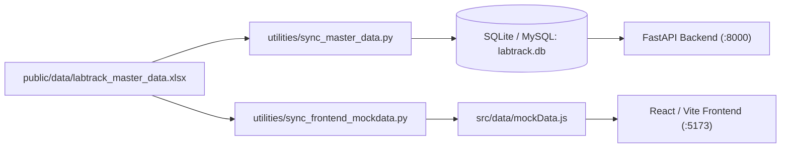

# LabTrack Phase 01 & Phase 02 Handover & QA Specification (`raghu_handover_1`)

**Target Audience:** Raghu's QA & Frontend Engineering Agent  
**Author:** Backend Architecture & Core Foundations Agent  
**Date:** October 18, 2026  
**Status:** DRAFT (Pending User Review & Approval before Git Commit)  
**Primary Objectives:**
1. Provide complete architectural context and change transparency for Phase 01 & Phase 02.
2. Synchronize frontend components across all roles (HoD, Lab In-Charge, Faculty Mentor, Lab Assistant) to match the Student role baseline.
3. Save prompt tokens and prevent redundant exploratory calls for Raghu's agent.

---

## 1. Executive Summary & Git Branch Topology

### 1.1 Branch & Commit Relationship
A comprehensive three-way diff and merge-tree analysis was performed across the active branches:
- **`main` (Local / Our Work):**
  - Contains commit `1d7fcad` (*complete and seal Phase 02 Catalogue, Inventory Model & Project Governance*).
  - Uncommitted staged/working tree contains the authoritative database sync tools, master data Excel generator, canonical component classes, and Student role departmental governance.
- **`origin/version-2.3` (Raghu's Latest Push, Head `399f31f`):**
  - Contains Raghu's complete UI improvements:
    - `ApprovalsQueuePage.jsx`: Cupertino dossier cards, supervisor review desk, past approvals tab, HoD executive controls, Tier-3 capital filters.
    - `DispatchDeskPage.jsx`: Multi-kit dispatch, batch returns, fast-pass, defect triage unblocking, shelf coordinates.
    - `facultyAuth.js`: Strict mentor name and PI identity binding to prevent cross-faculty project adoption.
    - `ProjectDetailPage.jsx` & `ProjectDirectoryPage.jsx`: Inline project title renaming, removal of artificial quota progress bars.
- **Conflict Assessment:**
  - Running `git merge-tree` between `HEAD` and `origin/version-2.3` identified **0 three-way merge conflicts**.
  - All file changes merge cleanly. Raghu's work focused on UI/UX presentation in operations and project pages, while our work focused on data models, deterministic backend validation, and inventory governance.

> [!IMPORTANT]
> **Commit Policy:** As instructed by the project lead, our local changes will **not** be committed or merged until this handover document is reviewed and approved. Once approved, the commit hash will be pinned in Section 1.2 below.

### 1.2 Authoritative Commit Reference
- **Authoritative Commit Hash:** `10229c1` (on branch `main`)
- **Status:** SEALED & PUSHED
- **Merge Target:** Clean rebase or merge of `origin/version-2.3` into `main`.

---

## 2. Authoritative Single Source of Truth

Raghu's agent must strictly adhere to the established institutional master data contracts:

### 2.1 The Master Data Pipeline

1. **Master Excel Workbook:** [`public/data/labtrack_master_data.xlsx`](file:///d:/Users/Documents/Symbiosis/Academics/Sem%203/Low%20Credit/CCE/Project/public/data/labtrack_master_data.xlsx)
   - Contains 7 structured sheets: `Labs` (20), `Users` (64), `Items` (34), `Stock` (55), `Assets` (36), `Projects` (8), `Project_Members` (22).
2. **Synchronized Databases:**
   - Relational Database (SQLite `labtrack.db` / MySQL): Populated via `python utilities/sync_master_data.py`.
   - Frontend In-Memory Mock Store: Synchronized via `python utilities/sync_frontend_mockdata.py` into [`src/data/mockData.js`](file:///d:/Users/Documents/Symbiosis/Academics/Sem%203/Low%20Credit/CCE/Project/src/data/mockData.js).

### 2.2 The 7 Canonical Component Classes
In accordance with `manoj sir talk.txt` (line 33) and SDD Section 5.2, all arbitrary or verbose categories have been purged. Every hardware item belongs to one of exactly 7 classes:
| Canonical Class | Description | Key Item Examples | Chromatic UI Theme |
|---|---|---|---|
| **`Sensors`** | Distance, optical, depth, thermal, LiDAR, and IMUs | HC-SR04, DHT22, MPU6050, BMP280, RealSense D435i, Ouster LiDAR, FLIR Lepton | Amber / Sunset Bronze |
| **`Microcontrollers`** | Low-power MCUs & industrial programmable logic controllers | Arduino Uno Rev3, ESP32-WROOM, Raspberry Pi Pico W, Siemens S7-1200 PLC | Electric Sky / Cyan |
| **`Microprocessors`** | Single-board compute modules, AI edge boards, workstations | NVIDIA Jetson Nano, Jetson Orin Nano, Raspberry Pi 4/5, Apple iMac M3, Dell Precision RTX 4090 | Deep Indigo / Sapphire |
| **`Motors`** | Mobile robotics platforms, robotic arms, servos, actuators | TurtleBot 3, TurtleBot 4, Dobot Magician, Kinova Gen3, SG90, MG996R, NEMA 17 | Radiant Violet / Magenta |
| **`Communication Modules`** | Wireless RF transceivers, GNSS positioning | U-Blox Neo-6M GPS, nRF24L01+ 2.4GHz RF | Radiant Teal / Cyan |
| **`Batteries`** | High-discharge LiPo battery packs, Li-ion cylindrical cells | 11.1V 3S LiPo 2200mAh, 18650 3.7V 2600mAh | Rose Coral / Amber |
| **`Misc`** | Bench instrumentation, prototyping consumables, switching | Rigol DS1054Z Oscilloscope, 830 Breadboard, Jumper Wires, 4-Ch Relay | Mint Emerald / Slate |

### 2.3 Departmental & Floor Alignment
- **Floor 4 (CSE Department):** PPSL, OSTL, CC-1, CC-2, DSL (CL-06), PL (CL-07), DMAL (CL-09).
- **Floor 5 (AIML & CSE Departments):**
  - *AIML Wing:* M.Tech Research Lab (5CL-01), Data Visualization (5CL-02), iMac Apple Vision (5CL-03), Cloud Computing (5CL-07), Multimodal Sensor Analytics (5CL-08), AI Project Lab (5CL-11).
  - *CSE Wing:* DSA Lab (5CL-04), Machine & Deep Learning (5CL-05), NLP Lab (5CL-06), Data Processing (5CL-09), Data Science (5CL-10).
- **Floor 6 (Robotics & Automation - RA Department):** Mechatronics & IoT (MIOTL), Hydraulic & Pneumatic (HPL), Mobile Robotics Lab (MRL), Hydraulic Lab (H Lab).

### 2.4 Department Leadership (HoDs)
- **AIML HoD:** Dr. Sumit Kumar (`T100101`, `sumit.kumar@sitpune.edu.in`)
- **CSE HoD:** Dr. Sonali Kothari (`T100201`, `sonali.kothari@sitpune.edu.in`)
- **RA HoD:** Dr. Arunkumar Bongale (`T100301`, `arunkumar.bongale@sitpune.edu.in`)

---

## 3. What Was Completed & Sealed in Phase 01 & 02

### 3.1 Backend Foundations & APIs (100% Test Passed)
- All 47 pytest test cases pass cleanly (`.venv\Scripts\pytest`).
- Key enforced domain rules:
  1. **Strict Dichotomy:** Assets are individually serialized (`SIT-BRANCH-ROOM-TAG`, Default ID, Bill Number); Consumables are quantity-tracked (`good + bad = total`).
  2. **Multi-Lab Stock Isolation:** Stock is partitioned by `(lab_id, item_id)`.
  3. **FIFO Queue & Reservation:** Requisitions queue deterministically when stock is exhausted.
  4. **Student Department Restriction Rule (`REQ-LT-0010` / `0011`):** A student enrolled in AIML can only issue hardware located in AIML department laboratories. Cross-department requests are rejected with `409 POLICY_REQUIRED` (`STUDENT_DEPARTMENT_RESTRICTION`).

### 3.2 Student Role Frontend Alignment
1. **TopHeader Department Registry:**
   - Active department switcher (`AIML DEPT`, `CSE DEPT`, `RA DEPT`, `ALL DEPTS`) bound to `LabDataContext`.
2. **Hardware Workstation (`InventoryListPage.jsx`):**
   - Replaced redundant lab dropdown with **Component Class** dropdown (`All Classes`, `Sensors`, `Microcontrollers`, `Microprocessors`, `Motors`, `Communication Modules`, `Batteries`, `Misc`).
   - Cards display full-bleed hardware photography (`/images/hardware/...`), technical spec chips, and physical location coordinates.
   - Enforced departmental issue lock: Items housed outside the student's enrolled department render a disabled lock button (`CSE Dept Only` / `RA Dept Only`) with explanatory tooltips, preventing illegal basket additions.
3. **Requisition Drawer (`RequisitionDrawer.jsx`):**
   - Live availability checks and department governance alerts prior to request submission.

---

## 4. What Needs to Be Done by Raghu's Agent (Phase 01 & 02 Bulletproofing)

While the Student role interface is aligned with Phase 1 & 2 requirements, **the other institutional roles (HoD, Lab In-Charge, Faculty Mentor, Lab Assistant) must now be brought up to the same bulletproof standard**.

Raghu's agent must perform the following tasks:

### 4.1 Head of Department (HoD) Role Upgrades
1. **Scope Approvals by HoD Department:**
   - Dr. Sumit Kumar (AIML HoD) must oversee AIML department requisitions and hardware by default.
   - Dr. Sonali Kothari (CSE HoD) must oversee CSE department requisitions.
   - Dr. Arunkumar Bongale (RA HoD) must oversee RA department requisitions.
   - Add a department filter toggle on [`src/pages/operations/ApprovalsQueuePage.jsx`](file:///d:/Users/Documents/Symbiosis/Academics/Sem%203/Low%20Credit/CCE/Project/src/pages/operations/ApprovalsQueuePage.jsx) allowing HoDs to view their department queue or switch to All Departments.
2. **Tier-3 & Tier-4 High-Value Gate:**
   - Ensure the HoD queue highlights items marked `Tier 3 Advanced` or `Tier 4 High Value` (e.g. Jetson Orin Nano, TurtleBot 4, Kinova Robotic Arm, Ouster LiDAR, RTX 4090 Workstations).
   - Verify that HoD override actions (`Approve with Caveat`, `Institutional Override`, `Write-Off`) update requisition state cleanly.

### 4.2 Faculty Mentor & PI Role Upgrades
1. **Bind Approvals to Project Mentorship:**
   - Faculty mentors must only be prompted to recommend or approve requisitions originating from student project groups under their mentorship wing (`src/utils/facultyAuth.js`).
   - Requisitions from other professors' teams must show in a distinct read-only audit view or be filtered out of the active action queue.
2. **Integrate with Authoritative Faculty Roster:**
   - Ensure mock data users match the 20 faculty IDs and designations in `public/data/labtrack_master_data.xlsx`.

### 4.3 Lab In-Charge Role Upgrades
1. **Physical Facility Gatekeeping:**
   - In accordance with SDD Section 2.3 and Manoj Sir's requirements, a Lab In-Charge is assigned to at most 1 or 2 specific lab rooms (e.g. `5CL-02` Data Visualization, `6MRL` Mobile Robotics).
   - When logged in as a Lab In-Charge, the approvals desk must feature a **"My In-Charge Facility"** tab showing requisitions for hardware housed specifically in their room.
   - Differentiate between Mentor approval (academic intent) and Lab In-Charge approval (physical asset authorization).

### 4.4 Lab Assistant (Technical Staff) Role Upgrades
1. **Dispatch Desk Barcode Scanning:**
   - In [`src/pages/operations/DispatchDeskPage.jsx`](file:///d:/Users/Documents/Symbiosis/Academics/Sem%203/Low%20Credit/CCE/Project/src/pages/operations/DispatchDeskPage.jsx), ensure the barcode scanner lookup binds to the 36 physical SIT barcodes in master data (e.g., `SIT-AIML-5CL07-0043`, `SIT-CSE-4CL07-0083`, `SIT-RA-6MRL-0012`).
2. **Defect Triage & Condition Tracking:**
   - In [`src/pages/operations/DefectManagementPage.jsx`](file:///d:/Users/Documents/Symbiosis/Academics/Sem%203/Low%20Credit/CCE/Project/src/pages/operations/DefectManagementPage.jsx), verify that logging an item as defective mutates stock correctly: decrementing `good` and incrementing `bad`, preserving `total = good + bad`.

---

## 5. Token-Saving Instructions for Raghu's Agent

To minimize redundant token consumption and avoid exploratory shell looping:
1. **Do not re-invent data generators:** Master Excel data is generated exclusively by `utilities/generate_master_excel.py`.
2. **Do not hardcode new categories:** Only use the 7 canonical classes defined in Section 2.2.
3. **Use the sync scripts:**
   - To update SQLite/MySQL: `python utilities/sync_master_data.py`
   - To update frontend mock data: `python utilities/sync_frontend_mockdata.py`
4. **Refer to this document as Ground Truth:** Use `raghu_handover_1.md` as the authoritative spec for roles, departments, and classes.

---

## 6. Verification Checklist for Raghu's QA Run

- [ ] **Build Validation:** Run `npm run build` (Must pass with 0 errors).
- [ ] **Backend Regression:** Run `.venv\Scripts\pytest` (All 47 tests must pass).
- [ ] **Student Role QA:**
  - [ ] Inventory cards display correct images, technical specs, and canonical category badges.
  - [ ] Filter dropdown filters accurately by `Sensors`, `Microcontrollers`, `Microprocessors`, `Motors`, `Communication Modules`, `Batteries`, `Misc`.
  - [ ] Enrolled department restriction prevents cross-department requisitions.
- [ ] **HoD Role QA:**
  - [ ] Log in as Dr. Sumit Kumar (AIML), Dr. Sonali Kothari (CSE), or Dr. Arunkumar Bongale (RA).
  - [ ] Verify Approvals Desk displays department-filtered requisitions and Tier-3/4 capital controls.
- [ ] **Faculty Mentor QA:**
  - [ ] Verify `facultyAuth.js` restricts approval actions exclusively to mentored teams.
- [ ] **Lab Assistant QA:**
  - [ ] Dispatch Desk barcode lookup finds SIT barcodes.
  - [ ] Return inspection correctly updates good/bad quantity balance.
