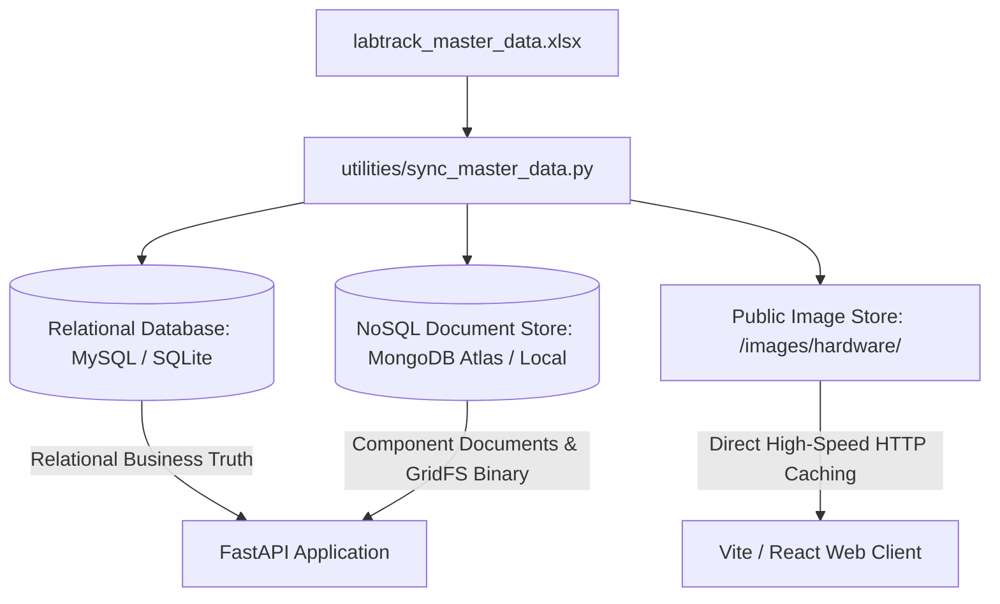
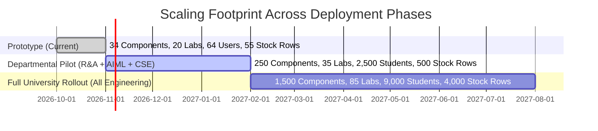

# LabTrack Master Data Dictionary & Institutional Scaling Guide

**Version:** 1.0  
**Target:** DCDS + CCE Academic Evaluation & Institutional Deployment  
**Workbook Source:** [`public/data/labtrack_master_data.xlsx`](file:///d:/Users/Documents/Symbiosis/Academics/Sem%203/Low%20Credit/CCE/Project/public/data/labtrack_master_data.xlsx)  
**Generator Script:** [`utilities/generate_master_excel.py`](file:///d:/Users/Documents/Symbiosis/Academics/Sem%203/Low%20Credit/CCE/Project/utilities/generate_master_excel.py)  

---

## 1. Executive Purpose & Architecture

This document defines the schema, field contracts, institutional identifier logic, and horizontal scaling metrics for the LabTrack platform. 

The current dataset in `labtrack_master_data.xlsx` serves as the authoritative mock baseline for testing and viva presentation. It models a high-fidelity multi-floor laboratory network across **Floor 4 (CSE)**, **Floor 5 (AIML & CSE)**, and **Floor 6 (Robotics & Automation - RA)** at Symbiosis Institute of Technology (SIT Pune).

---

## 2. Institutional Identifier Contracts

### 2.1 Student PRN (11 Digits, e.g., `25070126076`)

All student identities are strictly validated against an 11-digit Permanent Registration Number (PRN):

$$\text{PRN} = \underbrace{d_1 d_2}_{\text{Admission Year}} + \underbrace{07012}_{\text{Institute Code}} + \underbrace{d_8}_{\text{Branch Code}} + \underbrace{d_9 d_{10} d_{11}}_{\text{Roll Number}}$$

1. **Admission Year Prefix ($d_1 d_2$):**
   - `25` $\implies$ Batch 2025–2029
   - `24` $\implies$ Batch 2024–2028
   - `23` $\implies$ Batch 2023–2027
2. **Institute Code ($d_3 \dots d_7$):**
   - `07012` is the fixed constant code for Symbiosis Institute of Technology, Pune.
3. **Branch Code ($d_8$):**
   - `6` $\implies$ **AIML** (Artificial Intelligence & Machine Learning)
   - `2` $\implies$ **CSE** (Computer Science & Engineering)
   - `7` $\implies$ **RA** (Robotics & Automation)
   - `3` $\implies$ **ENTC** (Electronics & Telecommunication — *Out of current scope*)
4. **Roll Number ($d_9 \dots d_{11}$):**
   - 3-digit zero-padded student sequential roll number (e.g., `076`).

#### Study Year Derivation Formula:
$$\text{Year of Study} = \text{Current Academic Year} - (2000 + d_1 d_2) + 1$$
*Example (In 2026):*
- Prefix `26` $\to 2026 - 2026 + 1 =$ **1st Year (FE)**
- Prefix `25` $\to 2026 - 2025 + 1 =$ **2nd Year (SE)**
- Prefix `24` $\to 2026 - 2024 + 1 =$ **3rd Year (TE)**
- Prefix `23` $\to 2026 - 2023 + 1 =$ **4th Year (BE)**

#### Student Email Contract:
`{firstname}.{lastname}.btech{2000 + d_1 d_2}@sitpune.edu.in`  
*Example:* `ishaan.chand.btech2025@sitpune.edu.in`

---

### 2.2 Faculty & Staff Identifiers

1. **Faculty Mentors & HoDs:**
   - Format: `T` followed by 5–6 digits (e.g., `T100101`, `T100452`).
   - Email: `{firstname}.{lastname}@sitpune.edu.in`
2. **Lab Assistants (Staff):**
   - Format: `N` followed by 5 digits (e.g., `N10021`).
   - Email: `{firstname}.{lastname}.staff@sitpune.edu.in`

---

### 2.3 Lab Identifiers & The "Lab In-Charge" Contract

#### Lab Code Format:
`{LAB_CODE}-{BRANCH}` (e.g., `CCL-AIML`, `DSL-CSE`, `MIOT-RA`).

#### The Distinct Role of a "Lab In-Charge":
- **Faculty Mentor:** Mentors student project groups; approves initial requisition intent; does not control physical inventory.
- **Lab In-Charge:** A specialized faculty member assigned to **at most 1 or 2 laboratories**. The Lab In-Charge is the authoritative asset approval gatekeeper for high-value hardware stored in their specific lab room.
- **Lab Assistant:** Technical staff managing multiple labs; handles counter check-in/check-out, physical barcode scanning, and damage inspections.

---

## 3. Data Dictionary: Workbook Sheets

### 3.1 Sheet: `Labs` (20 Records)
| Field | Type | Constraint | Description |
|---|---|---|---|
| `Lab ID` | VARCHAR(30) | PRIMARY KEY | Unique natural code: `{CODE}-{BRANCH}` |
| `Lab Name` | VARCHAR(120) | NOT NULL | Official university lab name |
| `Floor` | INT | IN (4, 5, 6) | Physical building floor |
| `Wing` | VARCHAR(20) | NOT NULL | Building wing (A, B, C, D Wing) |
| `Location Description` | VARCHAR(200) | NOT NULL | Full physical room description |
| `Branch` | VARCHAR(10) | IN ('AIML', 'CSE', 'RA') | Departmental alignment |
| `In-Charge Faculty ID`| VARCHAR(20) | FK $\to$ `Users.user_id` | Responsible faculty gatekeeper |
| `In-Charge Faculty Name`| VARCHAR(120)| NOT NULL | Human-readable faculty name |

### 3.2 Sheet: `Users` (64 Records)
| Field | Type | Constraint | Description |
|---|---|---|---|
| `User ID` | VARCHAR(20) | PRIMARY KEY | PRN (Student), T-ID (Faculty), N-ID (Staff), AD-ID (Admin) |
| `Full Name` | VARCHAR(120) | NOT NULL | Complete legal name |
| `Email` | VARCHAR(200) | UNIQUE, NOT NULL | Standard institutional email address |
| `User Type` | VARCHAR(20) | ENUM | `STUDENT`, `FACULTY`, `ASSISTANT`, `HOD`, `ADMIN` |
| `Department` | VARCHAR(20) | NOT NULL | `AIML`, `CSE`, `RA`, or `CENTRAL` |
| `Designation` | VARCHAR(100) | NOT NULL | Institutional post or academic status |
| `Batch` | INT | NULLABLE | 4-digit admission year (e.g., 2025) |
| `Year of Study` | INT | NULLABLE | Current class year (1 to 4) |
| `Branch` | VARCHAR(10) | NULLABLE | Student academic branch |
| `Roll Number` | VARCHAR(10) | NULLABLE | 3-digit class roll number |
| `Phone` | VARCHAR(20) | NOT NULL | Contact number |
| `In-Charge Labs` | VARCHAR(100)| NULLABLE | Comma-separated labs for In-Charge faculty (max 2) |
| `Managed Labs` | VARCHAR(200)| NULLABLE | Comma-separated labs for Lab Assistants |
| `Active` | BOOLEAN | DEFAULT TRUE | Operational account status |

### 3.3 Sheet: `Items` (34 Records)
| Field | Type | Constraint | Description |
|---|---|---|---|
| `Item ID` | VARCHAR(30) | PRIMARY KEY | Semantic code: `DEV-...`, `SEN-...`, `ROB-...` |
| `Item Name` | VARCHAR(120) | NOT NULL | Component nomenclature |
| `Kind` | VARCHAR(20) | IN ('ASSET', 'CONSUMABLE') | Classification boundary |
| `Category` | VARCHAR(50) | IN (Canonical Classes) | Canonical hardware class (see below) |
| `Manufacturer / Brand`| VARCHAR(100)| NOT NULL | OEM or hardware manufacturer |
| `Sub-Specifications`| TEXT | NOT NULL | Technical electrical & mechanical parameters |
| `Description` | TEXT | NOT NULL | Functional domain usage |
| `Cost Tier` | VARCHAR(40) | NOT NULL | Replacement risk tier (Tier 1 to Tier 4) |
| `Image URL` | VARCHAR(200) | NOT NULL | Static/CDN relative path (`/images/hardware/...`) |

#### The 7 Canonical Component Classes (Charter & SDD Compliant):
As mandated by the institutional charter and SDD (Section 5.2), hardware items are strictly grouped into 7 canonical classes:
1. **`Sensors`**: Sonar distance, environmental temp/humidity, barometric altimeters, 6-DOF IMUs, line trackers, stereo RGB-D depth cameras, and LiDAR scanners.
2. **`Microcontrollers`**: Prototyping MCUs (Arduino Uno, ESP32, Raspberry Pi Pico W) and industrial programmable automation controllers (Siemens S7-1200 PLC).
3. **`Microprocessors`**: Embedded AI SBC modules (NVIDIA Jetson Nano/Orin, Raspberry Pi 4/5) and high-throughput lab compute towers (Apple iMac M3, Dell Precision RTX 4090).
4. **`Motors`**: Autonomous ground mobile platforms (TurtleBot 3/4), articulated robotic arms (Dobot Magician, Kinova Gen3), micro servos, stepper motors, and dual H-bridge motor drivers.
5. **`Communication Modules`**: GPS satellite positioning and 2.4GHz ISM RF wireless transceivers.
6. **`Batteries`**: High-discharge 3S LiPo battery packs and 18650 Li-ion power cells.
7. **`Misc`**: Benchtop digital oscilloscopes, solderless breadboards, jumper wires, and optocoupler relay modules.

### 3.4 Sheet: `Stock` (55 Records)
| Field | Type | Constraint | Description |
|---|---|---|---|
| `Lab ID` | VARCHAR(30) | COMPOSITE PK | FK $\to$ `Labs.lab_id` |
| `Item ID` | VARCHAR(30) | COMPOSITE PK | FK $\to$ `Items.item_id` |
| `Good Quantity` | INT | CHECK (good >= 0) | Operable units ready for loan/issue |
| `Bad Quantity` | INT | CHECK (bad >= 0) | Defective units undergoing repair |
| `Total Physical Quantity`| INT | Derived | `good + bad` |

### 3.5 Sheet: `Assets` (36 Records)
| Field | Type | Constraint | Description |
|---|---|---|---|
| `Barcode` | VARCHAR(80) | PRIMARY KEY | Physical SIT Barcode label (`SIT-AIML-...`) |
| `Item ID` | VARCHAR(30) | FK $\to$ `Items.item_id` | Component catalogue reference |
| `Lab ID` | VARCHAR(30) | FK $\to$ `Labs.lab_id` | Housing physical laboratory |
| `Default ID` | VARCHAR(80) | NOT NULL | Internal lab rack identifier |
| `Bill Number` | VARCHAR(80) | NOT NULL | Institutional CPR / procurement invoice |
| `Serial Number` | VARCHAR(80) | NOT NULL | Manufacturer hardware serial |
| `State` | VARCHAR(40) | ENUM | `AVAILABLE`, `RESERVED`, `IN_USE`, `DEFECTIVE`, `UNDER_REPAIR`, `LOST` |
| `Custody Holder PRN` | VARCHAR(20)| NULLABLE | Active student loan holder |

### 3.6 Sheet: `Projects` & `Project_Members`
- **Projects (8 Records):** Sequential ID `PROJ-000001` through `PROJ-000008` with Lead Student PRN and Faculty Mentor ID.
- **Project Members (22 Records):** Composite Primary Key `(project_id, student_prn)`.

---

## 4. Multi-Tier Image Architecture (DCDS & Cloud Computing)

### 4.1 Storage Decision Matrix
| Storage Layer | Technology | Primary Role | Viva / Academic Justification |
|---|---|---|---|
| **Edge / Static Cache** | Public HTTP directory (`public/images/hardware/`) | Immediate UI render in Vite/React with zero backend overhead. | Conforms to Cloud Computing (CCE) best practice: decoupling static binary payloads from transaction pipelines. |
| **NoSQL Document Store**| MongoDB Collection `component_catalog_documents` | Stores complete metadata: width, height, SHA-256 hash, and image URL. | Demonstrates schema-free document modeling for multi-tenant analytics and catalog browsing. |
| **NoSQL Binary Store** | MongoDB GridFS (`fs.files` & `fs.chunks`) | Stores raw binary images split into 255KB discrete chunks. | Fulfills DCDS advanced evaluation: storing arbitrary unstructured binary data within NoSQL. |
| **Relational SQL** | MySQL Table `items.image_url` | Stores relative string reference only. | Avoids MySQL BLOB storage anti-pattern, maintaining lean InnoDB buffer pools and rapid table scans. |

---

## 5. Institutional Data Scaling & Capacity Planning

### 5.1 Three-Phase Scale Projections

| Metric | Phase 1 (Prototype / Current) | Phase 2 (Departmental Pilot) | Phase 3 (Full University Rollout) |
|---|:---:|:---:|:---:|
| **Departments** | 3 (AIML, CSE, RA) | 5 (+ ENTC, Mechanical) | 9 (+ Civil, Applied Sci, etc.) |
| **Laboratories** | 20 | 35 | 85 |
| **Active Students** | 34 (Mock) | 2,500 | 9,000 |
| **Faculty & Staff** | 30 (Mock) | 120 | 380 |
| **Active Projects** | 8 | 450 | 1,800 |
| **Unique Catalogue Items** | 34 | 250 | 1,500 |
| **Serialized Assets** | 36 | 600 | 4,500 |
| **Stock Table Rows** | 55 | 500 | 4,200 |
| **Annual Requisitions** | ~100 | ~5,000 | ~35,000 |

### 5.2 Storage & Infrastructure Sizing
1. **Relational Database (MySQL 8.4 InnoDB):**
   - At full university scale (35,000 requests/year $\times$ 5 years $\approx$ 175,000 transactions + 500,000 audit rows):
   - Total Relational Database Disk Footprint: $\mathbf{< 1.8\text{ GB}}$.
   - Can easily operate on a modest AWS RDS `db.t4g.small` or Aiven standard instance with $<10\%$ CPU utilization.
2. **MongoDB Document Store & GridFS:**
   - 1,500 component images @ 400KB average $= \mathbf{\approx 600\text{ MB}}$.
   - Inspection damage photos (Phase 5): estimated 2,000 incident photos/year @ 1MB $= \mathbf{\approx 2\text{ GB/year}}$.
   - Handled smoothly by MongoDB Atlas Shared M0/M10 tiers with automated S3 lifecycle archival.
3. **Network & Concurrency:**
   - Peak concurrent users during lab semester registration: ~150 concurrent requests.
   - FastAPI asynchronous async worker pool handles up to 1,200 req/sec on 1 vCPU with sub-25ms response time.

---

## 6. Migration Guide for Production / Real Institutional Data

When migrating from `labtrack_master_data.xlsx` to real campus data (e.g., Peoplesoft ERP / Symbiosis IT Master Dumps):

1. **Step 1 — Extract CSV/Excel Dumps:** Export student roster, faculty directory, and departmental asset registers into standard CSV format.
2. **Step 2 — Validate Schema Contracts:** Run `utilities/sync_master_data.py --validate-only` to ensure PRN strings conform to the 11-digit regex `^[0-9]{2}07012[267][0-9]{3}$`.
3. **Step 3 — Bulk PBKDF2 Password Hashing:** Synthetic passwords should be generated as secure randomized temp passwords, or replaced with the institutional SAML 2.0 / OAuth SSO token adapter.
4. **Step 4 — Atomic Upsert:** Execute `python utilities/sync_master_data.py --import` within a single database transaction with automatic foreign-key verification.
