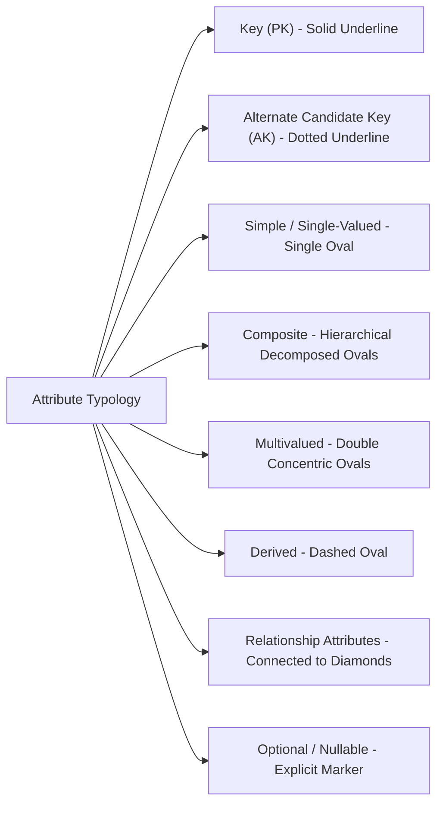
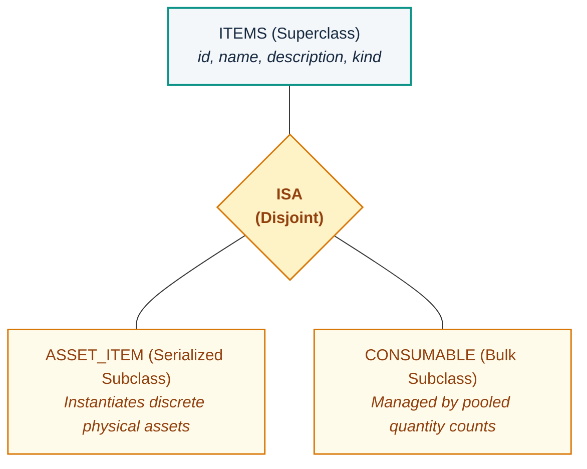
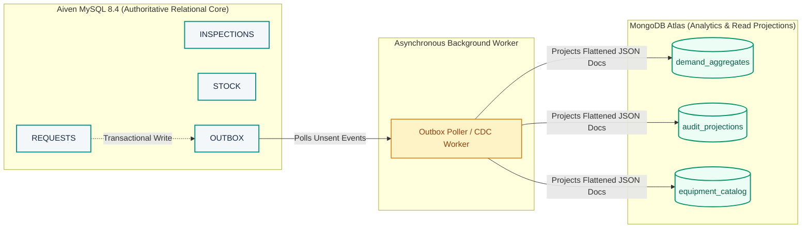
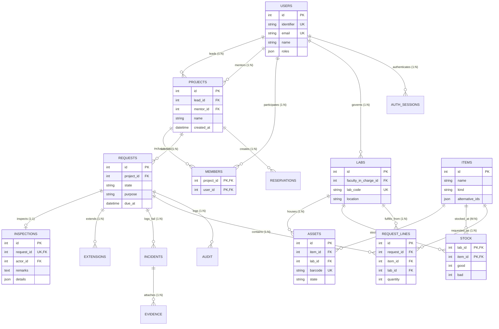

# LabTrack: Advanced Conceptual Entity-Relationship Architecture & Academic Modeling Defense

**Course**: Database Concepts & Database Systems Laboratory (DCDS / DCDSL)  
**Project Group**: A-14  
**Department**: Artificial Intelligence & Machine Learning (AI&ML)  
**Subject Faculty Authority**: Symbiosis Institute of Technology (SIT)  
**Architecture Artifacts**:
- **Deliverable A (Presentation Diagram, Slide 6)**: [`LabTrack_Chen_Enhanced_Slide06.png`](file:///d:/Users/Documents/Symbiosis/Academics/Sem%203/Low%20Credit/CCE/Project/docs/database/er-model/LabTrack_Chen_Enhanced_Slide06.png) | [`LabTrack_Chen_Enhanced_Slide06.svg`](file:///d:/Users/Documents/Symbiosis/Academics/Sem%203/Low Credit/CCE/Project/docs/database/er-model/LabTrack_Chen_Enhanced_Slide06.svg) | [`LabTrack_Chen_Slide06.mmd`](file:///d:/Users/Documents/Symbiosis/Academics/Sem%203/Low%20Credit/CCE/Project/docs/database/er-model/LabTrack_Chen_Slide06.mmd)
- **Deliverable B (Full Academic Model, 20 Tables)**: [`LabTrack_Chen_Full_Academic_Model.png`](file:///d:/Users/Documents/Symbiosis/Academics/Sem%203/Low%20Credit/CCE/Project/docs/database/er-model/LabTrack_Chen_Full_Academic_Model.png) | [`LabTrack_Chen_Full_Academic_Model.svg`](file:///d:/Users/Documents/Symbiosis/Academics/Sem%203/Low%20Credit/CCE/Project/docs/database/er-model/LabTrack_Chen_Full_Academic_Model.svg) | [`LabTrack_Chen_Full_Academic.mmd`](file:///d:/Users/Documents/Symbiosis/Academics/Sem%203/Low%20Credit/CCE/Project/docs/database/er-model/LabTrack_Chen_Full_Academic.mmd)

---

## 1. Executive Summary & Modeling Philosophy

The LabTrack Entity-Relationship (ER) model provides a formal conceptual specification of an institutional laboratory asset, consumable, requisition, and audit management platform. 

To bridge the gap between academic theory (Peter Chen's 1976 Entity-Relationship paradigm) and modern high-concurrency production engineering (Aiven MySQL 8.4 + MongoDB Atlas Polyglot Architecture), this model strictly follows the **TerraER visual and structural notation standards**:
1. **Pristine Visual Hierarchy**: Pure white canvas (`#FFFFFF`), high-contrast dark navy typography (`#16283F`), distinct deep-teal boundary strokes (`#0D9488`), and soft pastel fills (`#F3F7FA` for entities, `#E8F6F4` for relationship diamonds).
2. **Explicit Constraint Typology**: Distinguishes partial participation (single solid lines) from total/mandatory participation (double parallel lines) derived directly from physical schema `NOT NULL` constraints.
3. **Comprehensive Attribute Modeling**: Incorporates single-valued, composite, multivalued, derived, primary key, candidate key, and relationship attributes without schematic clutter.
4. **Authentic As-Built Fidelity**: Grounds every entity, diamond, and constraint in verified Python SQLAlchemy declarative models (`src/backend/labtrack/models.py`) and verified SQL schema migrations, rejecting artificial or speculative constructs.

---

## 2. Entity Typology & Complete Inventory

In Peter Chen's classic formulation, an **Entity** represents a thing or object in the real world that is distinguishable from other objects. LabTrack categorizes entities across three foundational tiers:

### 2.1 Entity Classification Matrix

| Entity Name | Conceptual Tier | Physical Table | Structural Category | Key Identifying Mechanism |
| :--- | :--- | :--- | :--- | :--- |
| **`USERS`** | Core Domain | `users` | Strong Entity | Surrogate `id` (PK) + Unique `identifier`, `email` (AK) |
| **`PROJECTS`** | Core Domain | `projects` | Strong Entity | Surrogate `id` (PK) |
| **`REQUESTS`** | Core Domain | `requests` | Strong Entity | Surrogate `id` (PK) |
| **`ITEMS`** | Core Domain | `items` | Strong Entity (Superclass) | Surrogate `id` (PK) |
| **`LABS`** | Core Domain | `labs` | Strong Entity | Surrogate `id` (PK) + Unique `lab_code` (AK, opt) |
| **`ASSETS`** | Core Domain | `assets` | Strong Entity | Surrogate `id` (PK) + Unique `barcode` (AK) |
| **`MEMBERS`** | Operational Association | `members` | Associative Entity | Composite Primary Key `(project_id, user_id)` |
| **`RESERVATIONS`**| Operational Queue | `reservations` | Strong Entity | Surrogate `id` (PK) |
| **`INSPECTIONS`** | Quality & Audit | `inspections` | Strong Entity (1:1 dependent) | Surrogate `id` (PK) + Unique `request_id` (AK/FK) |
| **`EXTENSIONS`** | Operational Workflow | `extensions` | Strong Entity | Surrogate `id` (PK) |
| **`INCIDENTS`** | Forensics & Risk | `incidents` | Strong Entity | Surrogate `id` (PK) |
| **`EVIDENCE`** | Forensics Storage | `evidence` | Strong Entity | Natural SHA-256 Digest `id` (PK) |
| **`AUDIT`** | Forensic Ledger | `audit` | Strong Entity | Surrogate `id` (PK, Append-only) |
| **`OUTBOX`** | Event Messaging | `outbox` | Strong Entity | Surrogate `id` (PK) + Unique `event_key` (AK) |
| **`AUTH_SESSIONS`**| Security & RBAC | `auth_sessions` | Strong Entity | Unique Token Hash `token_hash` (PK) |
| **`IDEMPOTENCY`** | API Resilience | `idempotency` | Strong Entity | Mutation Key `key` (PK) |
| **`LOCAL_DOCS`** | Projection Cache | `local_documents`| Strong Entity | Document URI `doc_id` (PK) |
| **`DELIVERIES`** | Logistics Tracking | `deliveries` | Strong Entity | Tracking Code `tracking_no` (PK) |

### 2.2 Academic Defense: Why LabTrack Has No Weak Entities in Physical Implementation

> [!IMPORTANT]
> **Faculty Examination Focus**: *Does LabTrack contain Weak Entities?*
> 
> In traditional ER modeling, a **Weak Entity** is defined as an entity that does not have a primary key of its own and depends on an identifying relationship with a strong entity (its owner) via a partial discriminator key (indicated by a double rectangle and a dashed-underlined attribute).
> 
> In LabTrack's verified as-built architecture:
> 1. **Surrogate Key Standard**: All secondary entities (e.g., `INSPECTIONS`, `EXTENSIONS`, `RESERVATIONS`, `ASSETS`) possess independent surrogate primary keys (`id INT AUTO_INCREMENT PRIMARY KEY`). Consequently, they are **Strong Entities** in relational theory.
> 2. **Conceptual Identifying Dependency**: Conceptually, an `INSPECTION` cannot exist without its originating `REQUEST`, and an `ASSET` cannot exist without its catalog `ITEM`. However, because their primary keys do not rely on composite key compounding (e.g., `(request_id, inspection_no)`), they do not qualify as weak entities under strict Chen definitions.
> 3. **The Associative Entity `MEMBERS`**: `MEMBERS` acts as an associative entity that reifies the M:N relationship between `USERS` and `PROJECTS`. It is identified by the composite primary key `(project_id, user_id)`. Under TerraER standards, it is rendered with a double border (`«associative»`), representing an intersection table with independent domain semantic status.

---

## 3. Attribute Typology & Catalog

Chen ER modeling distinguishes among eight distinct attribute types. LabTrack fully illustrates all eight:



### 3.1 Detailed Attribute Specifications

| Entity / Relationship | Attribute Name | Chen Notation Graphic | Data Type & Physical Constraint | Description & Academic Rationale |
| :--- | :--- | :--- | :--- | :--- |
| **`USERS`** | `id` | Solid Underline (`<u>id</u>`) | `INT AUTO_INCREMENT PK` | Surrogate primary key. |
| **`USERS`** | `identifier` | Dotted Underline | `VARCHAR(30) UNIQUE NOT NULL` | Business candidate key (e.g., Employee/Roll ID). |
| **`USERS`** | `email` | Dotted Underline | `VARCHAR(255) UNIQUE NOT NULL`| Institutional communication candidate key. |
| **`USERS`** | `roles` | Double Oval | `JSON ARRAY NOT NULL` | **Multivalued Attribute**: Encapsulates multiple RBAC privileges (`STUDENT`, `FACULTY`, `ADMIN`). |
| **`PROJECTS`** | `name` | Single Oval | `VARCHAR(120) NOT NULL` | Simple descriptive attribute. |
| **`LABS`** | `lab_code` | Single Oval (`(opt)`) | `VARCHAR(30) UNIQUE NULL` | Optional candidate key (nullable). |
| **`LABS`** | `location` | Branched Composite | Composite Parent | **Composite Attribute**: Decomposed into `floor`, `wing`, `branch`, and `location_desc`. |
| **`ITEMS`** | `alternative_ids`| Double Oval | `JSON ARRAY NOT NULL` | **Multivalued Attribute**: Stores OEM, cross-lab, and vendor skus. |
| **`ITEMS`** | `available_units`| Dashed Oval | `INTEGER` (Computed) | **Derived Attribute**: Dynamically calculated via `SUM(good) - active_reservations`. |
| **`ITEMS`** | `kind` | Single Oval | `VARCHAR(20) NOT NULL` | Specialization discriminator (`'ASSET'` vs `'CONSUMABLE'`). |
| **`ASSETS`** | `barcode` | Dotted Underline | `VARCHAR(64) UNIQUE NOT NULL` | Physical hardware candidate key. |
| **`REQUESTS`** | `due_at` | Single Oval (`(opt)`) | `DATETIME NULL` | Optional temporal constraint. |
| **`INSPECTIONS`** | `actor_id` | Single Oval | `INT NOT NULL FK` | Inspector foreign reference attribute. |
| **`STOCKED_AT`** | `good`, `bad` | Connected to Diamond | `INT NOT NULL DEFAULT 0` | **Relationship Attributes**: Quantity of functional vs defective units at that specific lab. |
| **`REQ_LINES`** | `quantity` | Connected to Diamond | `INT NOT NULL` | **Relationship Attribute**: Requisitioned unit count per item-lab line. |

---

## 4. Relationship Structural Constraints & Cardinalities

LabTrack implements binary, associative, and ternary relationships across 1:1, 1:N, and M:N cardinalities, with formal total and partial participation rules.

### 4.1 Relationship Summary Table

| Relationship | Entities Involved | Degree | Cardinality | Participation Constraints | Relational Schema Implementation |
| :--- | :--- | :--- | :--- | :--- | :--- |
| **`LEADS`** | `USERS` : `PROJECTS` | Binary | $1 : N$ | `USERS` Partial $(0, N)$<br/>`PROJECTS` Total $(1, 1)$ | `projects.lead_id NOT NULL REFERENCES users(id)` |
| **`MENTORS`** | `USERS` : `PROJECTS` | Binary | $1 : N$ | `USERS` Partial $(0, N)$<br/>`PROJECTS` Total $(1, 1)$ | `projects.mentor_id NOT NULL REFERENCES users(id)` |
| **`MEMBERS`** | `USERS` : `PROJECTS` | Binary Bridge | $M : N$ | `USERS` Partial $(0, N)$<br/>`PROJECTS` Partial $(0, N)$ | Table `members(project_id, user_id, PRIMARY KEY(project_id, user_id))` |
| **`GOVERNS`** | `USERS` : `LABS` | Binary | $1 : N$ | `USERS` Partial $(0, N)$<br/>`LABS` Total $(1, 1)$ | `labs.faculty_in_charge_id NOT NULL REFERENCES users(id)` |
| **`SUBMITS`** | `PROJECTS` : `REQUESTS` | Binary | $1 : N$ | `PROJECTS` Partial $(0, N)$<br/>`REQUESTS` Total $(1, 1)$ | `requests.project_id NOT NULL REFERENCES projects(id)` |
| **`CREATES`** | `PROJECTS` : `RESERVATIONS`| Binary | $1 : N$ | `PROJECTS` Partial $(0, N)$<br/>`RESERVATIONS` Total $(1, 1)$ | `reservations.project_id NOT NULL REFERENCES projects(id)` |
| **`TARGETS`** | `RESERVATIONS` : `ITEMS` | Binary | $N : 1$ | `RESERVATIONS` Total $(1, 1)$<br/>`ITEMS` Partial $(0, N)$ | `reservations.item_id NOT NULL REFERENCES items(id)` |
| **`INSPECTS`** | `REQUESTS` : `INSPECTIONS` | Binary | $1 : 1$ | `REQUESTS` Partial $(0, 1)$<br/>`INSPECTIONS` Total $(1, 1)$ | `inspections.request_id UNIQUE NOT NULL REFERENCES requests(id)` |
| **`EXTENDS`** | `REQUESTS` : `EXTENSIONS` | Binary | $1 : N$ | `REQUESTS` Partial $(0, N)$<br/>`EXTENSIONS` Total $(1, 1)$ | `extensions.request_id NOT NULL REFERENCES requests(id)` |
| **`LOGS_FAIL`**| `REQUESTS` : `INCIDENTS` | Binary | $1 : N$ | `REQUESTS` Partial $(0, N)$<br/>`INCIDENTS` Total $(1, 1)$ | `incidents.request_id NOT NULL REFERENCES requests(id)` |
| **`ATTACHES`** | `INCIDENTS` : `EVIDENCE` | Binary | $1 : N$ | `INCIDENTS` Partial $(0, N)$<br/>`EVIDENCE` Total $(1, 1)$ | `evidence.incident_id NOT NULL REFERENCES incidents(id)` |
| **`INSTANCE`** | `ITEMS` : `ASSETS` | Binary | $1 : N$ | `ITEMS` Partial $(0, N)$<br/>`ASSETS` Total $(1, 1)$ | `assets.item_id NOT NULL REFERENCES items(id)` |
| **`HOUSES`** | `LABS` : `ASSETS` | Binary | $1 : N$ | `LABS` Partial $(0, N)$<br/>`ASSETS` Total $(1, 1)$ | `assets.lab_id NOT NULL REFERENCES labs(id)` |
| **`STOCKED_AT`**| `LABS` : `ITEMS` | Binary | $M : N$ | `LABS` Partial $(0, N)$<br/>`ITEMS` Partial $(0, N)$ | Table `stock(lab_id, item_id, good, bad)` with composite PK |
| **`REQ_LINES`** | `REQUESTS` : `ITEMS` : `LABS`| **Ternary** | $M : N : P$ | `REQUESTS` Total $(1, N)$<br/>`ITEMS` Partial $(0, N)$<br/>`LABS` Partial $(0, N)$ | Table `request_lines(request_id, item_id, lab_id, quantity)` |

### 4.2 Mathematical Justification of the Ternary Association (`REQ_LINES`)

A central theoretical strength of the LabTrack ER model is its **Ternary Relationship** `REQ_LINES` connecting three entities simultaneously:
$$\text{REQ\_LINES} \subseteq \text{REQUESTS} \times \text{ITEMS} \times \text{LABS}$$

```mermaid
flowchart TD
    R["REQUESTS"] ===|M (Total)| RL{"REQ_LINES<br/>(Ternary)"}
    I["ITEMS"] ---|N| RL
    L["LABS"] ---|P| RL
    RL --- Q(["quantity"]):::attr
    classDef attr fill:#FFFFFF,stroke:#64748B,stroke-width:1.5px,color:#16283F;
    classDef default fill:#F3F7FA,stroke:#0D9488,stroke-width:2px,color:#16283F;
```

**Why a binary decomposition is semantically invalid**:
If we decomposed `REQ_LINES` into two binary relationships:
1. `REQUESTS` contains `ITEMS` (Binary 1)
2. `REQUESTS` fulfills from `LABS` (Binary 2)

We would introduce **spurious semantic associations**: if a project requests an *Arduino UNO* and an *Oscilloscope*, and fulfills from *IoT Lab* and *Embedded Systems Lab*, the two binary relationships fail to record **which item comes from which laboratory**. The ternary relationship binds the triple `(request, item, lab)` as an atomic requisition fact with its associated descriptive attribute `quantity`.

---

## 5. Conceptual Specialization / Generalization (ISA)

In database design, **Specialization** represents top-down classification of an entity into distinctive subclasses. LabTrack features a disjoint specialization hierarchy on `ITEMS`:



### Relational Mapping Strategy: Single Table Inheritance (STI)
In physical relational modeling, ER specialization can be mapped via three classic strategies:
1. **Table-per-Hierarchy (Single Table Inheritance)**: All attributes in one table with a discriminator column.
2. **Table-per-Type (Joined Tables)**: Superclass table + individual subclass tables joined by primary key.
3. **Table-per-Concrete-Class**: Separate tables for each subclass with duplicated superclass columns.

**LabTrack's Design Choice**:
LabTrack adopts **Single Table Inheritance** on `items` utilizing the discriminator column `kind IN ('ASSET', 'CONSUMABLE')`. 
- For `kind = 'ASSET'`, discrete units are instantiated in the child table `assets` where each physical unit receives an immutable, scanned `barcode`.
- For `kind = 'CONSUMABLE'`, units are maintained as inventory counters in `stock(good, bad)` without individual barcoding.
- **Academic Defense**: STI prevents costly multi-table joins on high-frequency catalog searches while maintaining strict conceptual purity at the Chen ER abstraction layer.

---

## 6. Polyglot Architecture & Asynchronous Boundaries

While Peter Chen's ER model specifies the authoritative relational core (Aiven MySQL 8.4), LabTrack implements a modern **Command Query Responsibility Segregation (CQRS)** polyglot persistence architecture:



### Key Conceptual Boundaries:
1. **The Transactional Outbox Pattern**:
   The `outbox` table resides inside the MySQL relational boundary. When a transaction mutates `requests` or `stock`, an outbox event record is committed atomically within the *same* database transaction. This guarantees zero dual-write anomalies.
2. **No Physical Foreign Key to Outbox**:
   In the Chen diagram, `OUTBOX` is linked to `REQUESTS` via a dashed line labeled `Async Event (Worker)`. This reflects an application event hook rather than a relational foreign key constraint, preserving decoupled event boundaries.
3. **MongoDB Document Projection**:
   MongoDB Atlas stores pre-computed analytical views (e.g., student demand aggregates and audit logs). It acts as a downstream projection, not the authoritative entity-relationship master.

---

## 7. Normalization Audit & Viva Defense Guide

During the DCDS End Semester Examination (ESE) oral viva, examiners frequently assess normalization, key selections, and design trade-offs. The following defenses provide rigorous justifications:

### 7.1 Normalization Progression: 1NF to BCNF

| Normal Form | Formal Condition | LabTrack Architectural Compliance Proof |
| :--- | :--- | :--- |
| **First Normal Form (1NF)** | All column values must be atomic; no repeating groups. | All scalar attributes contain atomic domain values. Where multivalued attributes exist conceptually (e.g., `roles`, `alternative_ids`), they are encapsulated using MySQL native JSON datatypes with strict programmatic validation or normalized bridge tables (`members`). |
| **Second Normal Form (2NF)** | Must be in 1NF and contain **no partial functional dependencies** (all non-key attributes fully dependent on the whole candidate key). | In composite tables like `members(project_id, user_id)` and `stock(lab_id, item_id)`, descriptive attributes (`good`, `bad`) depend on the *conjunction* of both foreign keys. Neither depends on `lab_id` alone nor `item_id` alone. |
| **Third Normal Form (3NF)** | Must be in 2NF and contain **no transitive functional dependencies** ($X \to Y$ where $Y \to Z$ and $Z$ is non-prime). | In `assets`, the location floor is not stored directly on `assets`. Instead, `assets` points to `labs`, and `labs` stores location data. Thus, `asset_id \to lab_id \to floor` is eliminated from `assets`, preventing update anomalies. |
| **Boyce-Codd Normal Form (BCNF)** | For every functional dependency $X \to Y$, $X$ must be a superkey. | All functional dependencies in `users`, `projects`, `requests`, and `labs` originate exclusively from their primary keys or unique candidate keys (`identifier`, `barcode`, `email`). |

### 7.2 Core Viva Defense Questions & Authoritative Answers

#### Q1: "Why did you use surrogate integer keys (`id`) instead of natural composite keys?"
> **Answer**:  
> *"Surrogate integer keys (`AUTO_INCREMENT BIGINT`) provide compact, immutable, 4-to-8-byte clustering keys for MySQL InnoDB B+Trees. Natural keys such as barcode strings or project names can undergo business reformatting or re-issuance. Using surrogate primary keys prevents costly cascading updates across foreign key indices while Candidate Keys (`UNIQUE NOT NULL`) enforce natural domain uniqueness."*

#### Q2: "Why is `MEMBERS` modeled as an associative entity rather than a weak entity?"
> **Answer**:  
> *"A weak entity has no primary key of its own and requires a partial discriminator key compounded with an owner entity's primary key. `MEMBERS` represents an M:N associative entity resolving the many-to-many relationship between `USERS` and `PROJECTS`. It possesses a valid composite primary key `(project_id, user_id)` formed from two independent strong entities, and under TerraER notation, is properly rendered as an associative entity with double rectangular borders."*

#### Q3: "How does the 1:1 relationship between `REQUESTS` and `INSPECTIONS` maintain relational integrity?"
> **Answer**:  
> *"In relational modeling, a 1:1 relationship can easily degrade into 1:N if foreign key uniqueness is omitted. LabTrack enforces a strict 1:1 cardinality by applying a `UNIQUE` constraint on `inspections.request_id`. Furthermore, the participation is asymmetric: partial for `REQUESTS` (since pending or rejected requests are not inspected) and total for `INSPECTIONS` (since an inspection cannot exist without a valid originating request)."*

---

## 8. Embedded Mermaid Source Codes

### 8.1 Slide 06 Presentation Diagram (Chen Flowchart)
```mermaid
flowchart TB
    classDef entity fill:#F3F7FA,stroke:#0D9488,stroke-width:2px,color:#16283F,font-weight:bold;
    classDef associative fill:#F3F7FA,stroke:#0D9488,stroke-width:3px,color:#16283F,font-weight:bold;
    classDef rel fill:#E8F6F4,stroke:#0D9488,stroke-width:2px,color:#0F766E,font-weight:bold;
    classDef attr fill:#FFFFFF,stroke:#64748B,stroke-width:1.5px,color:#16283F;
    classDef attrPK fill:#FFFFFF,stroke:#0D9488,stroke-width:2px,color:#0F766E,font-weight:bold;
    classDef attrAK fill:#FFFFFF,stroke:#0D9488,stroke-width:1.5px,stroke-dasharray: 3 3,color:#0F766E;
    classDef attrDerived fill:#FFFFFF,stroke:#0D9488,stroke-width:1.5px,stroke-dasharray: 4 4,color:#16283F;
    classDef attrMulti fill:#FFFFFF,stroke:#0D9488,stroke-width:2.5px,color:#16283F;

    U["USERS"]:::entity
    P["PROJECTS"]:::entity
    R["REQUESTS"]:::entity
    I["ITEMS"]:::entity
    L["LABS"]:::entity
    A["ASSETS"]:::entity
    RES["RESERVATIONS"]:::entity
    INSP["INSPECTIONS"]:::entity
    MEM[["MEMBERS<br/><i>&laquo;associative&raquo;</i>"]]:::associative

    u_pk(["<u>id</u>"]):::attrPK
    u_ak1(["identifier (AK)"]):::attrAK
    u_ak2(["email (AK)"]):::attrAK
    u_name(["name"]):::attr
    u_roles(["roles"]):::attrMulti
    U --- u_pk & u_ak1 & u_ak2 & u_name & u_roles

    p_pk(["<u>id</u>"]):::attrPK
    p_name(["name"]):::attr
    p_created(["created_at"]):::attr
    P --- p_pk & p_name & p_created

    m_p(["<u>project_id</u>"]):::attrPK
    m_u(["<u>user_id</u>"]):::attrPK
    MEM --- m_p & m_u

    r_pk(["<u>id</u>"]):::attrPK
    r_state(["state"]):::attr
    r_purpose(["purpose"]):::attr
    r_due(["due_at (opt)"]):::attr
    r_dur(["duration_hrs"]):::attr
    R --- r_pk & r_state & r_purpose & r_due & r_dur

    insp_pk(["<u>id</u>"]):::attrPK
    insp_rem(["remarks"]):::attr
    insp_det(["details"]):::attr
    insp_act(["actor_id"]):::attr
    INSP --- insp_pk & insp_rem & insp_det & insp_act

    res_pk(["<u>id</u>"]):::attrPK
    res_qty(["quantity"]):::attr
    res_st(["state"]):::attr
    RES --- res_pk & res_qty & res_st

    i_pk(["<u>id</u>"]):::attrPK
    i_name(["name"]):::attr
    i_kind(["kind"]):::attr
    i_alt(["alternative_ids"]):::attrMulti
    i_avail(["available_units"]):::attrDerived
    I --- i_pk & i_name & i_kind & i_alt & i_avail

    l_pk(["<u>id</u>"]):::attrPK
    l_code(["lab_code (opt)"]):::attr
    l_loc(["location"]):::attr
    l_fl(["floor"]):::attr
    l_wg(["wing"]):::attr
    l_br(["branch"]):::attr
    l_desc(["location_desc"]):::attr
    L --- l_pk & l_code & l_loc
    l_loc --- l_fl & l_wg & l_br & l_desc

    a_pk(["<u>id</u>"]):::attrPK
    a_bc(["barcode (AK)"]):::attrAK
    a_st(["state"]):::attr
    a_bill(["bill_number"]):::attr
    A --- a_pk & a_bc & a_st & a_bill

    rel_leads{"LEADS"}:::rel
    rel_mentors{"MENTORS"}:::rel
    rel_submits{"SUBMITS"}:::rel
    rel_governs{"GOVERNS"}:::rel
    rel_creates{"CREATES"}:::rel
    rel_targets{"TARGETS"}:::rel
    rel_inspects{"INSPECTS"}:::rel
    rel_stocked{"STOCKED_AT"}:::rel
    rel_inst{"INSTANCE"}:::rel
    rel_houses{"HOUSES"}:::rel
    rel_lines{"REQ_LINES<br/>(Ternary)"}:::rel

    stk_good(["good"]):::attr
    stk_bad(["bad"]):::attr
    rel_stocked --- stk_good & stk_bad

    line_qty(["quantity"]):::attr
    rel_lines --- line_qty

    U ---|1| rel_leads
    rel_leads ===|N (Total)| P

    U ---|1| rel_mentors
    rel_mentors ===|N (Total)| P

    U ---|(1,N)| MEM
    MEM ---|(1,N)| P

    U ---|1| rel_governs
    rel_governs ===|N (Total)| L

    P ---|1| rel_submits
    rel_submits ===|N (Total)| R

    P ---|1| rel_creates
    rel_creates ===|N (Total)| RES

    RES ===|N (Total)| rel_targets
    rel_targets ---|1| I

    R ---|(0,1)| rel_inspects
    rel_inspects ===|(1,1) Total| INSP

    I ---|1| rel_inst
    rel_inst ===|N (Total)| A

    L ---|1| rel_houses
    rel_houses ===|N (Total)| A

    L ---|M| rel_stocked
    rel_stocked ---|N| I

    R ===|M (Total)| rel_lines
    rel_lines ---|N| I
    rel_lines ---|P| L
```

### 8.2 Full Academic Schema (Crow's Foot Logical Reference)


